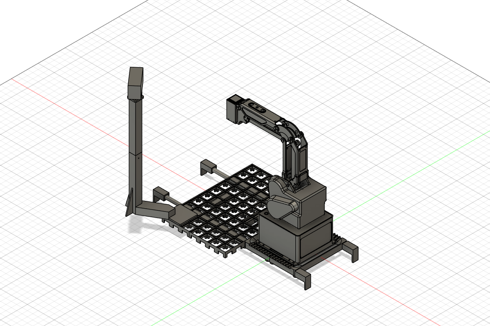
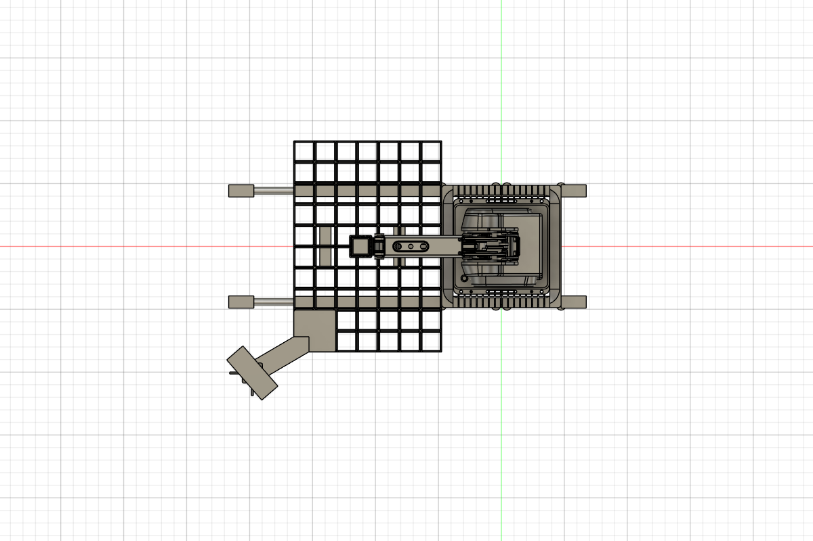
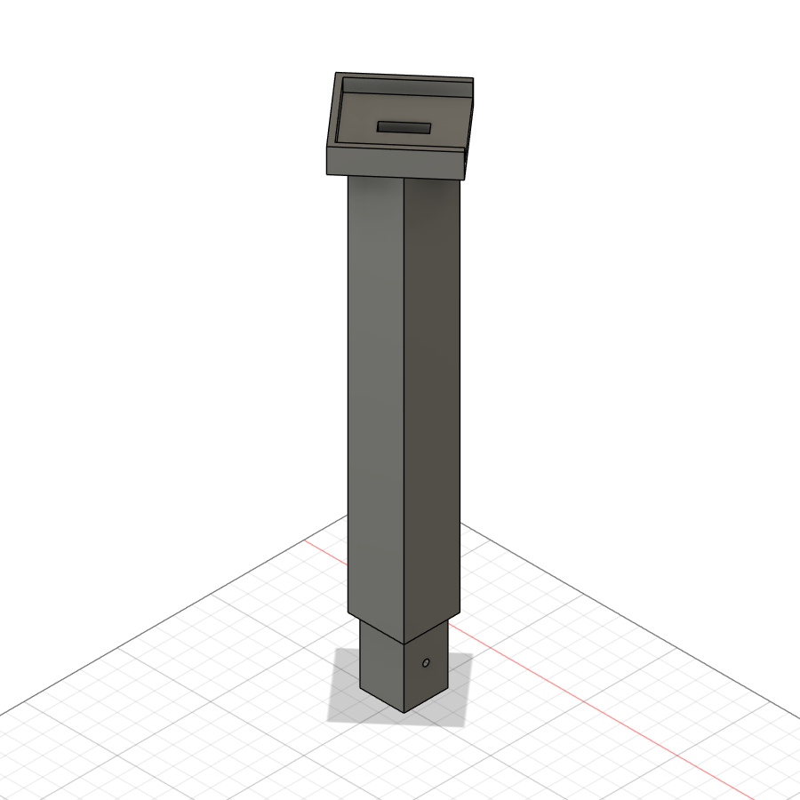
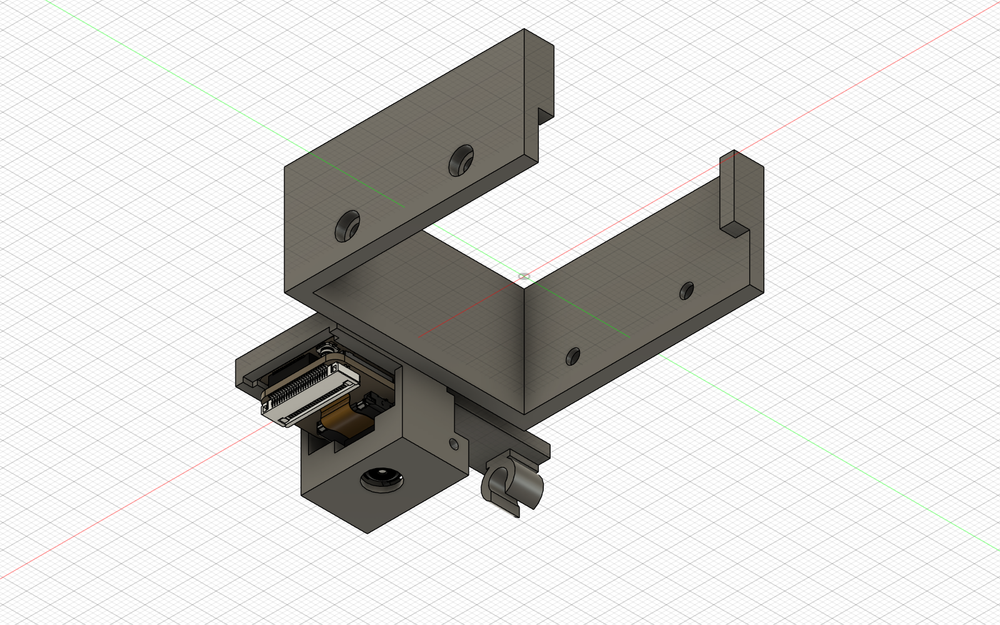
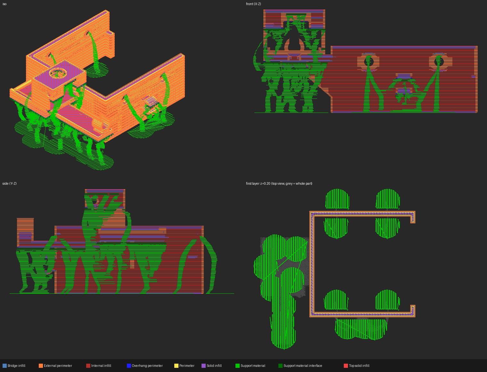
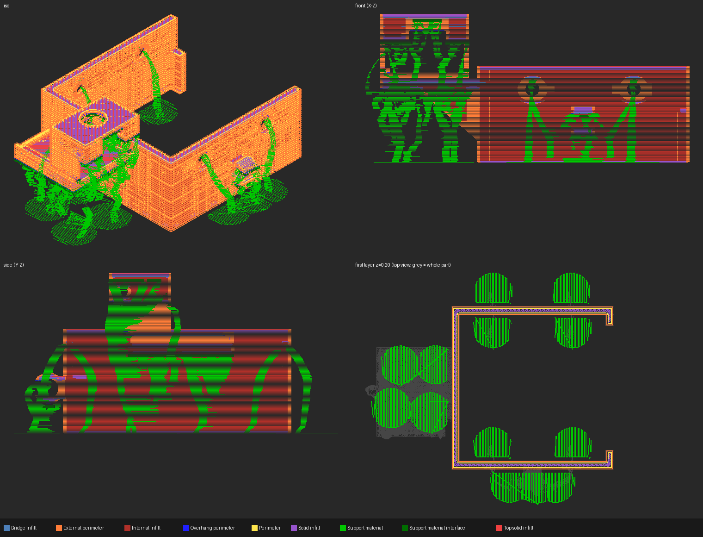

# 3D printimine ja CAD: Labor 2 - Sisend, töökoht, väljund

**Maht:** 30 tundi | **Hindamine:** 20 punkti | **Meeskond:** 3 tudengit

See on meeskonna tööpäevik ja otsuste register. Hoia mõõtmised koos ühikutega, lisa iga töökorra kohta uus päevikusissekanne ning jäta varasemad tulemused alles. Täielikku töölehte ei kopeerita.

## Ametlik kuupäev ja kohaliku ülesandekoopia parandused

Esimene kaitsmine on **29.10.2026, veebis**. Kontrollitud 23.10.2026 [ajakohasest ametlikust ülesandest](https://github.com/KKallas/Narva-subjects/blob/main/EST/2026-27/3D%20printing/3D%20Printing%20%5BLab%202%5D%20EST.md) (`KKallas/Narva-subjects`, faili Git blob SHA `26414cd29cd4a1a6e8e377b4ab1b1e31168f7625`). Kohalikus [`assignment-EST.md`](assignment-EST.md) on tehniliselt parandatud ainult vananenud kuupäev 27.10.26 → 29.10.26 ja suhtelised lingid `MG 400 rakis.f3z` → `reference/MG 400 rakis.f3z` ning `MG 400 rakis.md` → `docs/MG 400 rakis.md`. Muu ülesandetekst säilib senisel kujul; kohalik koopia ei ole bait-baidilt muutmata originaal.

## Eesmärk

Kavandada MG400 töölauale Gridfinity hoidikud sisenditele, töökohtadele ning heade ja praakdetailide väljundile. Hoidik peab pärast ruudustikust eemaldamist ja tagasipanekut jääma roboti suhtes samasse kohta. Kaamerad peavad nägema töökohta ja kogu lauda.

## Kaamerate ja Smart Solutionsi arhitektuur — 23.10.2026

XIAO ESP32S3 Sense on füüsiliselt kontrollitud **USB Serial** diagnostikapüsivaraga: **COM5**, sensor **OV3660**, JPEG **1600 × 1200 px**. Tegelik foto on [`tool-camera-first-frame.jpg`](docs/photos/tool-camera-first-frame.jpg); katse on kirjeldatud allpool 23.10.26 arenduspäevikus. See tõendab USB kaudu pildi saamist, kuid mitte Wi-Fi HTTP tööd ega töökoha lõplikku nähtavust.

Smart Solutions Lab 2 lõppvariandiks valime eraldi [Wi-Fi HTTP püsivara](https://github.com/Dennel04/smart-solutions-course/tree/main/smart-solutions/lab2/firmware-xiao-camera/) (`Dennel04/smart-solutions-course/smart-solutions/lab2/firmware-xiao-camera/`). Siinne [`tool-camera/firmware/`](tool-camera/firmware/) ja [`capture.py`](tool-camera/capture.py) jäävad USB diagnostikaks alles. Käesolev dokumentatsiooniotsus ei tähenda püsivara laadimist ega uut füüsilist katset.

| Seade | Valitud ühendus ja roll | Kinnituse piir |
|---|---|---|
| XIAO tööriistakaamera | Wi-Fi HTTP → jaamaarvuti (station PC); USB Serial jääb diagnostikaks | USB kaader kontrollitud; Wi-Fi HTTP füüsiline kontroll: TODO — waiting for physical test |
| Verbatim AWC-03 üldvaatekaamera | USB → station PC | Mudel tuvastatud; kogu laua vaade, vibratsioon ja korduspaigaldus: TODO — waiting for physical test |
| MG400 | Ethernet; käsud station PC-st | Ühenduse valik ei tõenda kogu liikumisvahemiku kokkupõrkevabadust |
| Atom | USB Serial ja Wi-Fi | Arhitektuuri ühendused; selle sissekandega ei kinnitata uut sidetesti |

Wi-Fi füüsiline toimimine ja station PC võrgust ligipääs, kaablite marsruut ja tõmbetõke, lõplik toide koos pinge/voolu kontrolliga, MG400 kogu kavandatud liikumine ja J4 pööre ning terav töökoha kaader koos terve **30 × 30 mm** klaasi ja Atomiga: **TODO — waiting for physical test**. USB-katse ajal kasutati arvuti USB-C toidet; seda ei loeta lõpliku toite ega kogu liikumistee katseks. Katsete järjekord: [`docs/test-procedure.md`](docs/test-procedure.md), osad F–G.

## Kontrollnimekiri

- [ ] `docs/layout.md`: töövoog, ruutude paigutus ja skeem mõõdetud laua järgi.
- [ ] 1 x 1 Gridfinity kalibreerimishoidik testitud ruudustikus ja robotiga.
  - 23.10.26 otsus: keskpunkt leitakse iminapaga hoidiku nelja sisenurga kaudu (nelja punkti keskmine); napa raadius taandub sümmeetria tõttu välja ja lisaks saame ruudustiku pöördenurga. Protseduur: [`docs/test-procedure.md`](docs/test-procedure.md) A1, tabel: [`docs/measurements.md`](docs/measurements.md).
  - 23.10.26 kalibreerimine alustatud ruudus G-1 (B-2-s ei ulatu käsi kasti põhja, J3 piir). 3 nurka 4-st kinnitatud, eeldatav nihe ≈ +5,3 / +5,4 mm; vt [`docs/measurements.md`](docs/measurements.md). Lõpetamata: 4. nurk, Xmin+Ymax nurk samal Z-l, kontrollruut.
- [ ] Kolm sisendhoidikut, igaühes vähemalt neli mõõdetud pesa.
  - 23.10.26 prinditud: klaas (`glass-input-holder-v1`, 2 × 2, 4 pesa), AtomS3 (`atoms3-input-holder-v1`, 2 × 2, 4 pesa), akumoodul (`ready-parts-input-holder-v1`, 2 × 2, 4 pesa). Pesade mõõdud nihikuga: TODO.
- [ ] Töökoha hoidik ja heade ning praakdetailide väljundikohad.
  - 23.10.26 otsus: `ready-parts-input-holder-v1` (2 × 2) on korraga akumooduli sisend ja töökoht: inimene laeb akumoodulid, robot paneb igaühe peale AtomS3 ja selle peale klaasi. Ülesanne lubab sammul jagada kohta eelmisega.
  - 23.10.26 otsus: praak = `gridfinity-calibration-v1` (1 × 1 lahtine kast) pärast kalibreerimist. CAD-ist: välismõõt 41,2 × 41,2 mm, kõrgus 20 mm, sisemus ~37,2 × 37,2 mm, sügavus 16 mm. Klaas ja AtomS3 on 24 × 24 mm, varu ~6,6 mm igale poole; kõrgus jääb alla 60 mm piiri. Ülesanne praagi suurust ega pesasid ei nõua ("võib olla lihtsalt kast"). Füüsiline kontroll: TODO.
  - 23.10.26 mõõduparandus eelnevale kirjele: meie klaas on **30 × 30 × 2 mm**, mitte 24 × 24 × 2 mm (Maksimi Excel, `Measurements!D8:E19`, meeskonna kinnitus). Kirjeldatud 37,2 mm sirgete siseseinte vahe korral on keskse klaasi teoreetiline külgvaru `(37,2 − 30) / 2 = 3,6 mm`, mitte 6,6 mm. See ei ole sobivuskatse; kalibreerimiskast ei ole praagi praegune sihtkoht.
  - Heade väljund (4 klaasi, suuremate kaldservadega): TODO — modelleerimata.
  - 23.10.26 parandus (meeskonna otsus, lihtsustus): praak läheb samuti oranži `ready-parts-input-holder-v1` hoidikusse; `gridfinity-calibration-v1` jääb ainult kalibreerimiseks.
  - 23.10.26: heade väljund modelleeritud — `valjundhoidik/src/valjundhoidik-v1.f3d`, `valjundhoidik/stl/valjundhoidik-v1.stl`. Alus on `glass-input-holder-v1` (sama 2 × 2 välismõõt 83,2 × 83,2 mm ja Gridfinity jalad); nelja pesa ja vaheseinte asemel üks lahtine kast. Uued parameetrid: põhi `out_floor_thickness = 2,5 mm`, õõne sügavus `out_cavity_depth = 14 mm`, sein `out_wall_thickness = 2,5 mm`, sisenurga raadius `4 mm`, sissejuhtiv faas ülaservas `out_lead_in = 2 mm`. Kõrgus ilma jalata 16,5 mm, jalaga 24,15 mm (alla 60 mm piiri). Sisemus ~78 × 78 mm, 4 klaasi mahuvad kõrvuti. 3MF ja füüsiline kontroll: TODO.
  - 23.10.26 print ette valmistatud: `valjundhoidik/3mf/valjundhoidik-v1.3mf` (PrusaSlicer). Prusa CORE One HF0.4, `0.20mm SPEED`, Prusament PLA, täide 15 % grid, 2 perimeetrit, jalad all. Orgaanilised toed ainult alusplaadilt: korpuse alumine serv ulatub jalgadest ~2,9 mm välja ja see pind toetub ruudustikule, nii et ta peab jääma sirge. Ilma tugedeta 46 min / 33,6 g, tugedega **1 h 7 min / 37,7 g** (valitud). Pikim mõõt 83,2 mm < 150 mm, seega brim'i ei ole vaja. Füüsiline kontroll: TODO.
- [ ] Iga pesa mõõt ja roboti sihtpunkt dokumenteeritud ruudu ning nihkega.
- [ ] Klaasiga tehtud viis korduskatset ja tulemused failis `docs/refit_test.csv`.
- [ ] XIAO ESP32S3 Sense kaamera kinnitus ning valitud ja katsetatud toide.
  - 23.10.26: XIAO istub prinditud kinnituses roboti küljes ja annab pilti. Toide katsetamisel USB-C kaudu arvutist (COM5). Püsivara `tool-camera/firmware/` (JPEG 1600 × 1200 USB kaudu, sest labori arvutil pole WiFi-t), kaader `python tool-camera/capture.py COM5 <fail>.jpg`. Sensor OV3660 (PID 0x3660), PSRAM 8 MB. Esimene kaader: [`docs/photos/tool-camera-first-frame.jpg`](docs/photos/tool-camera-first-frame.jpg) — pildis on iminapp, ruudustik ja oranž hoidik; iminapa voolik läheb diagonaalis üle kaadri.
    - Kontrollimata: kas töökoht koos klaasi ja Atomiga on pildis teravana; kas kinnitus jääb napa laskumisel hoidiku seintest vabaks; kaabli marsruut kogu liikumisel ja J4 pööramisel; tööriista mass enne/pärast. TODO — waiting for physical test.
- [ ] USB UHD veebikaamera jäik post; mõõdetud pildikõikumine roboti liikumise ajal.
  - 23.10.26 prototüüp v1 (CAD, printimata): `veebikaamera-post/src/veebikaamera-post-v1.f3d`, STL-id `veebikaamera-post-v1-alumine.stl` ja `veebikaamera-post-v1-ulemine.stl`.
    - Kaamera: Verbatim AWC-03 (49580), andmelehelt 106 × 55 × 42,5 mm, 129 g, vaatenurk 120° diagonaalis (≈113° × 81° 16:9 juures), klambris ¼" statiivikeere, kaabel micro-USB → USB-A 1,5 m. Mõõdud nihikuga: TODO.
    - Koht: 2 × 1 Gridfinity alus ruutudes G-5 + G-4 (ülesanne soovitab nurgaruute); post aluse J1-st kõige kaugemas nurgas, r ≈ 442 mm (MG400 ulatus 440 mm). Jalad samad mis `glass-input-holder-v2`.
    - Kõrgus arvutatud: objektiiv ~450 mm roboti talla tasapinnast, siis on kogu ruudustik ja robot ~70 % kaadris (arvutuses kaamera pööre ~74° üle laua ja kalle ~62° alla, kaamera enda liigendiga). Minimaalne arvutatud kõrgus 325 mm (kaader täis, varu ei ole). Tuleb kontrollida kaamera käes hoides.
    - Jäikus kujust: õõnes 30 × 30 mm toru, sein 3 mm, kaks ribi aluse peal (60 mm, kõrgem ei tohi käe teel olla), kaabel saab käia toru sees.
    - Kaks tükki printeri 270 mm Z jaoks: alumine 207 mm (alus + toru kuni 210 mm), ülemine 220 mm (30 mm tapp 0,2 mm lõtkuga + toru + 40 × 40 mm plaat ¼" avaga Ø6,6 mm). Ülemine prinditakse plaat all.
    - Kontrollimata: käe suurim kõrgus ja kas käsi ulatub kaamerani (kaamera korpus ulatub postist ~50 mm roboti poole); liitekoha loks; pildi värisemine. TODO — waiting for physical test.

    
  - 23.10.26 parandus: **v1 on vale** — käsi ulatub postini. MG400 Hardware User Guide V1.4 (joonised 2.2 ja 2.3): 440 mm on flantsi (J4 telje) ulatus, mitte kogu käe oma; J2 on 224 mm roboti tallast, J4 mootori korpus ulatub flantsist ~80 mm üles ja ~25 mm külgedele, tööriist ripub all. v1 posti lähim külg oli 422 mm J1-st ja kaamera ~404 mm kõrgusel 425–480 mm, kuhu käsi ulatub. Ülesanne nõuab: *"käsi ei ulatu temani"*, *"Kaamera ja kõik, mis teda hoiab, on sellest väljas"*.
  - 23.10.26 prototüüp v2 (CAD, printimata): `veebikaamera-post/src/veebikaamera-post-v2.f3d`, `stl/veebikaamera-post-v2-alumine.stl`, `stl/veebikaamera-post-v2-ulemine.stl`.
    - Käe ümbris (joonisest digitaliseeritud, varuga): flants + J4 korpus (±25 mm, +80 mm) + tööriist (raadius 75 mm, 70 mm allapoole). Suurim horisontaalne ulatus ~515 mm kõrgusel 40–200 mm; käe kõrgeim punkt ~490 mm roboti tallast.
    - Post on 555 mm kaugusel J1-st ruudustiku nurga (G-5) kaudu mineval kiirel, väljaspool ruudustikku. Kontroll Fusionis (iga võrgu punkt vs ümbris): post ja kaamera on ümbrisest vähemalt **30 mm** väljas. Ümbrisesse jäävad ainult alus ja konsool kuni 37 mm kõrguseni — madalad nagu iga hoidik (reegel: üle 60 mm osad ei ole käe teel).
    - Alus 2 × 2 Gridfinity ruutudes G-5, G-4, F-5, F-4 (kordustäpsus tuleb jalgadest, samad jalad mis `glass-input-holder-v2`), sealt madal õõnes konsool (30 mm kõrge, all lahti — USB kaabel käib sees) postini.
    - Kaamera on roboti kohal: plaat 470 mm, kaamera korpus ~495–550 mm, objektiiv ~522 mm (käsi ei tõuse kõrgemale kui ~490 mm). Arvutatud: kogu ruudustik + robot ~93 % kaadris, kaamera pööre ~41° ja kalle ~42° alla.
    - Jäikus: õõnes 30 × 30 mm toru (sein 3 mm), kaks 100 mm ribi posti välisküljel (roboti poole ribi ega kõrget seina ei ole), lai 2 × 2 alus.
    - Kaks tükki: alumine 242 mm (210,7 × 170,4 mm), ülemine 260 mm (40 × 40 mm) — printeri Z 270 mm, tükk ≤ 250 × 250 mm. Liide: 35 mm tapp (0,2 mm lõtk) + M3 risttihvt (Ø3,3) loksu vastu. Üle 150 mm tükil brim.
    - Kaabel: aken ülemise toru välisküljel plaadi all (USB sisse ja käsi ¼" kruvi jaoks), kaabel toru ja konsooli sees alla.
    - Kontrollimata: kas laud ulatub ruudustiku nurgast välja (konsool on õhus, laud ei pea all olema); pildi värisemine; reaalne kaamera mõõt. Enne esimest jooksu sõita käsi aeglaselt postile kõige lähemale (ohutusreegel). TODO — waiting for physical test.

    

    
  - 23.10.26 v2 täiendus — kaamera kinnitus: Verbatim AWC-03 klamber koosneb kahest osast, mis on liigendiga (kruvid reguleerivad pingust) ühendatud. Alumine osa mõõdetud nihikuga: **42,04 × 48,5 × 10,88 mm**. Posti otsas on selle jaoks pesa: 42,84 × 49,30 mm (lõtk 0,4 mm külje kohta, Lab 1 vahemik 0,2–0,4 mm), sügavus 7 mm (klamber jääb 3,9 mm välja, et sõrmedega kätte saada), seinad kolmel küljel, liigendi pool lahti ja pööratud laua poole (41°), et kaamera saaks alla kalduda. Põhjas 20 mm pilu ¼" kruvile (keerme täpne koht klambril mõõtmata); kruviga on kaamera jäigalt kinni, ilma kruvita istub klamber lihtsalt pesas. Ülemine tükk nüüd 267 mm (printeri Z 270 mm). Kontroll ümbrise vastu: varu endiselt ≥ 30 mm.

    
- [ ] `docs/bom.md` sisaldab iga tellitava rea põhjendust.
- [ ] Iga prindi lähtefail, STL ja 3MF on versioonitud.
- [ ] Arenduspäevik täidetud; esitamisel lisatud tag `3d-print-lab2`.

## Teadaolevad lähteandmed

### Ametlikult teadaolevad väärtused

- Ametlik lauakirjeldus ja kõik ruudukoordinaadid: [`docs/MG 400 rakis.md`](docs/MG%20400%20rakis.md). Vastav muutmata Fusioni referentsfail: [`reference/MG 400 rakis.f3z`](reference/MG%20400%20rakis.f3z).
- Gridfinity ruudustik on 7 × 10 ruutu, samm `42 mm`, kogumõõt `294 × 420 mm`.
- Hoidiku välismõõt on `42 × n − 0,5 mm`; ühe ruudu hoidik on `41,5 mm`. Standardse Gridfinity jala ametlik kirjelduskõrgus on `4,75 mm`.
- Ametliku ülesande nominaalid: polükarbonaatklaas `24 × 24 × 2 mm` ja töökoha prinditud Atomi mannekeen `24 × 24 × 13 mm`. Hoidiku lõplikud mõõdud peavad tuginema päris detailide mõõtmisele.
  - **23.10.2026 parandus meie detailile:** ametlik tsitaat jääb alles; meie klaas on `30 × 30 × 2 mm` (`confirmed`), AtomS3 `24 × 24 × 12,9 mm` on `nominal`. Akumoodul `24,04 × 24,01 × 21,97 mm` ja XIAO põhiplaat `17,74 × 21,33 × 1,21 mm` on Maksimi tabelis `measured`. USB-C keskjoon Atomil on `11,4 mm` valitud servast (`measured`), kuid serv tuleb veel skeemil tuvastada. Kõik allikad ja olekud: [`docs/measurements.md`](docs/measurements.md).
- 23.10.26 otsus: töökohal kasutame prinditud mannekeeni asemel **päris AtomS3-t**. Klaas asetatakse päris Atomi peale; mannekeeni ei prindita.
- Laua ja ametliku ülesande materjal on PLA.

### Lab 1-st pärinevad tulemused

- `0,4 mm` lõtkuga detail liikus vabalt.
- `0,2 mm` lõtkuga detail kiilus ja vajas vabastamist.
- Lab 1 lõpptulemus on ainult vahemik `0,2–0,4 mm`; `0,3 mm` ei prinditud ega füüsiliselt kinnitatud.

### Tegelikku mõõtmist või katset vajavad väärtused

23.10.2026 täiendus: allolev varasem loend ei tähenda, et kõik komponendimõõdud oleks endiselt puudu. Maksimi Exceli ülekanne ja allesjäänud puudused on [`mõõteregistris`](docs/measurements.md); nimimõõt, kinnitatud mõõt ja mõõdetud väärtus on seal eristatud. Füüsilise sobivuse katsed jäävad avatuks.

- AtomS3, klaaside, akumooduli, XIAO ESP32S3 Sense'i, olemasoleva iminapa tööriistahoidiku ja veebikaamera tegelikud mõõdud.
- Gridfinity jala sobivus ja loks päris laual ning sobiva lõtku valik.
- Roboti telgede vastavus lauakoordinaatidele, B-2 kalibreerimisnihe, Z ja kauge ruudu viga.
- Hoidikute ruudud ja täpsed sihtpunktid, detailipesade sobivus ning eemaldamise/tagasipaneku kordustäpsus.
- Tööriistakaamera nurk, kõrgus, nähtav ala, mass, toide, kaabli marsruut ja tõmbetõke.
- Üldvaatekaamera kõrgus, asukoht, kaabli pikkus, vibratsioon ning eemaldamise/tagasipaneku kordustäpsus.

Kõigi nende olek on `TODO — waiting for physical test`.

## Tööfailid ja katsejuhendid

- [`assignment-EST.md`](assignment-EST.md) — ülesande kohalik koopia; ainult kuupäev ja suhtelised lingid tehniliselt parandatud, vt ülal ametliku allika viidet.
- [`docs/MG 400 rakis.md`](docs/MG%20400%20rakis.md) — ametlik töölaua kirjeldus ja koordinaadid.
- [`docs/measurements.md`](docs/measurements.md) — riistvara mõõtmissessiooni kontrollnimekiri.
- [`docs/cad-measurement-review.md`](docs/cad-measurement-review.md) — 30 mm klaasi mõju olemasolevatele STL-idele, vajalikud Fusioni kontrollid ja MG400 trajektoori lahtised küsimused.
- [`docs/test-procedure.md`](docs/test-procedure.md) — lühike juhend roboti juures kasutamiseks.
- [`docs/layout.md`](docs/layout.md) — töövoog, paigutus ja mõõdetavad sihtpunktid.
- [`docs/refit_test.csv`](docs/refit_test.csv) — 5 × 4 eemaldamise/tagasipaneku katse read.
- [`docs/bom.md`](docs/bom.md) — kinnitamist vajav komponentide nimekiri.

## CAD-failid

- `src/gridfinity-calibration-v1.scad` - varasem lihtsustatud jalaga prototüüp; seda versiooni ei tohi printida.
- `src/gridfinity-calibration-v2.scad` - kandidaat esimeseks füüsiliseks 1 × 1 kalibreerimisprindiks. Jalg järgib dokumenteeritud Gridfinity profiili; ülapinnal on keskpunkti tähistav rist. Füüsiline sobivus: `TODO — waiting for physical test`.
- `src/gridfinity-tray-v1.scad` - nelja pesaga varasem alustusmudel, mille lihtsustatud jalg ei vasta dokumenteeritud Gridfinity profiilile. Seda versiooni ei tohi printida ega kasutada uute hoidikute alusena.

- `gripper-attachment/src/mg400-gripper-attachment-v1.f3d`, `gripper-attachment/stl/mg400-gripper-attachment-v1.stl` - MG400 haarats-tööriist (Fusioni dokument `MG_400_gripper_attachment`, versioon 5). Keskel flantsi boss ja kahvel AtomS3R-i ning aku tõstmiseks, vasakul iminapa kinnitus, paremal süstla klamber. Printimata; 3MF puudub. Lahtised küsimused vt arenduspäevik 04.10.26. **Arendus peatatud 23.10.26:** Lab 2-s kasutame ainult iminappa (vt arenduspäevik 23.10.26).

  

- `camera-mounts/src/xiao-square-mount-v2.f3d`, `camera-mounts/stl/xiao-square-mount-v2.stl`, `camera-mounts/3mf/xiao-square-mount-v2.3mf` - XIAO ESP32S3 Sense tööriistakaamera kinnitus MG400 J4 mootori nelikandile (Fusioni dokument `xiao-square-mount-v2`, projekt `3d-printing`). U-klamber ümber nelikandi kaane M2,5 kruvidega, plaadi rennid, kaks prinditud kaabliklambrit (tõmbetõke). Prinditud 04.10.26 sobivuskatseks; füüsiline sobivus: `TODO — waiting for physical test`.

  

  

- `camera-mounts/src/xiao-square-mount-v3.f3d` (+ `xiao-square-mount-v3-standalone.f3d` ilma roboti välisviiteta, avaneb ka teistel), `camera-mounts/stl/xiao-square-mount-v3.stl`, `camera-mounts/3mf/xiao-square-mount-v3.3mf` (ainult võrk, slaiseri seadeid pole) - v2 + kaameramooduli pesa (`camera_nest`), piiraja (`camera_stop`) ja objektiivi aken (`lens_window`, Ø6,5 mm); kõrgus 35,4 mm (v2: 25,6 mm). Kaamera mõõdud Seeedi mudelist (`cam_w 8`, `cam_h 5,8` mm), nihikuga mõõtmata. Kopeeritud 24.10.26 kaustast `fusion-tutor/people/Dennel04/models/` (Fusioni dokument `xiao-square-mount-v3`, 04.10.26). Printimata: prinditakse pärast v2 katset ja kaameramooduli mõõtmist.

- `camera-mounts/src/xiao-square-mount-v4.f3d` (ilma välisviiteta, avaneb igas arvutis), `camera-mounts/stl/xiao-square-mount-v4.stl`, `camera-mounts/3mf/xiao-square-mount-v4.3mf` (PrusaSliceri projekt: CORE One HF0.4, 0.20mm SPEED, Prusament PLA, orgaanilised toed alusplaadilt, tagurpidi; 55 min, 17,6 g) - v3 + kaamera fikseerimine tihvtiga: pesa seinad pikendatud +Y suunas 3 mm (`pin_ext`) ja neist läbi X-suunaline ava Ø1,85 (`pin_d` 1,75 + `pin_fit` 0,1), millesse käib tükk 1,75 mm PLA-filamenti. Kaamera on −Y piiraja ja tihvti vahel (mõlemal pool 0,23 mm). `ledge_z` 7,8 → 8,8 mm. Printimata.

  

  

- `camera-mounts/src/xiao-square-mount-v5.f3d` (ilma välisviiteta), `camera-mounts/stl/xiao-square-mount-v5.stl`, `camera-mounts/3mf/xiao-square-mount-v5.3mf` (PrusaSliceri projekt, samad seaded mis v4; 49 min, 16,2 g) - v4 ilma esimese kaabliklambrita: eemaldatud `cable_tab` (sild plaadi kohal Y 7,5…38) ning `cable_clip_body`/`cable_clip_cut` (klamber Y 32…38). Kasutaja: USB-C pistiku korpus ei mahtunud silla alla. Teine klamber (`cable_clip2`, +Y seinal) ja tihvtiga kaamerapesa jäävad. Printimata.

  

  

- `gridfinity-calibration/src/gridfinity-calibration-v1.f3d`, `gridfinity-calibration/stl/gridfinity-calibration-v1.stl`, `gridfinity-calibration/3mf/gridfinity-calibration-v1.3mf` - lisatud 1 × 1 Gridfinity kalibreerimishoidiku Fusioni fail ja ekspordid; füüsiline sobivus ja roboti kalibreerimine: `TODO — waiting for physical test`.
- `atoms3-input-holder/src/atoms3-input-holder-v1.f3d`, `atoms3-input-holder/stl/atoms3-input-holder-v1.stl`, `atoms3-input-holder/3mf/atoms3-input-holder-v1.3mf` - AtomS3 sisendhoidiku Fusioni fail ja ekspordid; mõõtude ning füüsilise sobivuse kinnitus: `TODO — waiting for physical test`.
- `ready-parts-input-holder/src/ready-parts-input-holder-v1.f3d`, `ready-parts-input-holder/stl/ready-parts-input-holder-v1.stl`, `ready-parts-input-holder/3mf/ready-parts-input-holder-v1.3mf` - ReadyParts sisendhoidiku Fusioni fail ja ekspordid; mõõtude ning füüsilise sobivuse kinnitus: `TODO — waiting for physical test`.
- `glass-input-holder/src/glass-input-holder-v1.f3d`, `glass-input-holder/stl/glass-input-holder-v1.stl`, `glass-input-holder/3mf/glass-input-holder-v1.3mf` - klaasi sisendhoidiku Fusioni fail ja ekspordid; mõõtude ning füüsilise sobivuse kinnitus: `TODO — waiting for physical test`.
- `glass-input-holder/src/glass-input-holder-v2.f3d`, `glass-input-holder/stl/glass-input-holder-v2.stl` - 23.10.26: v1 jalad ei läinud ruudustikku päris lõpuni. Põhjus (mõõdetud Fusionis `MG 400 rakis`, `grid_pos_0`): pesa kitsaim koht on 36,28 mm, nurga raadius **1,14 mm** (z +2,63). v1 jalg 35,98 mm nurgaraadiusega 0,5 mm ulatus diagonaalis 0,05 mm pesast välja, nurgad kiilusid; külgvahe oli ainult 0,15 mm. Lisaks pikendas `Extrude18` jalga 3 mm (kuni z −0,37), see jõuab ±3 ja ±1 ruutude all olevate talade vastu (talade ülaserv z +2,48). v2: `foot_clearance = 0,25 mm` külje kohta (jalg 35,78 mm), `foot_corner_radius = 1,5 mm` (nurga vahe 0,5 mm), 0,5 mm faas jala alumisel serval (sissejuhtimine ja esimese kihi laiendus), `Extrude18` välja lülitatud. Pesad muutmata. 3MF ja füüsiline kontroll: TODO.
- `valjundhoidik` sai samad jala parandused (v1, printimata, failid üle kirjutatud).

Need lähtefailid ei ole veel füüsiliselt sobivaks kinnitatud. Iga print vajab PrusaSlicerist eksporditud STL-i ja 3MF-i, uue versiooninime ning mõõtmistulemuste dokumenteerimist.

Versioonis v2 on standardne nominaalgeomeetria ja printeri sobitusparandus eraldi: `fit_adjustment = 0 mm` tähendab muutmata nominaalprofiili; positiivne väärtus vähendab jala mõõtu selle võrra mõlemalt küljelt. See on esialgne katseparameeter, mitte mõõdetud lõtk. Enne jala korduskasutust teistes hoidikutes tuleb v2 päris laual printida ning mõõta täielikku istumist, loksu ja eemaldamisjõudu. OpenSCADi edukas kompileerimine ei tõesta füüsilist sobivust.

V2 nominaalprofiili allikas on [kennetek/gridfinity-rebuilt-openscad `src/core/standard.scad`](https://github.com/kennetek/gridfinity-rebuilt-openscad/blob/main/src/core/standard.scad) (MIT-litsents); sama profiil on kirjas ametlikus lauakirjelduses.

### Arenduspäevik

**KAARDISTA ISE — päevik.** Üks sissekanne iga töösessiooni kohta, kirjutatud
iseendale, nii et inimene, kes seal ei olnud, saab aru. Sissekandeid lisatakse,
mitte ei muudeta.

**PP.KK.AA — kes olid kohal**
* Tegime:
* Juhtus (numbrid):
* Otsustasime, ja miks:
* Lahti järgmiseks korraks:
* Failid: (valikuline lisainfo)

**03.10.26 — Codex; meeskonnaliikmete kohalolek teadmata**
- Tegime: kontrollisime Gridfinity jala profiili ametliku lauakirjelduse ja avatud lähtekoodiga generaatori vastu; koostasime kalibreerimishoidiku v2 keskristiga ning märkisime v1 tray lihtsustatud jala aegunuks.
- Probleem: v1 jalg oli ühe koonusega ega sisaldanud standardset vertikaalset lõiku ega kahte eraldi kaldserva.
- Mõõtmised ja tulemused koos ühikutega: füüsilisi mõõtmisi ega katseid ei tehtud. V2 nominaalprofiil on `0,8 mm + 1,8 mm + 2,15 mm = 4,75 mm`; esialgne `fit_adjustment = 0 mm` külje kohta. Füüsiline sobivus: `TODO — waiting for physical test`.
- Oodatav tulemus: keskristi abil saab määrata ruudu keskpunkti ja füüsiline print näitab jala tegelikku sobivust. Tegelik tulemus: `TODO — waiting for physical test`.
- Otsused ja põhjendused: säilitasime v1 failid ajaloo jaoks; v2 eraldab nominaalprofiili printeri sobitusparandusest. Tray jalga ei kasutata enne füüsilist sobivuskatset.
- Failid ja versioonid: `src/gridfinity-calibration-v2.scad`, `src/gridfinity-tray-v1.scad`, `docs/measurements.md`, `README.md`.
- Järgmiseks: kontrollida v2 OpenSCADis, seejärel printida eraldi füüsiline kandidaat ja dokumenteerida sobivus, loks ning eemaldamisjõud.

> Märkus: selles ajaloolises kirjes nimetatud AI oli kasutatud tööriist, mitte füüsiliselt kohal olnud meeskonnaliige. Algset päevikukirjet ei muudeta tagantjärele.

**04.10.26 — r4imps (Raimo) koos Claude'iga (Fusion MCP kaudu)**
- Tegime: vaatasime üle haaratsi `MG_400_gripper_attachment` ja muutsime seda kaalu ning kruvide järgi. Fusionis on iga samm eraldi versioonina (v1 = algne, v5 = tänane lõpp).
  - Plaat `8 → 5 mm` (`d1`); iminapa posti ülaosa lühendatud koos plaadiga.
  - Iminapa silindriline post (`Extrude3`) eemaldatud; napp kinnitub otse plaadi alla (`z 0`), mitte enam `z −20`.
  - Mõlemad kinnitused (keskmine flantsi boss ja iminapa koht) sama kruviga: **M3 × 6 sisekuuskantpeaga (DIN 912)**, ava `Ø3,4`, peapesa `Ø6,5`, pea all `2 mm` materjali → keermesse jääb ~`4 mm`.
  - Keskmise bossi kruvid käivad altpoolt: peapesa `Ø6,5` ulatub `z −6 → 12`, kahvli katuse nurkadesse tekkisid väikesed sisselõiked. Kontrollitud: kõigi nelja kruvi tee altpoolt on vaba. Vajalik ≥ 50 mm varrega 2,5 mm kuuskantkruvikeeraja.
  - Iminapa kruvipead ülalt, pesa `Ø6,5 × 3 mm` (pea on plaadiga tasa).
  - Materjal Fusionis Steel → PET (PLA-d Fusioni teegis pole); kaalu arvutame PLA tihedusega.
- Mõõtmised ja tulemused koos ühikutega: CAD-ist, mitte nihikuga. Maht `93,9 → 70,2 cm³`; täistäidisega PLA (1,24 g/cm³) ~`116 → 87 g`. Kahvli sõrmed `2,4 mm`, sisemine vahe `24,4 mm`, huulte vahe `21,2 mm`, sisekõrgus huultest katuseni `27,5 mm`. Kahvli otsad `z −36`, iminapa ots ~`z −63` (napp `63 mm`).
- Otsused ja põhjendused: M3, mitte M4 — Lab 1 kirjeldus ütleb `4 × M3 kruvi flantsi külge` ja M4 ei esine dokumentides kordagi. Sisekuuskant, sest kuuskantpea mutrivõti ei mahu kahvli tõttu ligi. Kahvlit ei muudetud (sõrmede paksus määrab klõpsu jõu).
- Mõte tulevikuks (Raimo): kui AtomS3R tulevikus kokku panna (aku, moodul ise ja lõpuks klaas peale liimida UV-valgusega), saab protsessi lahendada kahe tööriistaga ja seda haaratsit pole vaja, kui komplekt ehitada ülevalt alla, mitte alt üles (st alustada pealmisest kihist ehk klaasist, siis moodul, siis aku).
- Nõuded (Raimo sõnul, mõõtmata): napp `63 mm` kõrge; kahvel tõstab akumooduli ja seejärel AtomS3R-i `8 mm` sügavusest süvendist ja vajutab `28 mm` süvendisse, et pinnid kohale suruda.
- Failid ja versioonid: `gripper-attachment/src/mg400-gripper-attachment-v1.f3d`, `gripper-attachment/stl/mg400-gripper-attachment-v1.stl` (Fusioni v5). 3MF tegemata.
- Järgmiseks:
  - Otsustada, kas iminapa kruvid on nagu praegu (pea prindis, keere napa kinnituses) või paneme M3 kuumsisestused (koht = MG400 flantsi koopia, napa komplekti oma kruvid altpoolt).
  - Sügavuskonflikt: napp ulatub ~`27 mm` allapoole kui kahvli otsad — kahvliga töötades võib napp lauda/hoidikut puudutada. Kontrollida hoidikute mõõtudega või lühendada napi kinnitust.
  - Süstla klamber: Raimo vaatab hiljem üle.
  - Nihikuga üle mõõta: MG400 flantsi keere ja augu samm (`17 × 17 mm`?), napa kinnituse keere, AtomS3R-i ja aku mõõdud.

> Märkus: selles ajaloolises kirjes nimetatud AI oli kasutatud tööriist, mitte füüsiliselt kohal olnud meeskonnaliige. Algset päevikukirjet ei muudeta tagantjärele.

**04.10.26 — Dennel04 (Denys) koos Claude'iga (Fusion MCP kaudu)**
- Tegime: XIAO ESP32S3 Sense tööriistakaamera kinnitus MG400 J4 mootori nelikandile (robot Fusionis XREF-ina). v1: U-klamber ümber nelikandi kaane, kaane M2,5 kruvide avad süvistustega, plaadi rennid ja otsapiire, kaabliklamber pistiku taga. v1 printimata. v2: tõmbepaela sild eemaldatud, selle asemel teine kaabliklamber +Y seinal; kaabel läheb mööda seina roboti poole.
- Mõõtmised ja tulemused koos ühikutega: nihikuga mõõdetud ainult kaane kruvi: kogupikkus `6,3 mm`, pea `Ø4,62 mm`. Kõik muud mõõdud on CAD-ist (MG400 mudel: nelikant `44 × 44 mm`, kruvide samm `24 mm`) ja XIAO STEP-ist; neil on Fusionis parameetrid. Lõtk nelikandil `0,3 mm` külje kohta (Lab 1 vahemikust `0,2–0,4 mm`, kinnitamata). Interference robotiga ja XIAO-ga `0`. Print: Prusa CORE One HF0.4, `0.20mm SPEED`, Prusament PLA, orgaanilised toed ainult alusplaadilt, tagurpidi (klambri serv alusel); `45 min`, `15,6 g`. Füüsiline sobivus: `TODO — waiting for physical test`.
- Otsused ja põhjendused: õppejõud lubas suuliselt kõigile kaamera kinnitada ükskõik kuhu, mitte ainult iminapa tööriistahoidikule (04.10.26). Valisime J4 nelikandi: see ei pöörle J4-ga, nii et kaabel ei keerdu, ja olemasolev tööriistahoidik jääb muutmata. Teine klamber, mitte tõmbepael: kulumaterjali pole vaja ja kaabli saab ilma lõikamata välja.
- Failid ja versioonid: `camera-mounts/src/xiao-square-mount-v2.f3d`, `camera-mounts/stl/xiao-square-mount-v2.stl`, `camera-mounts/3mf/xiao-square-mount-v2.3mf` (PrusaSlicer projekt).
- Järgmiseks:
  - Prindil kontrollida: sobivus nelikandil, kas originaalkruvi ulatub läbi süvistuse põhja (`1 mm`) keermesse, plaat rennides, kaabel mõlemas klambris. Kruviavadesse kasvanud toed puhastada.
  - Kaameramoodul ripub oma lindikaablil ega ole fikseeritud. v3-s on kaamerapesa (Fusionis `xiao-square-mount-v3`); prinditakse alles pärast v2 katset ja kaameramooduli nihikuga mõõtmist.
  - Mõõta iminapa otsa kõrgus nelikandi suhtes (kinnitus ei tohi ulatuda napa otsast allapoole) ja valida kaamera toide.

> Märkus: selles ajaloolises kirjes nimetatud AI oli kasutatud tööriist, mitte füüsiliselt kohal olnud meeskonnaliige. Algset päevikukirjet ei muudeta tagantjärele.

**23.10.26 — r4imps (Raimo)**
* Tegime: otsustasime haaratsi `MG_400_gripper_attachment` arenduse peatada.
* Juhtus (numbrid): uusi mõõtmisi ega printe ei tehtud. Haarats jääb Fusioni versiooni 5 seisu (`mg400-gripper-attachment-v1`), printimata, 3MF puudub.
* Otsustasime, ja miks: Lab 2-s pole süstalt ega UV-lampi vaja, seega kasutame olemasolevat iminappa ja haaratsit praegu edasi ei arenda. Jätkame haaratsi arendusega, kui selleks vajadus tekib (nt Lab 3 tööriist: napp, süstal, UV-lamp). 04.10.26 lahtised küsimused (kruvid vs kuumsisestused, napa ja kahvli sügavuskonflikt, süstla klamber, flantsi mõõtmine) jäävad seniks lahti.
* Lahti järgmiseks korraks: Lab 2 hoidikud ja töökoht kavandada olemasoleva iminapa järgi; iminapa tööriistahoidiku mõõdud failis `docs/measurements.md`.
* Failid: `README.md`, `docs/bom.md` (M3 × 6 kruvide rida ootel).

**23.10.26 — Dennel04 (Denys) koos Claude'iga**
* Tegime: XIAO ESP32S3 Sense pandi prinditud kinnitusse roboti küljes. Tehasepüsivara (Seeed demo, ootas WiFi-t, kaamerat ei kasutanud) asendati omaga: `tool-camera/firmware/` saadab käsu `c` peale ühe JPEG-kaadri USB kaudu, `tool-camera/capture.py` salvestab selle.
* Juhtus (numbrid): kaamera vastab `INFO camera=ok pid=0x3660 psram=8386199`; kaader 1600 × 1200, ~80–88 kB. Esimene kaader liikumise ajal oli udune, paigal olles terav.
* Otsustasime, ja miks: pilt USB kaudu, mitte WiFi kaudu, sest labori arvutil on ainult Ethernet. USB roboti küljes andis ainult toidet, pilti arvuti ei näe — seepärast kaabel arvutisse.
* Lahti järgmiseks korraks: kaader töökohast koos klaasi ja Atomiga; napa laskumine hoidikusse kinnitusega; kaabli marsruut ja J4 pööre; tööriista kaal; lõplik toite valik `docs/measurements.md` tabelisse.
* Failid: `tool-camera/firmware/`, `tool-camera/capture.py`, `docs/photos/tool-camera-first-frame.jpg`, `README.md`.

**23.10.26 õhtu — Dennel04 (Denys) koos Claude'iga — kalibreerimine**
* Tegime: alustasime nelja sisenurga kalibreerimist musta 1 × 1 kastiga (`gridfinity-calibration-v1`). Robotit juhiti `mg400-base` serveri kaudu (2 % kiirus, 0,5 mm sammud, abiskript `calibration/jog.py`) ja osaliselt DobotStudio Pro-st.
* Juhtus (numbrid): B-2-s jõuab käsi ainult Z ≈ −98-ni (J3 105° piir), seega G-1. Kinnitatud nurgad: Xmax+Ymin 404,47 / 18,80, Xmax+Ymax 403,98 / 34,34, Xmin+Ymax 389,47 / 33,80 (Z −150,85). Xmin+Ymin 389,50 / 18,77 kinnitamata. Napi efektiivne läbimõõt ≈ 22 mm. Eeldatav keskpunkt ≈ 396,85 / 26,43, nihe mudelist ≈ +5,3 / +5,4 mm.
* Probleemid: DobotStudio Pro JOG-režiim võtab roboti üle ja sulgeb serveri TCP ühenduse (vaja lülitada TCP/IP režiimi). Pehme napp kaldub seina vastu — puudutust hinnatakse silmaga, kalle = liiga kaugel.
* Lahti järgmiseks korraks: kinnitada Xmin+Ymin nurk; korrata Xmin+Ymax Z −155,84 peal; arvutada keskpunkt ja pööre; kontrollruut lähemal (nt C+2); kast välja/tagasi ja kordus (kordustäpsus).
* Failid: `docs/calibration_g-1_corners.csv`, `docs/measurements.md`, `calibration/jog.py`.

**23.10.2026 — dokumentatsiooni ülekanne; mõõteallikas Maksim Naprejev**
* Osalejad: kasutaja edastas Maksimi Exceli ja meeskonna kinnituse; dokumentatsiooni töötles Codex. Füüsiliselt kohal olnud inimeste nimekiri ja mõõtmise kuupäev pole teada.
* Tegime: lugesime `Measurements.xlsx` lehe `Measurements`, eristasime `measured`, `nominal`, `confirmed`, `planned` ja TODO ning lisasime lahtriviited. Kontrollisime `main` viimaseid meeskonnakommite (lähtepunkt `acd3d5c`, sh `9e68690`, `175b000`, `95610fc`) ja Lab 2 STL-geomeetriat.
* Probleem ja parandus: klaasi varasem 24 × 24 × 2 mm on meie detaili kohta vale; õige on 30 × 30 × 2 mm (`confirmed`). Vanad kirjed ja ametlik ülesanne säilivad. AtomS3 24 × 24 × 12,9 mm on `nominal`; aku 24,04 × 24,01 × 21,97 mm ja XIAO põhiplaat 17,74 × 21,33 × 1,21 mm on `measured`; Atom USB-C keskjoon 11,4 mm valitud servast on `measured`, lähteserv tuvastamata.
* Parameetrid ja oodatav tulemus: klaasipesa sirgseinte vahe STL-is 30,6 mm annab 30 mm klaasile arvutuslikult 0,3 mm külgvaru. Väljundi sirgseinte vahe 78,2 mm lubab kavandada neli 30 mm klaasi 2 × 2, kuid vajab määratud sihtpunkte, pöörde ja ümardatud nurkade kontrolli. Üksikasjad `docs/cad-measurement-review.md`.
* Tegelik tulemus: dokumentatsioon täiendatud; uusi füüsilisi mõõtmisi, printe ega robotikatseid selles sessioonis ei tehtud. Sobivus, vaakumhaare ja trajektoor: TODO — waiting for physical test.
* Otsused ja põhjused: geomeetriat automaatselt ei muudetud, sest olemasolevad klaasipesad ei ole STL-i järgi 24 mm pesad. Exceli originaali ei avaldatud sisemist võrguteed sisaldavate metaandmete tõttu; kohalik originaal jäi muutmata ja SHA-256 on mõõteregistris.
* Failid: `README.md`, `docs/measurements.md`, `docs/layout.md`, `docs/cad-measurement-review.md`, `docs/test-procedure.md`.
* Järgmiseks: tuvastada USB-C lähteserv, mõõta klaaside hajuvus ning prinditud pesad, kontrollida Fusionis sobivust ja kõiki nelja võtu/asetuse punkti. Lõpetada G-1 kalibreerimine ja kontrollruut enne uue trajektoori kasutamist; säilitada iga füüsilise iteratsiooni eraldi CAD/STL/3MF.

**23.10.2026 — kaamerate ja Smart Solutionsi dokumentatsiooni sünkroonimine**
* Osalejad: kasutaja kinnitas arhitektuuri; dokumentatsiooni töötles Codex. Füüsilist sessiooni ei toimunud ja meeskonnaliikmete kohalolekut ei kinnitata.
* Tegime: kontrollisime ajakohast ametlikku ülesannet ja `main` seisu `a47896d`; parandasime esimese kaitsmise kuupäeva 29.10.2026 ning ülesandekoopia suhtelised lingid. Täpsustasime tegelikke Lab 2 kaustu, kaamerate ühendusi ja komponentide olemasolu.
* Probleem ja lahendus: kohalikus ülesandes oli 27.10.26; README nimetas koopiat muutmata originaaliks. Nüüd on tehnilised parandused ja allikas selgelt kirjas. USB-kaamera tõend eristatakse Wi-Fi HTTP lõppvariandi valikust.
* Parameetrid ja tõend: varasema USB-katse COM5, OV3660 ja 1600 × 1200 px JPEG ning olemasolev foto jäid alles. Uusi mõõtmisi, massi, kaablikoguseid, tellimusi ega katsetulemusi ei lisatud.
* Otsused ja oodatav tulemus: XIAO lõppvariant kasutab Smart Solutionsi eraldi Wi-Fi HTTP püsivara; USB lähtekood jääb diagnostikaks. Verbatim AWC-03 ühendub USB kaudu station PC-ga, MG400 käsud liiguvad Ethernetis, Atom kasutab USB Serialit ja Wi-Fi-t.
* Tegelik tulemus: ainult dokumentatsioon uuendatud; Wi-Fi, toite, kaablite, MG400 täieliku liikumisvahemiku ja töökoha kaadri füüsiline kontroll: TODO — waiting for physical test.
* Failid: `../../AGENTS.md`, `assignment-EST.md`, `README.md`, `docs/test-procedure.md`, `docs/bom.md`.
* Järgmiseks: kontrollida valitud Wi-Fi püsivara tegelikul seadmel ja station PC võrgus, seejärel toide, kaablimarsruut, liikumisvahemik ja kogu 30 × 30 mm klaasi nähtavus. Ohutusreeglid ja ajaloolised päevikukirjed säilivad.

**24.10.2026 — roboti kalibreerimine ruudustiku järgi (G-1 + E+3)**
* Osalejad: kasutaja (Denys) robotiga laboris; Claude MG400 serveri (`mg400-base`) ja arvutuste kaudu.
* Tegime: alguses andis robot vea `Joint4 exceeds positive limit` — J4 loendur oli 814,9° (kaabel keerdus ei olnud). J4 keerati DobotStudio Pro Jog-režiimis tagasi 26,4°-ni. Seejärel võeti G-1 ja E+3 kummaski kaks vastasnurka (diagonaal) ja arvutati keskpunktid.
* Probleem ja lahendus: ainult nihkega (G-1 järgi) läks E+3 mööda +4,0 / −2,7 mm. Põhjus: ruudustik on roboti telgede suhtes pööratud **+1,82°**. Kahe ruudu järgi arvutati nihe + pööre; telgede suund (mudel pööratud 180° ümber Z) ja 42 mm samm kinnitusid (G-1 → E+3 151,54 mm, mudelis 151,43 mm).
* Parameetrid ja tõend: G-1 keskpunkt 420,50 / 27,55; E+3 340,50 / −101,15; R ≈ 33 (napp ei ole J4 teljel, X/Y sõltub R-ist). Kontroll Z −53: E+2 339,19 / −59,12 ja E+4 341,86 / −143,08 — kasutaja hinnangul keskel. Toorandmed `docs/calibration_g-1_corners.csv`, arvutus `docs/measurements.md`.
* Tööriistakaamera kaadrid (USB, COM5): [`tool-camera-2026-10-24.jpg`](docs/photos/tool-camera-2026-10-24.jpg) ja G-1 kohal Z −80 [`tool-camera-2026-10-24-g1.jpg`](docs/photos/tool-camera-2026-10-24-g1.jpg). Töökoha kaader Atomi ja klaasiga: TODO — waiting for physical test.
* Järgmiseks: Z puudutus ruudustiku pinnal; kasti välja/tagasi kordustäpsus; iga pesa Z = ruudustiku Z + pesa põhja kõrgus CAD-ist + detaili paksus (kontroll üks puudutus hoidikutüübi kohta); `layout.md` ruudud ja sihtpunktid kujul ruut + nihe.

**24.10.2026 — Fusioni failid ei avanenud meeskonnakaaslasel**
* Probleem: `camera-mounts/src/xiao-square-mount-v2.f3d` ja `veebikaamera-post/src/veebikaamera-post-v2.f3d` sisaldavad välisviiteid (XREF) Denysi Fusioni pilvedokumentidele `mg400-solidworks_asm` ja `MG 400 rakis`. Ilma nende dokumentideta annab Fusion vea `New design cannot be created from a local file containing external references`. Sama kehtib `veebikaamera-post-v1.f3d` kohta.
* Lahendus: lisatud kõrvale **`xiao-square-mount-v2-standalone.f3d`** ja **`veebikaamera-post-v2-standalone.f3d`** — samad detailid ilma roboti/laua viiteta (robot ja laud olid ainult proovimiseks; detailide geomeetria neist ei sõltu). Kontrollitud: avanevad kohalikust failist, kõik kehad alles; `Extrude4` (`webcam_post_upper`) oli juba originaalis maha surutud. Vanad failid jäävad alles.
* Katse lisada robot ja laud faili sisse (break link) andis 8–12 MB faili, mille import kukutas Fusioni kokku — seda varianti ei kasutata. Robotiga kontrolliks: laadi laud `reference/MG 400 rakis.f3z` eraldi ja sisesta detail sinna.

**24.10.2026 — XIAO kaamerakinnitus v4: kaamera kindel fikseerimine ja teisaldatav CAD**
* Osalejad: meeskonnakaaslase ülesanne; töö tegi Claude Fusioni API kaudu (Denysi arvutis). Füüsilist katset ei tehtud.
* Põhjus, miks v2/v3 `.f3d` ei avanenud: kontrollitud GitHubist alla laaditud failidega — Fusion annab vea `New design cannot be created from a local file containing external references`; välisviide on `mg400-solidworks_asm` (robot). STL avaneb, sest selles viiteid pole. Lahendus: viitega komponent kustutatakse enne eksporti (`-standalone.f3d`, v4.f3d). `.f3z` koos robotiga ei tehtud: roboti sisse kopeerimisel (break link) tekkis 8–12 MB fail, mille import kukutas Fusioni kokku. Robotiga kontrolliks ava `reference/MG 400 rakis.f3z` ja lisa detail sinna.
* v3 analüüs (Seeedi XIAO ESP32S3 Sense mudel, kaamera mõõdud nihikuga mõõtmata): kaamera on X-is seinte vahel (0,15–0,25 mm), −Y-s piiraja vastas (0,24 mm), all põhjal (0,24 mm), üleval ~0,5 mm microSD pesani — aga **+Y suunas ei hoia teda miski** (pesa on avatud sinna, kust plaat sisse libiseb). Lisaks oli v3 pesa ülaserv (`ledge_z` 7,8) 0,23 mm XIAO B2B-pistiku ja microSD pesa sees (interferents 1,42 ja 0,04 mm³; tuutori märge "Interference 0" ei pidanud paika).
* v4 muudatused: (1) tihvt: seinad +Y suunas +3 mm (ülaserv Z −9,0, et mitte microSD-d puudutada), X-suunaline ava Ø1,85 läbi mõlema seina, telg Y = `cam_y0 + cam_w + cam_clr + pin_d/2` (11,98), Z = kaamera kõrguse keskel (−11,3); tihvt = 1,75 mm PLA-filament, pikkus 21,4 mm. Tihvt ei kata objektiivi, lindikaablit ega USB-C-d. (2) `ledge_z` 8,8: pistikuni 0,77 mm, microSD-ni 0,3 mm; seinad hoiavad kaamerat 5,4 mm ulatuses tema 5,76 mm kõrgusest. Kinnitus J4 nelikandile, plaadi rennid ja kaabliklambrid muutmata.
* Kontroll Fusionis: interferents XIAO-ga 0 (v3: 2 kohta); plaadi väljatõmbamine renni pidi 0–18 mm ilma kokkupuuteta; alates 20 mm puudutab USB-otsa ümbris kaablihoidiku ala (Y 32–38) — sama v3-s ja v2-s, v2 pandi füüsiliselt kokku. Robotimudeli piirikasti (x ≥ −22,0) ja pesa (x ≤ −26,8) vahe ≥ 4,8 mm. Imporditud v4.f3d: ajajoon terve, parameetrid alles. Madalaim punkt Z −15,4 nelikandi põhjast (v3-ga sama).
* Kokkupanek: plaat koos kaameraga renni pidi sisse → tihvt läbi seinte. Eemaldamine: tihvt välja lükata teise filamenditükiga, plaat välja.
* Füüsiliselt kontrollida (TODO — waiting for physical test): kaameramooduli mõõdud nihikuga (`cam_w`, `cam_h`, `cam_y0`) ja tegelik asend lindikaabli otsas; kas 1,75 mm filament läheb Ø1,85 avasse ja püsib hõõrdega (horisontaalne ava võib tulla kitsam — vajadusel puurida 1,8–1,9 mm või muuta `pin_fit`); tugede puudumine tihvti avas; kaamera kordub samasse asendisse (eemaldada/panna tagasi, võrrelda kaadreid); vahe iminapani (tööriistahoidiku mõõdud `measurements.md`-s on TODO); PLA soojenemine mooduli juures.
* Failid: `camera-mounts/src|stl|3mf/xiao-square-mount-v4.*`, `docs/photos/xiao-square-mount-v4-fusion.png`, `docs/photos/xiao-square-mount-v4-slicer.png`. v2 ja v3 failid muutmata.

**24.10.2026 — XIAO kaamerakinnitus v5: esimene kaabliklamber eemaldatud**
* Osalejad: Denys vaatas v4 Fusionis üle; muudatuse tegi Claude Fusioni API kaudu. Füüsilist katset ei tehtud.
* Probleem: esimene kaabliklamber (sild `cable_tab` + klamber `cable_clip_body`/`cable_clip_cut`) on USB-C pesale liiga lähedal; USB-C pistiku korpus on suurem kui silla all olev ruum.
* Lahendus: kolm fiitšerit ja nende visandid kustutatud. Tõmbetõkkeks jääb teine klamber `cable_clip2` +Y seinal. Maht 14 500,6 → 13 584,8 mm³.
* Kontroll Fusionis: interferents XIAO-ga 0; plaadi väljatõmbamine renni pidi +Y suunas 0–44 mm ilma ühegi kokkupuuteta (v4-s puudutas plaat silda alates 20 mm-st). Imporditud v5.f3d: ajajoon terve, välisviiteid pole.
* Füüsiliselt kontrollida (TODO — waiting for physical test): USB-C pistik koos kaabliga mahub; kaabel püsib ainult teises klambris ja ei tõmba pistikut lahti J4 pööramisel; kõik v4 kontrollid (kaamera mõõdud, tihvti istuvus, vahe iminapani).
* Failid: `camera-mounts/src|stl|3mf/xiao-square-mount-v5.*`, `docs/photos/xiao-square-mount-v5-fusion.png`, `docs/photos/xiao-square-mount-v5-slicer.png`. v2–v4 muutmata.

### Väljundid ja tulemused

**Väljundid**
* Gridfinity hoidikute kandidaadid ja töölaua paigutusdokumendid; lõplikud
  hoidikud ning ruudukohad on TODO — real measurement and physical fit test
  required.
* XIAO tööriistakaamera kinnituse CAD-kandidaat on olemas; selle füüsiline
  sobivus ja USB üldvaatekaamera lõplik kinnitus on TODO — waiting for physical
  test.
* Hoidikute eemaldamise/tagasipaneku sobivus ja kordustäpsus: TODO — real
  measurement required.
* Smart Solutions Lab 2/3 saab siit pärast füüsilisi katseid kontrollitud
  hoidikukohad, roboti sihtpunktid ja kaamerate kinnitusgeomeetria: TODO — real
  measurement required.

**KAARDISTA ISE, lõpus.**
* Git repo ja tag: TODO — lisada alles esitamisel.
* Numbrid, mille see labor andis, ühikutega: TODO — real measurement required;
  CAD-i nominaale ei esitata füüsilise kordustäpsuse tulemusena.
* Mida me teeksime teisiti: TODO — complete after physical fit and refit tests.
* Mida järgmine labor peaks enne alustamist teadma: TODO — complete after the
  holders, camera mounts and robot target points are physically verified.
