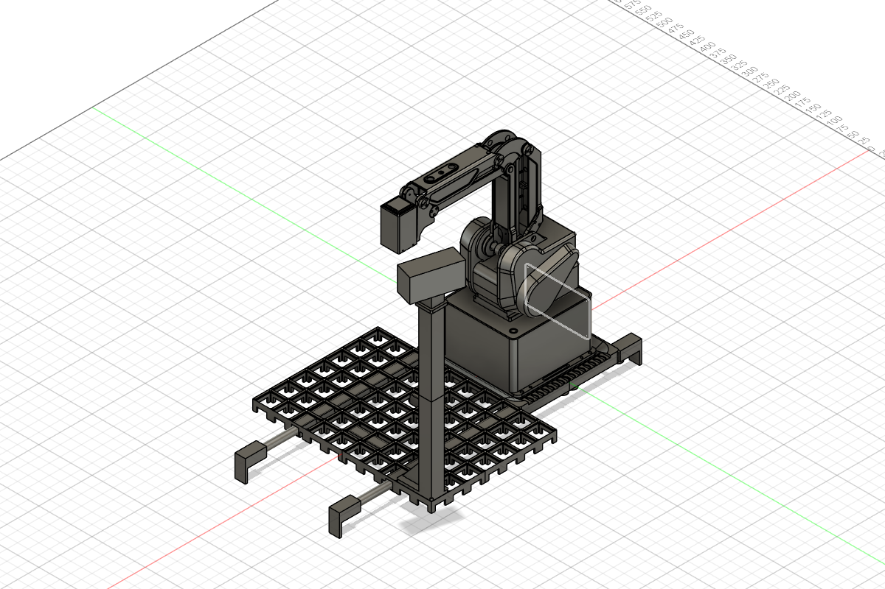
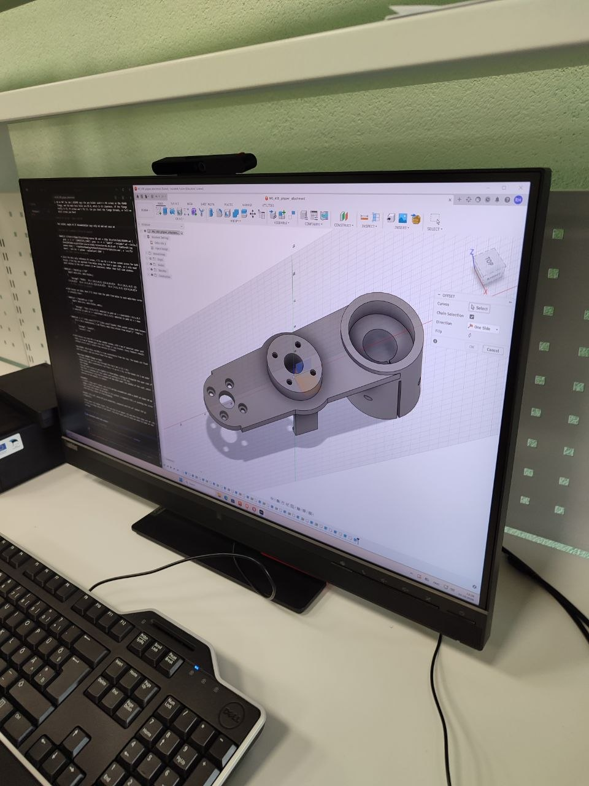
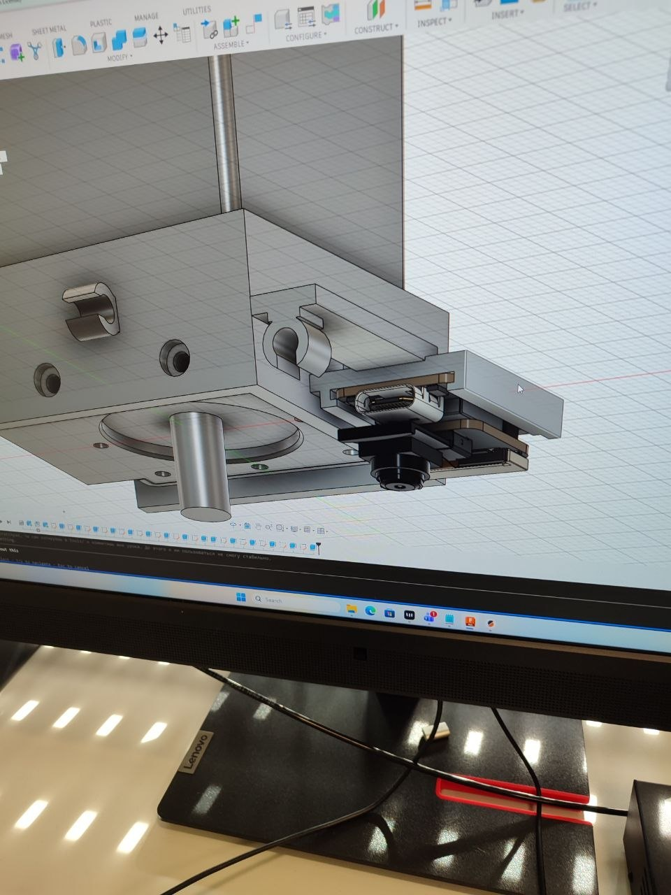

# 3D printimine ja CAD: Labor 2 - Sisend, töökoht, väljund

**Maht:** 30 tundi | **Hindamine:** 20 punkti | **Meeskond:** 3 tudengit

See on meeskonna tööpäevik ja otsuste register. Hoia mõõtmised koos ühikutega, lisa iga töökorra kohta uus päevikusissekanne ning jäta varasemad tulemused alles. Täielikku töölehte ei kopeerita.

## Eesmärk

Kavandada MG400 töölauale Gridfinity hoidikud sisenditele, töökohtadele ning heade ja praakdetailide väljundile. Hoidik peab pärast ruudustikust eemaldamist ja tagasipanekut jääma roboti suhtes samasse kohta. Kaamerad peavad nägema töökohta ja kogu lauda.

## Kontrollnimekiri

- [ ] `docs/layout.md`: töövoog, ruutude paigutus ja skeem mõõdetud laua järgi.
- [ ] 1 x 1 Gridfinity kalibreerimishoidik testitud ruudustikus ja robotiga.
  - 23.10.26 otsus: keskpunkt leitakse iminapaga hoidiku nelja sisenurga kaudu (nelja punkti keskmine); napa raadius taandub sümmeetria tõttu välja ja lisaks saame ruudustiku pöördenurga. Protseduur: [`docs/test-procedure.md`](docs/test-procedure.md) A1, tabel: [`docs/measurements.md`](docs/measurements.md).
- [ ] Kolm sisendhoidikut, igaühes vähemalt neli mõõdetud pesa.
  - 23.10.26 prinditud: klaas (`glass-input-holder-v1`, 2 × 2, 4 pesa), AtomS3 (`atoms3-input-holder-v1`, 2 × 2, 4 pesa), akumoodul (`ready-parts-input-holder-v1`, 2 × 2, 4 pesa). Pesade mõõdud nihikuga: TODO.
- [ ] Töökoha hoidik ja heade ning praakdetailide väljundikohad.
  - 23.10.26 otsus: `ready-parts-input-holder-v1` (2 × 2) on korraga akumooduli sisend ja töökoht: inimene laeb akumoodulid, robot paneb igaühe peale AtomS3 ja selle peale klaasi. Ülesanne lubab sammul jagada kohta eelmisega.
  - 23.10.26 otsus: praak = `gridfinity-calibration-v1` (1 × 1 lahtine kast) pärast kalibreerimist. CAD-ist: välismõõt 41,2 × 41,2 mm, kõrgus 20 mm, sisemus ~37,2 × 37,2 mm, sügavus 16 mm. Klaas ja AtomS3 on 24 × 24 mm, varu ~6,6 mm igale poole; kõrgus jääb alla 60 mm piiri. Ülesanne praagi suurust ega pesasid ei nõua ("võib olla lihtsalt kast"). Füüsiline kontroll: TODO.
  - Heade väljund (4 klaasi, suuremate kaldservadega): TODO — modelleerimata.
  - 23.10.26 parandus (meeskonna otsus, lihtsustus): praak läheb samuti oranži `ready-parts-input-holder-v1` hoidikusse; `gridfinity-calibration-v1` jääb ainult kalibreerimiseks.
  - 23.10.26: heade väljund modelleeritud — `valjundhoidik/src/valjundhoidik-v1.f3d`, `valjundhoidik/stl/valjundhoidik-v1.stl`. Alus on `glass-input-holder-v1` (sama 2 × 2 välismõõt 83,2 × 83,2 mm ja Gridfinity jalad); nelja pesa ja vaheseinte asemel üks lahtine kast. Uued parameetrid: põhi `out_floor_thickness = 2,5 mm`, õõne sügavus `out_cavity_depth = 14 mm`, sein `out_wall_thickness = 2,5 mm`, sisenurga raadius `4 mm`, sissejuhtiv faas ülaservas `out_lead_in = 2 mm`. Kõrgus ilma jalata 16,5 mm, jalaga 24,15 mm (alla 60 mm piiri). Sisemus ~78 × 78 mm, 4 klaasi mahuvad kõrvuti. 3MF ja füüsiline kontroll: TODO.
  - 23.10.26 print ette valmistatud: `valjundhoidik/3mf/valjundhoidik-v1.3mf` (PrusaSlicer). Prusa CORE One HF0.4, `0.20mm SPEED`, Prusament PLA, täide 15 % grid, 2 perimeetrit, jalad all. Orgaanilised toed ainult alusplaadilt: korpuse alumine serv ulatub jalgadest ~2,9 mm välja ja see pind toetub ruudustikule, nii et ta peab jääma sirge. Ilma tugedeta 46 min / 33,6 g, tugedega **1 h 7 min / 37,7 g** (valitud). Pikim mõõt 83,2 mm < 150 mm, seega brim'i ei ole vaja. Füüsiline kontroll: TODO.
- [ ] Iga pesa mõõt ja roboti sihtpunkt dokumenteeritud ruudu ning nihkega.
- [ ] Klaasiga tehtud viis korduskatset ja tulemused failis `docs/refit_test.csv`.
- [ ] XIAO ESP32S3 Sense kaamera kinnitus ning valitud ja katsetatud toide.
- [ ] USB UHD veebikaamera jäik post; mõõdetud pildikõikumine roboti liikumise ajal.
  - 23.10.26 prototüüp v1 (CAD, printimata): `veebikaamera-post/src/veebikaamera-post-v1.f3d`, STL-id `veebikaamera-post-v1-alumine.stl` ja `veebikaamera-post-v1-ulemine.stl`.
    - Kaamera: Verbatim AWC-03 (49580), andmelehelt 106 × 55 × 42,5 mm, 129 g, vaatenurk 120° diagonaalis (≈113° × 81° 16:9 juures), klambris ¼" statiivikeere, kaabel micro-USB → USB-A 1,5 m. Mõõdud nihikuga: TODO.
    - Koht: 2 × 1 Gridfinity alus ruutudes G-5 + G-4 (ülesanne soovitab nurgaruute); post aluse J1-st kõige kaugemas nurgas, r ≈ 442 mm (MG400 ulatus 440 mm). Jalad samad mis `glass-input-holder-v2`.
    - Kõrgus arvutatud: objektiiv ~450 mm roboti talla tasapinnast, siis on kogu ruudustik ja robot ~70 % kaadris (arvutuses kaamera pööre ~74° üle laua ja kalle ~62° alla, kaamera enda liigendiga). Minimaalne arvutatud kõrgus 325 mm (kaader täis, varu ei ole). Tuleb kontrollida kaamera käes hoides.
    - Jäikus kujust: õõnes 30 × 30 mm toru, sein 3 mm, kaks ribi aluse peal (60 mm, kõrgem ei tohi käe teel olla), kaabel saab käia toru sees.
    - Kaks tükki printeri 270 mm Z jaoks: alumine 207 mm (alus + toru kuni 210 mm), ülemine 220 mm (30 mm tapp 0,2 mm lõtkuga + toru + 40 × 40 mm plaat ¼" avaga Ø6,6 mm). Ülemine prinditakse plaat all.
    - Kontrollimata: käe suurim kõrgus ja kas käsi ulatub kaamerani (kaamera korpus ulatub postist ~50 mm roboti poole); liitekoha loks; pildi värisemine. TODO — waiting for physical test.

    
- [ ] `docs/bom.md` sisaldab iga tellitava rea põhjendust.
- [ ] Iga prindi lähtefail, STL ja 3MF on versioonitud.
- [ ] Arenduspäevik täidetud; esitamisel lisatud tag `3d-print-lab2`.

## Teadaolevad lähteandmed

### Ametlikult teadaolevad väärtused

- Ametlik lauakirjeldus ja kõik ruudukoordinaadid: [`docs/MG 400 rakis.md`](docs/MG%20400%20rakis.md). Vastav muutmata Fusioni referentsfail: [`reference/MG 400 rakis.f3z`](reference/MG%20400%20rakis.f3z).
- Gridfinity ruudustik on 7 × 10 ruutu, samm `42 mm`, kogumõõt `294 × 420 mm`.
- Hoidiku välismõõt on `42 × n − 0,5 mm`; ühe ruudu hoidik on `41,5 mm`. Standardse Gridfinity jala ametlik kirjelduskõrgus on `4,75 mm`.
- Ametliku ülesande nominaalid: polükarbonaatklaas `24 × 24 × 2 mm` ja töökoha prinditud Atomi mannekeen `24 × 24 × 13 mm`. Hoidiku lõplikud mõõdud peavad tuginema päris detailide mõõtmisele.
- 23.10.26 otsus: töökohal kasutame prinditud mannekeeni asemel **päris AtomS3-t**. Klaas asetatakse päris Atomi peale; mannekeeni ei prindita.
- Laua ja ametliku ülesande materjal on PLA.

### Lab 1-st pärinevad tulemused

- `0,4 mm` lõtkuga detail liikus vabalt.
- `0,2 mm` lõtkuga detail kiilus ja vajas vabastamist.
- Lab 1 lõpptulemus on ainult vahemik `0,2–0,4 mm`; `0,3 mm` ei prinditud ega füüsiliselt kinnitatud.

### Tegelikku mõõtmist või katset vajavad väärtused

- AtomS3, klaaside, akumooduli, XIAO ESP32S3 Sense'i, olemasoleva iminapa tööriistahoidiku ja veebikaamera tegelikud mõõdud.
- Gridfinity jala sobivus ja loks päris laual ning sobiva lõtku valik.
- Roboti telgede vastavus lauakoordinaatidele, B-2 kalibreerimisnihe, Z ja kauge ruudu viga.
- Hoidikute ruudud ja täpsed sihtpunktid, detailipesade sobivus ning eemaldamise/tagasipaneku kordustäpsus.
- Tööriistakaamera nurk, kõrgus, nähtav ala, mass, toide, kaabli marsruut ja tõmbetõke.
- Üldvaatekaamera kõrgus, asukoht, kaabli pikkus, vibratsioon ning eemaldamise/tagasipaneku kordustäpsus.

Kõigi nende olek on `TODO — waiting for physical test`.

## Tööfailid ja katsejuhendid

- [`assignment-EST.md`](assignment-EST.md) — ülesande originaaltekst, muutmata.
- [`docs/MG 400 rakis.md`](docs/MG%20400%20rakis.md) — ametlik töölaua kirjeldus ja koordinaadid.
- [`docs/measurements.md`](docs/measurements.md) — riistvara mõõtmissessiooni kontrollnimekiri.
- [`docs/test-procedure.md`](docs/test-procedure.md) — lühike juhend roboti juures kasutamiseks.
- [`docs/layout.md`](docs/layout.md) — töövoog, paigutus ja mõõdetavad sihtpunktid.
- [`docs/refit_test.csv`](docs/refit_test.csv) — 5 × 4 eemaldamise/tagasipaneku katse read.
- [`docs/bom.md`](docs/bom.md) — kinnitamist vajav komponentide nimekiri.

## CAD-failid

- `src/gridfinity-calibration-v1.scad` - varasem lihtsustatud jalaga prototüüp; seda versiooni ei tohi printida.
- `src/gridfinity-calibration-v2.scad` - kandidaat esimeseks füüsiliseks 1 × 1 kalibreerimisprindiks. Jalg järgib dokumenteeritud Gridfinity profiili; ülapinnal on keskpunkti tähistav rist. Füüsiline sobivus: `TODO — waiting for physical test`.
- `src/gridfinity-tray-v1.scad` - nelja pesaga varasem alustusmudel, mille lihtsustatud jalg ei vasta dokumenteeritud Gridfinity profiilile. Seda versiooni ei tohi printida ega kasutada uute hoidikute alusena.

- `gripper-attachment/src/mg400-gripper-attachment-v1.f3d`, `gripper-attachment/stl/mg400-gripper-attachment-v1.stl` - MG400 haarats-tööriist (Fusioni dokument `MG_400_gripper_attachment`, versioon 5). Keskel flantsi boss ja kahvel AtomS3R-i ning aku tõstmiseks, vasakul iminapa kinnitus, paremal süstla klamber. Printimata; 3MF puudub. Lahtised küsimused vt arenduspäevik 04.10.26. **Arendus peatatud 23.10.26:** Lab 2-s kasutame ainult iminappa (vt arenduspäevik 23.10.26).

  

- `camera-mounts/src/xiao-square-mount-v2.f3d`, `camera-mounts/stl/xiao-square-mount-v2.stl`, `camera-mounts/3mf/xiao-square-mount-v2.3mf` - XIAO ESP32S3 Sense tööriistakaamera kinnitus MG400 J4 mootori nelikandile (Fusioni dokument `xiao-square-mount-v2`, projekt `3d-printing`). U-klamber ümber nelikandi kaane M2,5 kruvidega, plaadi rennid, kaks prinditud kaabliklambrit (tõmbetõke). Prinditud 04.10.26 sobivuskatseks; füüsiline sobivus: `TODO — waiting for physical test`.

  

  

- `gridfinity-calibration/src/gridfinity-calibration-v1.f3d`, `gridfinity-calibration/stl/gridfinity-calibration-v1.stl`, `gridfinity-calibration/3mf/gridfinity-calibration-v1.3mf` - lisatud 1 × 1 Gridfinity kalibreerimishoidiku Fusioni fail ja ekspordid; füüsiline sobivus ja roboti kalibreerimine: `TODO — waiting for physical test`.
- `atoms3-input-holder/src/atoms3-input-holder-v1.f3d`, `atoms3-input-holder/stl/atoms3-input-holder-v1.stl`, `atoms3-input-holder/3mf/atoms3-input-holder-v1.3mf` - AtomS3 sisendhoidiku Fusioni fail ja ekspordid; mõõtude ning füüsilise sobivuse kinnitus: `TODO — waiting for physical test`.
- `ready-parts-input-holder/src/ready-parts-input-holder-v1.f3d`, `ready-parts-input-holder/stl/ready-parts-input-holder-v1.stl`, `ready-parts-input-holder/3mf/ready-parts-input-holder-v1.3mf` - ReadyParts sisendhoidiku Fusioni fail ja ekspordid; mõõtude ning füüsilise sobivuse kinnitus: `TODO — waiting for physical test`.
- `glass-input-holder/src/glass-input-holder-v1.f3d`, `glass-input-holder/stl/glass-input-holder-v1.stl`, `glass-input-holder/3mf/glass-input-holder-v1.3mf` - klaasi sisendhoidiku Fusioni fail ja ekspordid; mõõtude ning füüsilise sobivuse kinnitus: `TODO — waiting for physical test`.
- `glass-input-holder/src/glass-input-holder-v2.f3d`, `glass-input-holder/stl/glass-input-holder-v2.stl` - 23.10.26: v1 jalad ei läinud ruudustikku päris lõpuni. Põhjus (mõõdetud Fusionis `MG 400 rakis`, `grid_pos_0`): pesa kitsaim koht on 36,28 mm, nurga raadius **1,14 mm** (z +2,63). v1 jalg 35,98 mm nurgaraadiusega 0,5 mm ulatus diagonaalis 0,05 mm pesast välja, nurgad kiilusid; külgvahe oli ainult 0,15 mm. Lisaks pikendas `Extrude18` jalga 3 mm (kuni z −0,37), see jõuab ±3 ja ±1 ruutude all olevate talade vastu (talade ülaserv z +2,48). v2: `foot_clearance = 0,25 mm` külje kohta (jalg 35,78 mm), `foot_corner_radius = 1,5 mm` (nurga vahe 0,5 mm), 0,5 mm faas jala alumisel serval (sissejuhtimine ja esimese kihi laiendus), `Extrude18` välja lülitatud. Pesad muutmata. 3MF ja füüsiline kontroll: TODO.
- `valjundhoidik` sai samad jala parandused (v1, printimata, failid üle kirjutatud).

Need lähtefailid ei ole veel füüsiliselt sobivaks kinnitatud. Iga print vajab PrusaSlicerist eksporditud STL-i ja 3MF-i, uue versiooninime ning mõõtmistulemuste dokumenteerimist.

Versioonis v2 on standardne nominaalgeomeetria ja printeri sobitusparandus eraldi: `fit_adjustment = 0 mm` tähendab muutmata nominaalprofiili; positiivne väärtus vähendab jala mõõtu selle võrra mõlemalt küljelt. See on esialgne katseparameeter, mitte mõõdetud lõtk. Enne jala korduskasutust teistes hoidikutes tuleb v2 päris laual printida ning mõõta täielikku istumist, loksu ja eemaldamisjõudu. OpenSCADi edukas kompileerimine ei tõesta füüsilist sobivust.

V2 nominaalprofiili allikas on [kennetek/gridfinity-rebuilt-openscad `src/core/standard.scad`](https://github.com/kennetek/gridfinity-rebuilt-openscad/blob/main/src/core/standard.scad) (MIT-litsents); sama profiil on kirjas ametlikus lauakirjelduses.

### Arenduspäevik

**KAARDISTA ISE — päevik.** Üks sissekanne iga töösessiooni kohta, kirjutatud
iseendale, nii et inimene, kes seal ei olnud, saab aru. Sissekandeid lisatakse,
mitte ei muudeta.

**PP.KK.AA — kes olid kohal**
* Tegime:
* Juhtus (numbrid):
* Otsustasime, ja miks:
* Lahti järgmiseks korraks:
* Failid: (valikuline lisainfo)

**03.10.26 — Codex; meeskonnaliikmete kohalolek teadmata**
- Tegime: kontrollisime Gridfinity jala profiili ametliku lauakirjelduse ja avatud lähtekoodiga generaatori vastu; koostasime kalibreerimishoidiku v2 keskristiga ning märkisime v1 tray lihtsustatud jala aegunuks.
- Probleem: v1 jalg oli ühe koonusega ega sisaldanud standardset vertikaalset lõiku ega kahte eraldi kaldserva.
- Mõõtmised ja tulemused koos ühikutega: füüsilisi mõõtmisi ega katseid ei tehtud. V2 nominaalprofiil on `0,8 mm + 1,8 mm + 2,15 mm = 4,75 mm`; esialgne `fit_adjustment = 0 mm` külje kohta. Füüsiline sobivus: `TODO — waiting for physical test`.
- Oodatav tulemus: keskristi abil saab määrata ruudu keskpunkti ja füüsiline print näitab jala tegelikku sobivust. Tegelik tulemus: `TODO — waiting for physical test`.
- Otsused ja põhjendused: säilitasime v1 failid ajaloo jaoks; v2 eraldab nominaalprofiili printeri sobitusparandusest. Tray jalga ei kasutata enne füüsilist sobivuskatset.
- Failid ja versioonid: `src/gridfinity-calibration-v2.scad`, `src/gridfinity-tray-v1.scad`, `docs/measurements.md`, `README.md`.
- Järgmiseks: kontrollida v2 OpenSCADis, seejärel printida eraldi füüsiline kandidaat ja dokumenteerida sobivus, loks ning eemaldamisjõud.

> Märkus: selles ajaloolises kirjes nimetatud AI oli kasutatud tööriist, mitte füüsiliselt kohal olnud meeskonnaliige. Algset päevikukirjet ei muudeta tagantjärele.

**04.10.26 — r4imps (Raimo) koos Claude'iga (Fusion MCP kaudu)**
- Tegime: vaatasime üle haaratsi `MG_400_gripper_attachment` ja muutsime seda kaalu ning kruvide järgi. Fusionis on iga samm eraldi versioonina (v1 = algne, v5 = tänane lõpp).
  - Plaat `8 → 5 mm` (`d1`); iminapa posti ülaosa lühendatud koos plaadiga.
  - Iminapa silindriline post (`Extrude3`) eemaldatud; napp kinnitub otse plaadi alla (`z 0`), mitte enam `z −20`.
  - Mõlemad kinnitused (keskmine flantsi boss ja iminapa koht) sama kruviga: **M3 × 6 sisekuuskantpeaga (DIN 912)**, ava `Ø3,4`, peapesa `Ø6,5`, pea all `2 mm` materjali → keermesse jääb ~`4 mm`.
  - Keskmise bossi kruvid käivad altpoolt: peapesa `Ø6,5` ulatub `z −6 → 12`, kahvli katuse nurkadesse tekkisid väikesed sisselõiked. Kontrollitud: kõigi nelja kruvi tee altpoolt on vaba. Vajalik ≥ 50 mm varrega 2,5 mm kuuskantkruvikeeraja.
  - Iminapa kruvipead ülalt, pesa `Ø6,5 × 3 mm` (pea on plaadiga tasa).
  - Materjal Fusionis Steel → PET (PLA-d Fusioni teegis pole); kaalu arvutame PLA tihedusega.
- Mõõtmised ja tulemused koos ühikutega: CAD-ist, mitte nihikuga. Maht `93,9 → 70,2 cm³`; täistäidisega PLA (1,24 g/cm³) ~`116 → 87 g`. Kahvli sõrmed `2,4 mm`, sisemine vahe `24,4 mm`, huulte vahe `21,2 mm`, sisekõrgus huultest katuseni `27,5 mm`. Kahvli otsad `z −36`, iminapa ots ~`z −63` (napp `63 mm`).
- Otsused ja põhjendused: M3, mitte M4 — Lab 1 kirjeldus ütleb `4 × M3 kruvi flantsi külge` ja M4 ei esine dokumentides kordagi. Sisekuuskant, sest kuuskantpea mutrivõti ei mahu kahvli tõttu ligi. Kahvlit ei muudetud (sõrmede paksus määrab klõpsu jõu).
- Mõte tulevikuks (Raimo): kui AtomS3R tulevikus kokku panna (aku, moodul ise ja lõpuks klaas peale liimida UV-valgusega), saab protsessi lahendada kahe tööriistaga ja seda haaratsit pole vaja, kui komplekt ehitada ülevalt alla, mitte alt üles (st alustada pealmisest kihist ehk klaasist, siis moodul, siis aku).
- Nõuded (Raimo sõnul, mõõtmata): napp `63 mm` kõrge; kahvel tõstab akumooduli ja seejärel AtomS3R-i `8 mm` sügavusest süvendist ja vajutab `28 mm` süvendisse, et pinnid kohale suruda.
- Failid ja versioonid: `gripper-attachment/src/mg400-gripper-attachment-v1.f3d`, `gripper-attachment/stl/mg400-gripper-attachment-v1.stl` (Fusioni v5). 3MF tegemata.
- Järgmiseks:
  - Otsustada, kas iminapa kruvid on nagu praegu (pea prindis, keere napa kinnituses) või paneme M3 kuumsisestused (koht = MG400 flantsi koopia, napa komplekti oma kruvid altpoolt).
  - Sügavuskonflikt: napp ulatub ~`27 mm` allapoole kui kahvli otsad — kahvliga töötades võib napp lauda/hoidikut puudutada. Kontrollida hoidikute mõõtudega või lühendada napi kinnitust.
  - Süstla klamber: Raimo vaatab hiljem üle.
  - Nihikuga üle mõõta: MG400 flantsi keere ja augu samm (`17 × 17 mm`?), napa kinnituse keere, AtomS3R-i ja aku mõõdud.

> Märkus: selles ajaloolises kirjes nimetatud AI oli kasutatud tööriist, mitte füüsiliselt kohal olnud meeskonnaliige. Algset päevikukirjet ei muudeta tagantjärele.

**04.10.26 — Dennel04 (Denys) koos Claude'iga (Fusion MCP kaudu)**
- Tegime: XIAO ESP32S3 Sense tööriistakaamera kinnitus MG400 J4 mootori nelikandile (robot Fusionis XREF-ina). v1: U-klamber ümber nelikandi kaane, kaane M2,5 kruvide avad süvistustega, plaadi rennid ja otsapiire, kaabliklamber pistiku taga. v1 printimata. v2: tõmbepaela sild eemaldatud, selle asemel teine kaabliklamber +Y seinal; kaabel läheb mööda seina roboti poole.
- Mõõtmised ja tulemused koos ühikutega: nihikuga mõõdetud ainult kaane kruvi: kogupikkus `6,3 mm`, pea `Ø4,62 mm`. Kõik muud mõõdud on CAD-ist (MG400 mudel: nelikant `44 × 44 mm`, kruvide samm `24 mm`) ja XIAO STEP-ist; neil on Fusionis parameetrid. Lõtk nelikandil `0,3 mm` külje kohta (Lab 1 vahemikust `0,2–0,4 mm`, kinnitamata). Interference robotiga ja XIAO-ga `0`. Print: Prusa CORE One HF0.4, `0.20mm SPEED`, Prusament PLA, orgaanilised toed ainult alusplaadilt, tagurpidi (klambri serv alusel); `45 min`, `15,6 g`. Füüsiline sobivus: `TODO — waiting for physical test`.
- Otsused ja põhjendused: õppejõud lubas suuliselt kõigile kaamera kinnitada ükskõik kuhu, mitte ainult iminapa tööriistahoidikule (04.10.26). Valisime J4 nelikandi: see ei pöörle J4-ga, nii et kaabel ei keerdu, ja olemasolev tööriistahoidik jääb muutmata. Teine klamber, mitte tõmbepael: kulumaterjali pole vaja ja kaabli saab ilma lõikamata välja.
- Failid ja versioonid: `camera-mounts/src/xiao-square-mount-v2.f3d`, `camera-mounts/stl/xiao-square-mount-v2.stl`, `camera-mounts/3mf/xiao-square-mount-v2.3mf` (PrusaSlicer projekt).
- Järgmiseks:
  - Prindil kontrollida: sobivus nelikandil, kas originaalkruvi ulatub läbi süvistuse põhja (`1 mm`) keermesse, plaat rennides, kaabel mõlemas klambris. Kruviavadesse kasvanud toed puhastada.
  - Kaameramoodul ripub oma lindikaablil ega ole fikseeritud. v3-s on kaamerapesa (Fusionis `xiao-square-mount-v3`); prinditakse alles pärast v2 katset ja kaameramooduli nihikuga mõõtmist.
  - Mõõta iminapa otsa kõrgus nelikandi suhtes (kinnitus ei tohi ulatuda napa otsast allapoole) ja valida kaamera toide.

> Märkus: selles ajaloolises kirjes nimetatud AI oli kasutatud tööriist, mitte füüsiliselt kohal olnud meeskonnaliige. Algset päevikukirjet ei muudeta tagantjärele.

**23.10.26 — r4imps (Raimo)**
* Tegime: otsustasime haaratsi `MG_400_gripper_attachment` arenduse peatada.
* Juhtus (numbrid): uusi mõõtmisi ega printe ei tehtud. Haarats jääb Fusioni versiooni 5 seisu (`mg400-gripper-attachment-v1`), printimata, 3MF puudub.
* Otsustasime, ja miks: Lab 2-s pole süstalt ega UV-lampi vaja, seega kasutame olemasolevat iminappa ja haaratsit praegu edasi ei arenda. Jätkame haaratsi arendusega, kui selleks vajadus tekib (nt Lab 3 tööriist: napp, süstal, UV-lamp). 04.10.26 lahtised küsimused (kruvid vs kuumsisestused, napa ja kahvli sügavuskonflikt, süstla klamber, flantsi mõõtmine) jäävad seniks lahti.
* Lahti järgmiseks korraks: Lab 2 hoidikud ja töökoht kavandada olemasoleva iminapa järgi; iminapa tööriistahoidiku mõõdud failis `docs/measurements.md`.
* Failid: `README.md`, `docs/bom.md` (M3 × 6 kruvide rida ootel).

### Väljundid ja tulemused

**Väljundid**
* Gridfinity hoidikute kandidaadid ja töölaua paigutusdokumendid; lõplikud
  hoidikud ning ruudukohad on TODO — real measurement and physical fit test
  required.
* XIAO tööriistakaamera kinnituse CAD-kandidaat on olemas; selle füüsiline
  sobivus ja USB üldvaatekaamera lõplik kinnitus on TODO — waiting for physical
  test.
* Hoidikute eemaldamise/tagasipaneku sobivus ja kordustäpsus: TODO — real
  measurement required.
* Smart Solutions Lab 2/3 saab siit pärast füüsilisi katseid kontrollitud
  hoidikukohad, roboti sihtpunktid ja kaamerate kinnitusgeomeetria: TODO — real
  measurement required.

**KAARDISTA ISE, lõpus.**
* Git repo ja tag: TODO — lisada alles esitamisel.
* Numbrid, mille see labor andis, ühikutega: TODO — real measurement required;
  CAD-i nominaale ei esitata füüsilise kordustäpsuse tulemusena.
* Mida me teeksime teisiti: TODO — complete after physical fit and refit tests.
* Mida järgmine labor peaks enne alustamist teadma: TODO — complete after the
  holders, camera mounts and robot target points are physically verified.
