# 3D printimine ja CAD: Labor 2 - Sisend, töökoht, väljund

**Maht:** 30 tundi | **Hindamine:** 20 punkti | **Meeskond:** 3 tudengit

See on meeskonna tööpäevik ja otsuste register. Hoia mõõtmised koos ühikutega, lisa iga töökorra kohta uus päevikusissekanne ning jäta varasemad tulemused alles. Täielikku töölehte ei kopeerita.

## Ametlik kuupäev ja kohaliku ülesandekoopia parandused

Esimene kaitsmine on **29.10.2026, veebis**. Kontrollitud 23.10.2026 [ajakohasest ametlikust ülesandest](https://github.com/KKallas/Narva-subjects/blob/main/EST/2026-27/3D%20printing/3D%20Printing%20%5BLab%202%5D%20EST.md) (`KKallas/Narva-subjects`, faili Git blob SHA `26414cd29cd4a1a6e8e377b4ab1b1e31168f7625`). Kohalikus [`assignment-EST.md`](assignment-EST.md) on tehniliselt parandatud ainult vananenud kuupäev 27.10.26 → 29.10.26 ja suhtelised lingid `MG 400 rakis.f3z` → `reference/MG 400 rakis.f3z` ning `MG 400 rakis.md` → `docs/MG 400 rakis.md`. Muu ülesandetekst säilib senisel kujul; kohalik koopia ei ole bait-baidilt muutmata originaal.

## Eesmärk

Kavandada MG400 töölauale Gridfinity hoidikud sisenditele, töökohtadele ning heade ja praakdetailide väljundile. Hoidik peab pärast ruudustikust eemaldamist ja tagasipanekut jääma roboti suhtes samasse kohta. Kaamerad peavad nägema töökohta ja kogu lauda.

## Kaamerate ja Smart Solutionsi arhitektuur — 23.10.2026

XIAO ESP32S3 Sense on füüsiliselt kontrollitud **USB Serial** diagnostikapüsivaraga: **COM5**, sensor **OV3660**, JPEG **1600 × 1200 px**. Tegelik foto on [`tool-camera-first-frame.jpg`](docs/photos/tool-camera-first-frame.jpg); katse on kirjeldatud allpool 23.10.26 arenduspäevikus. See tõendab USB kaudu pildi saamist, kuid mitte Wi-Fi HTTP tööd ega töökoha lõplikku nähtavust.

Smart Solutions Lab 2 lõppvariandiks valime eraldi [Wi-Fi HTTP püsivara](https://github.com/Dennel04/smart-solutions-course/tree/main/smart-solutions/lab2/firmware-xiao-camera/) (`Dennel04/smart-solutions-course/smart-solutions/lab2/firmware-xiao-camera/`). Siinne [`tool-camera/firmware/`](tool-camera/firmware/) ja [`capture.py`](tool-camera/capture.py) jäävad USB diagnostikaks alles. Käesolev dokumentatsiooniotsus ei tähenda püsivara laadimist ega uut füüsilist katset.

| Seade | Valitud ühendus ja roll | Kinnituse piir |
|---|---|---|
| XIAO tööriistakaamera | Wi-Fi HTTP → jaamaarvuti (station PC); USB Serial jääb diagnostikaks | USB kaader kontrollitud; Wi-Fi HTTP füüsiline kontroll: TODO — waiting for physical test |
| Verbatim AWC-03 üldvaatekaamera | USB → station PC | Mudel tuvastatud; kogu laua vaade, vibratsioon ja korduspaigaldus: TODO — waiting for physical test |
| MG400 | Ethernet; käsud station PC-st | Ühenduse valik ei tõenda kogu liikumisvahemiku kokkupõrkevabadust |
| Atom | USB Serial ja Wi-Fi | Arhitektuuri ühendused; selle sissekandega ei kinnitata uut sidetesti |

Wi-Fi füüsiline toimimine ja station PC võrgust ligipääs, kaablite marsruut ja tõmbetõke, lõplik toide koos pinge/voolu kontrolliga, MG400 kogu kavandatud liikumine ja J4 pööre ning terav töökoha kaader koos terve **30 × 30 mm** klaasi ja Atomiga: **TODO — waiting for physical test**. USB-katse ajal kasutati arvuti USB-C toidet; seda ei loeta lõpliku toite ega kogu liikumistee katseks. Katsete järjekord: [`docs/test-procedure.md`](docs/test-procedure.md), osad F–G.

## Kontrollnimekiri

- [ ] `docs/layout.md`: töövoog, ruutude paigutus ja skeem mõõdetud laua järgi.
  - 24.10.26: paigutus otsustatud (variant B, kaksikus kontrollitud) ja kirjas [`docs/layout.md`](docs/layout.md) koos skeemiga. Avatud: hoidikud füüsiliselt uutesse ruutudesse, AtomS3 nihikuga, veebikaamera posti lõplik koht.
- [x] 1 x 1 Gridfinity kalibreerimishoidik testitud ruudustikus ja robotiga.
  - 24.10.26: 1 × 1 kalibreerimiskast `gridfinity-calibration` prinditi uuesti standardse Gridfinity jalaga (generaatori profiil) ja see on nüüd meie kalibreerimise standard. Istub ruudustikus hästi ega loksu; kontrollitud robotiga ruudus C−2: Z puudutus põhjal −155,0, neli sisenurka → keskpunkt 253,81 / 68,46, napp risti keskel 253,94 / 68,30 (kasutusel `calibration/cells.py`). Andmed: [`docs/calibration_c-2.csv`](docs/calibration_c-2.csv), [`docs/measurements.md`](docs/measurements.md).
  - 23.10.26 otsus: keskpunkt leitakse iminapaga hoidiku nelja sisenurga kaudu (nelja punkti keskmine); napa raadius taandub sümmeetria tõttu välja ja lisaks saame ruudustiku pöördenurga. Protseduur: [`docs/test-procedure.md`](docs/test-procedure.md) A1, tabel: [`docs/measurements.md`](docs/measurements.md).
  - 23.10.26 kalibreerimine alustatud ruudus G-1 (B-2-s ei ulatu käsi kasti põhja, J3 piir). 3 nurka 4-st kinnitatud, eeldatav nihe ≈ +5,3 / +5,4 mm; vt [`docs/measurements.md`](docs/measurements.md). Lõpetamata: 4. nurk, Xmin+Ymax nurk samal Z-l, kontrollruut.
- [ ] Kolm sisendhoidikut, igaühes vähemalt neli mõõdetud pesa.
  - 23.10.26 prinditud: klaas (`glass-input-holder`, 2 × 2, 4 pesa), AtomS3 (`atoms3-input-holder-v1`, 2 × 2, 4 pesa), akumoodul (`ready-parts-input-holder-v1`, 2 × 2, 4 pesa). Pesade mõõdud nihikuga: TODO.
  - 24.10.26 kasutaja kinnitas kõigi kolme sisendhoidikutüübi detailide füüsilise sobivuse: põhjani, vabalt lõtku piires, sõrmedega eemaldatavad, kiilumiseta. Täpne kontrollitud pesade arv ja prinditud pesade nihikumõõdud on kinnitamata; kogu punkti ei märgita tehtuks. Üksikasjad: [`docs/measurements.md`](docs/measurements.md), 24.10 kirje.
- [ ] Töökoha hoidik ja heade ning praakdetailide väljundikohad.
  - 23.10.26 otsus: `ready-parts-input-holder-v1` (2 × 2) on korraga akumooduli sisend ja töökoht: inimene laeb akumoodulid, robot paneb igaühe peale AtomS3 ja selle peale klaasi. Ülesanne lubab sammul jagada kohta eelmisega.
  - Heade väljund (4 klaasi, suuremate kaldservadega): TODO — modelleerimata.
  - 23.10.26 parandus (meeskonna otsus, lihtsustus): praak läheb samuti oranži `ready-parts-input-holder-v1` hoidikusse.
  - 23.10.26: heade väljund modelleeritud — `valjundhoidik/src/valjundhoidik-v1.f3d`, `valjundhoidik/stl/valjundhoidik-v1.stl`. Alus: 2 × 2 välismõõt 83,2 × 83,2 mm ja Gridfinity jalad; nelja pesa ja vaheseinte asemel üks lahtine kast. Uued parameetrid: põhi `out_floor_thickness = 2,5 mm`, õõne sügavus `out_cavity_depth = 14 mm`, sein `out_wall_thickness = 2,5 mm`, sisenurga raadius `4 mm`, sissejuhtiv faas ülaservas `out_lead_in = 2 mm`. Kõrgus ilma jalata 16,5 mm, jalaga 24,15 mm (alla 60 mm piiri). Sisemus ~78 × 78 mm, 4 klaasi mahuvad kõrvuti. 3MF ja füüsiline kontroll: TODO.
  - 23.10.26 print ette valmistatud: `valjundhoidik/3mf/valjundhoidik-v1.3mf` (PrusaSlicer). Prusa CORE One HF0.4, `0.20mm SPEED`, Prusament PLA, täide 15 % grid, 2 perimeetrit, jalad all. Orgaanilised toed ainult alusplaadilt: korpuse alumine serv ulatub jalgadest ~2,9 mm välja ja see pind toetub ruudustikule, nii et ta peab jääma sirge. Ilma tugedeta 46 min / 33,6 g, tugedega **1 h 7 min / 37,7 g** (valitud). Pikim mõõt 83,2 mm < 150 mm, seega brim'i ei ole vaja. Füüsiline kontroll: TODO.
  - 24.10.26: `valjundhoidik-v1` prinditud (2 × 2, üks lahtine kast ilma vaheseinteta). Füüsiline kontroll: hoidik istub ruudustikus hästi (jalad v2 parandusega ei kiilu). Klaasi panek robotiga ja pesade mõõdud nihikuga: TODO.
- [ ] Iga pesa mõõt ja roboti sihtpunkt dokumenteeritud ruudu ning nihkega.
- [ ] Klaasiga tehtud viis korduskatset ja tulemused failis `docs/refit_test.csv`.
  - 24.10.26: **ring 1 tehtud, 4 / 4 klaasi** (sisend D/E −4/−5 → töökoht C+1 AtomS3 peal → väljund D/E +4/+5, 10 %), Denys kinnitas. Kaadrid `docs/photos/cycle-r1-*.jpg`. Järgmiseks: hoidikud välja ja tagasi, ringid 2–5 ilma ümberõpetamiseta.
- [x] XIAO ESP32S3 Sense kaamera kinnitus ning valitud ja katsetatud toide.
  - 24.10.26: kinnitus `xiao-square-mount-v2` (kaamerapesa objektiivi aknaga, tihvt) prinditud ja paigaldatud, töötab.
  - 23.10.26: XIAO istub prinditud kinnituses roboti küljes ja annab pilti. Toide katsetamisel USB-C kaudu arvutist (COM5). Püsivara `tool-camera/firmware/` (JPEG 1600 × 1200 USB kaudu, sest labori arvutil pole WiFi-t), kaader `python tool-camera/capture.py COM5 <fail>.jpg`. Sensor OV3660 (PID 0x3660), PSRAM 8 MB. Esimene kaader: [`docs/photos/tool-camera-first-frame.jpg`](docs/photos/tool-camera-first-frame.jpg) — pildis on iminapp, ruudustik ja oranž hoidik; iminapa voolik läheb diagonaalis üle kaadri.
  - **Toide: USB-C kaabel** (sama kaabel annab ka pildi). Kinnitus on J4 mootori nelikandil, mis J4-ga kaasa ei pöörle; kaabel läheb roboti taha ega sega J4 pööret. Aku jäi ära: lisakaal käe otsas ja tühjeneb. Roboti tööriistapistik jäi ära: pinge kontrollimata, vale pinge rikub mooduli. Kumbki ei anna ka pilti.
  - **Kaal (hinnang, kaalumata):** kinnitus v2 ≈ 15 g (STL maht 13,6 cm³, PrusaSlicer 16,2 g koos tugedega), XIAO ESP32S3 Sense ≈ 5–10 g, kaabli tükk paar grammi → tööriistale lisandub ≈ 25 g, MG400 500 g piirist väike osa.
  - **Napp jääb vabaks:** kinnituse madalaim punkt on 15,4 mm nelikandi põhjast allpool, napp ulatub J4 mootori alt ~66 mm → kinnitus ja kaamera on napa otsast ~50 mm kõrgemal ega sega laskumist pesasse.
  - **Kaader töökohast** (24.10.26 19:22, ring 1 klaas 4, napp C+1 kohal): oranžis töökohas AtomS3 (sinine) ja klaas tema peal, iminapp üleval paremal. Kaabel ei jäänud kogu tsükli ajal kuhugi kinni.

    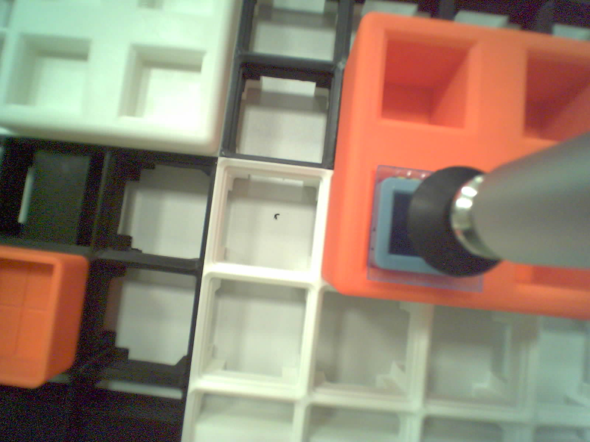
- [ ] USB UHD veebikaamera jäik post; mõõdetud pildikõikumine roboti liikumise ajal.
  - **Kinnitus laua serval rakise toru otsas** (väljaspool ruudustikku, käsi sinna ei ulatu): Denys nihutas laual L-nurgad nii, et pika toru esiots ulatub ~50 mm üle laua serva. Prinditakse kaks osa, vertikaalne toru on sama 16 mm toru: `veebikaamera-post/src/veebikaamera-post-v1.f3d`, `stl/veebikaamera-post-v1-nurk.stl`; ülemine: `src/veebikaamera-post-v2-ulemine.f3d`, `stl/veebikaamera-post-v2-ulemine.stl`, `stl/veebikaamera-post-v2-kiil.stl`, `3mf/veebikaamera-post-v2-ulemine-kiil.3mf`.
    - **Nurk** (prinditud 25.10.26, istub hästi): pesa 30 mm toru otsa peale (tilgakujuline ava, prinditakse ilma tugedeta), kaks külgtiiba padjanditega toetuvad lauale L-nurga kõrval, nii et nurk ei pöördu toru ümber; vertikaalne pesa toru jaoks. Vertikaalse toru telg J1-st ~568 mm.
    - **Ülemine v2** (Denys 25.10.26): pesa Ø16,5 toru otsa peale (toru vastu pesa põhja), peal kaamera klambri pesa, taga kiil lukustab. Pööratakse toru peal käsitsi, avatud pool ruudustiku keskele.
    - Vertikaalne toru **458 mm** (kaamera ~470 mm laua kohal). Kõrgus kinnitada kaamerat käes hoides enne lõikamist.
    - **Paigaldatud 25.10.26:** ülemine osa prinditud, toru lõigatud, kaamera postil ja ühendatud (Verbatim 49580 UHD 4K, 3840×2160, 30 fps). Kaader näitab kogu ruudustikku, kõiki hoidikuid ja robotit ülevalt; pilti näeb ja salvestab MG400 Station Hubis (`3d-print/hub`, nupp **Webcam**).
    - Veel teha: käe suurim kõrgus; pildi värin täiskiirusel; kaamera maha-tagasi sama pilt; kaabel mööda toru alla kinni.

    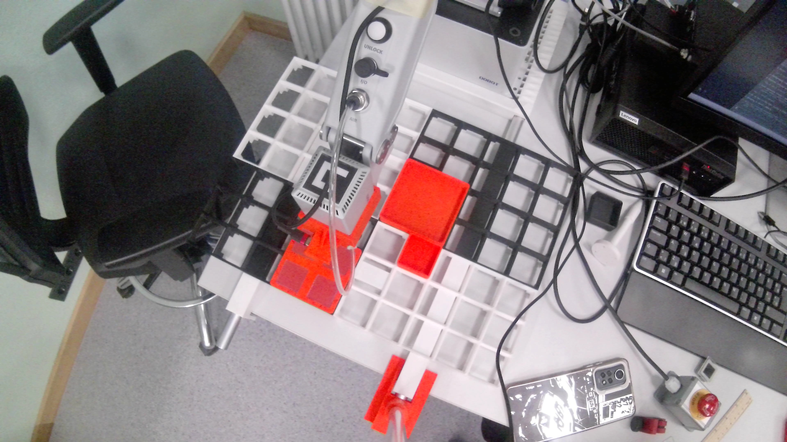

    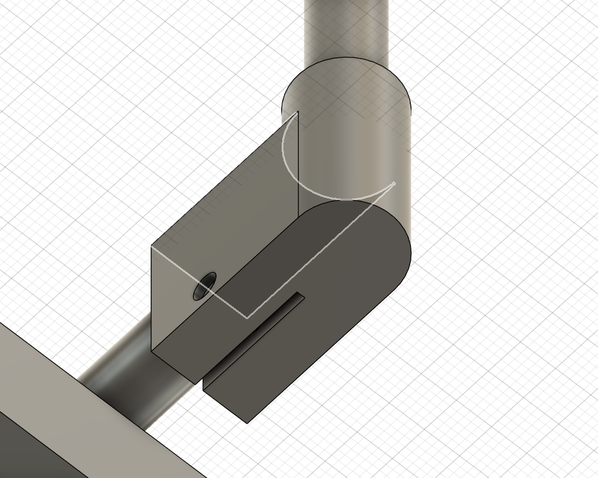

- [ ] `docs/bom.md` sisaldab iga tellitava rea põhjendust.
- [ ] Iga prindi lähtefail, STL ja 3MF on versioonitud.
- [ ] Arenduspäevik täidetud; esitamisel lisatud tag `3d-print-lab2`.

## Füüsilise töö fototõendid — 24.10.2026

Kasutaja edastatud kaheksa fotot päris laboritööst; originaalfailid kopeeriti kausta `docs/photos/`. Fotod kinnitavad prinditud detailide olemasolu ja nähtavat paiknemist pildistamise hetkel. Neid ei käsitleta [`docs/layout.md`](docs/layout.md) lõpliku paigutuse kinnitusena ega automaatse klaasitsükli tõendina. Meeskonna eraldi dokumenteeritud ringi 1 tulemus ja katsed säilivad arenduspäevikus ning [`docs/refit_test.csv`](docs/refit_test.csv).

### Gridfinity tööala üldvaade

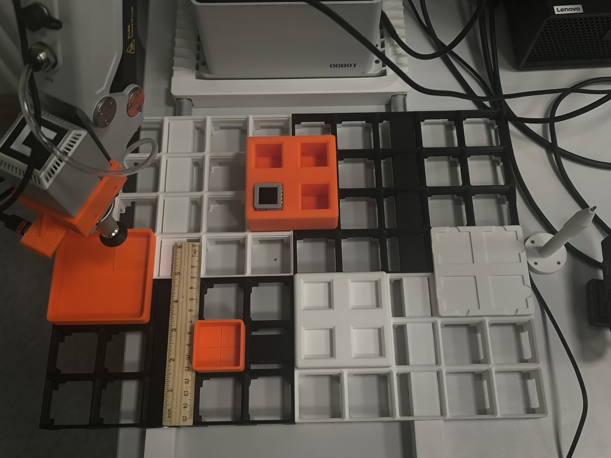

Põhiline üldfoto: robot, Gridfinity ruudustik, valged ja oranžid prinditud hoidikud ning joonlaud. Näha on pildistamisaegne paigutus; ruudutähiseid ega sihtpunktide nihkeid sellest fotost ei tuletata.

### MG400 vaakumtööriist ja paigaldatud XIAO kinnitus

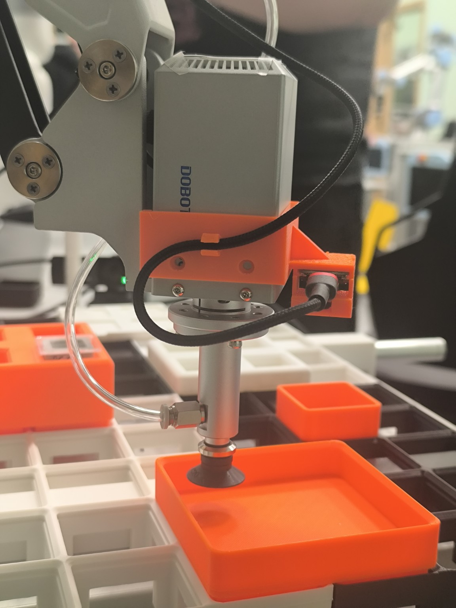

Tööriista lähivaade küljelt: oranž XIAO kinnitus on robotile paigaldatud, USB-kaabel on ühendatud ning vaakumvoolik ja iminapp on nähtavad. Foto ei kinnita kaabli tõmbetõkke toimimist kogu liikumisvahemikus ega kaamera lõplikku vaadet.

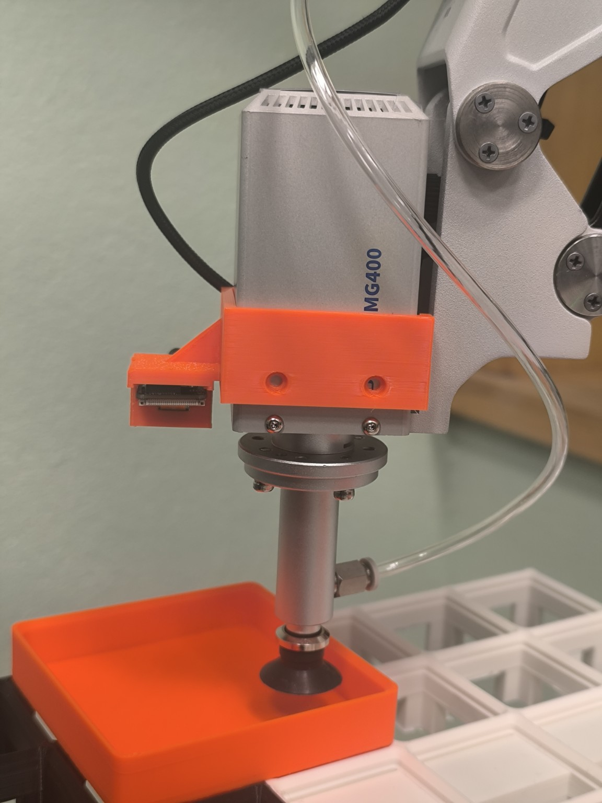

Teine rakurss näitab kinnitust, flantsi all olevat vaakumtööriista ja iminapa paiknemist oranži konteineri kohal. Foto põhjal ei määrata kinnituse CAD-versiooni ega arvulisi vahekaugusi.

### Prinditud hoidikud ja AtomS3

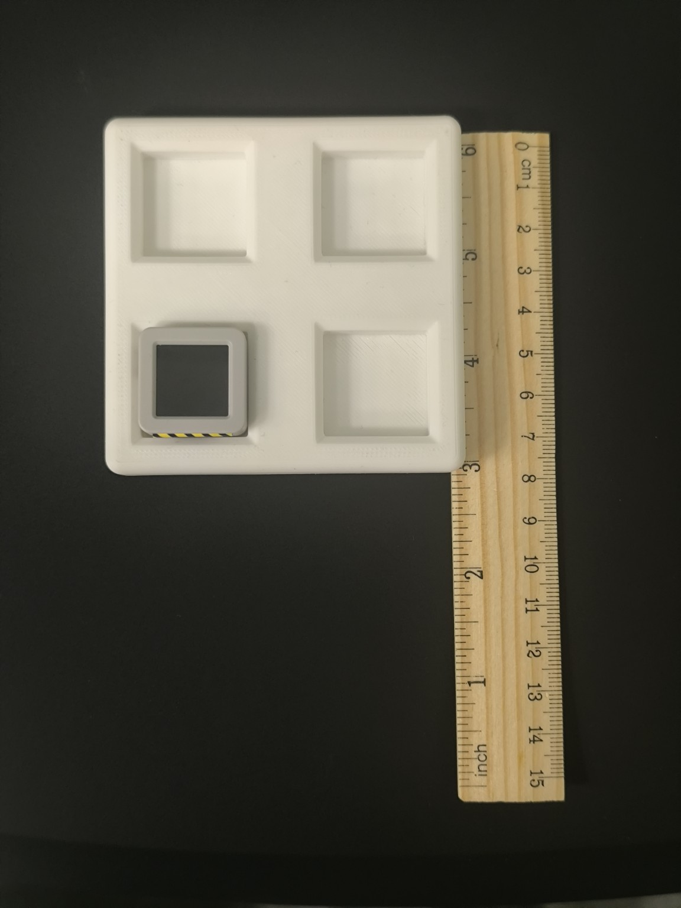

AtomS3 valge hoidiku ühes pesas, ekraan üles; kõrval on joonlaud. Foto toetab detaili pesas paiknemise dokumenteerimist, kuid ei tõenda kõigi pesade põhjani istumist ega täpset lõtku.

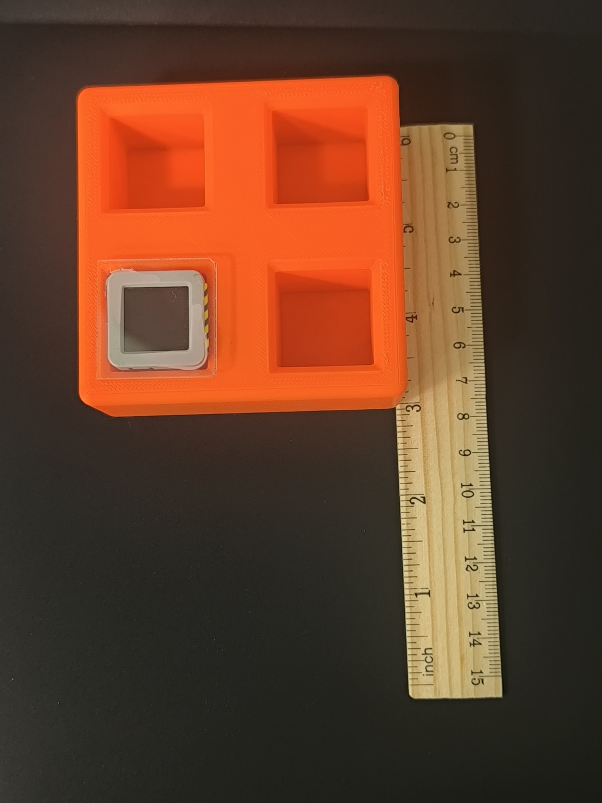

AtomS3 oranži hoidiku ühes pesas ja joonlaud selle kõrval. Käsitsi kinnitatud sobivust (`physical fit confirmed`) kirjeldab eraldi [`mõõteregistri 24.10 kirje`](docs/measurements.md); fotost uusi nihikumõõte ei lisata.

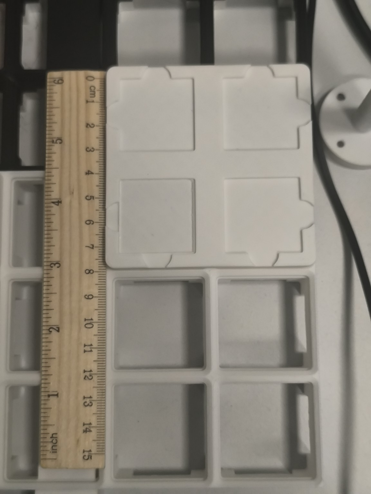

Valged prinditud hoidikud ruudustikul, joonlaud kõrval. Pildil nähtavad pesad ja väljalõiked on füüsilised prindid; joonlaud annab konteksti, mitte prinditud pesade arvuliste nihikumõõtude protokolli.

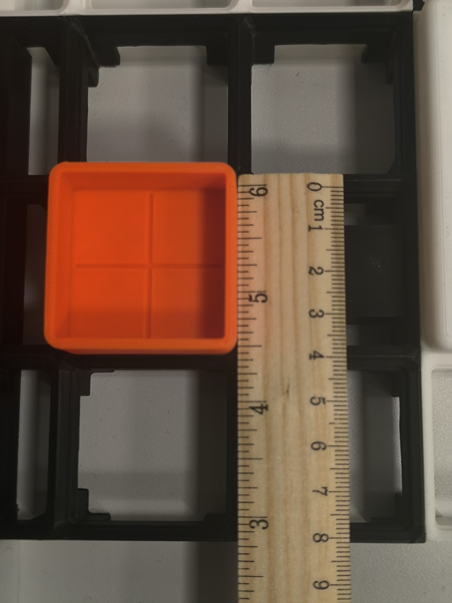

Oranž väike avatud kast ristiga põhjas ruudustikul. Foto kinnitab kasti olemasolu ja asendit pildistamise hetkel, kuid mitte selle eemaldamise/tagasipaneku kordustäpsust.

### Oranž väljundkonteiner, läbipaistev plaat ja iminapp

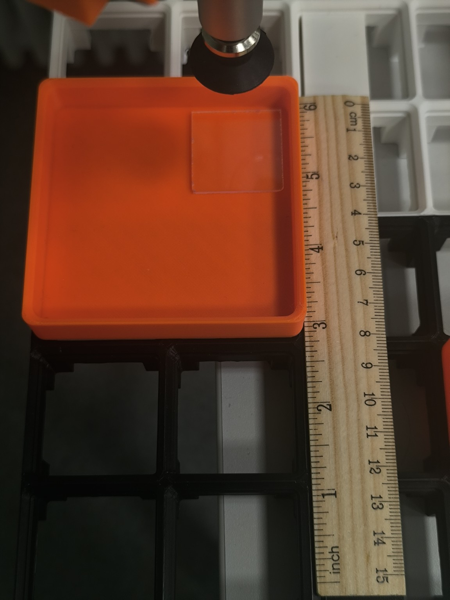

Lähivaates on läbipaistev plaat oranžis avatud konteineris, iminapp selle kohal ja joonlaud kõrval. See on asendi tõend, mitte foto põhjal kinnitatud vaakumhaare, klaasi automaatne ülekandmine või täpne kõrgusmõõt.

Olemasolevad `measured` mõõtmised, `estimated` massihinnang ja `CAD dimensions` jäävad [`docs/measurements.md`](docs/measurements.md) ning [`docs/cad-measurement-review.md`](docs/cad-measurement-review.md) andmeteks. Fotod ei muuda neid olekuid: puuduvad prinditud pesade arvulised mõõdud, tegelik kaalumine enne/pärast kaamerat, kaamerate ja kaablite täielikud katsed ning ringid 2–5 koos hoidikute välja/tagasi katsega jäävad `TODO — waiting for physical test`.

## Teadaolevad lähteandmed

### Ametlikult teadaolevad väärtused

- Ametlik lauakirjeldus ja kõik ruudukoordinaadid: [`docs/MG 400 rakis.md`](docs/MG%20400%20rakis.md). Vastav muutmata Fusioni referentsfail: [`reference/MG 400 rakis.f3z`](reference/MG%20400%20rakis.f3z).
- Gridfinity ruudustik on 7 × 10 ruutu, samm `42 mm`, kogumõõt `294 × 420 mm`.
- Hoidiku välismõõt on `42 × n − 0,5 mm`; ühe ruudu hoidik on `41,5 mm`. Standardse Gridfinity jala ametlik kirjelduskõrgus on `4,75 mm`.
- Ametliku ülesande nominaalid: polükarbonaatklaas `24 × 24 × 2 mm` ja töökoha prinditud Atomi mannekeen `24 × 24 × 13 mm`. Hoidiku lõplikud mõõdud peavad tuginema päris detailide mõõtmisele.
  - **23.10.2026 parandus meie detailile:** ametlik tsitaat jääb alles; meie klaas on `30 × 30 × 2 mm` (`confirmed`), AtomS3 `24 × 24 × 12,9 mm` on `nominal`. Akumoodul `24,04 × 24,01 × 21,97 mm` ja XIAO põhiplaat `17,74 × 21,33 × 1,21 mm` on Maksimi tabelis `measured`. USB-C keskjoon Atomil on `11,4 mm` valitud servast (`measured`), kuid serv tuleb veel skeemil tuvastada. Kõik allikad ja olekud: [`docs/measurements.md`](docs/measurements.md).
- 23.10.26 otsus: töökohal kasutame prinditud mannekeeni asemel **päris AtomS3-t**. Klaas asetatakse päris Atomi peale; mannekeeni ei prindita.
- Laua ja ametliku ülesande materjal on PLA.

### Lab 1-st pärinevad tulemused

- `0,4 mm` lõtkuga detail liikus vabalt.
- `0,2 mm` lõtkuga detail kiilus ja vajas vabastamist.
- Lab 1 lõpptulemus on ainult vahemik `0,2–0,4 mm`; `0,3 mm` ei prinditud ega füüsiliselt kinnitatud.

### Tegelikku mõõtmist või katset vajavad väärtused

23.10.2026 täiendus: allolev varasem loend ei tähenda, et kõik komponendimõõdud oleks endiselt puudu. Maksimi Exceli ülekanne ja allesjäänud puudused on [`mõõteregistris`](docs/measurements.md); nimimõõt, kinnitatud mõõt ja mõõdetud väärtus on seal eristatud. Füüsilise sobivuse katsed jäävad avatuks.

- AtomS3, klaaside, akumooduli, XIAO ESP32S3 Sense'i, olemasoleva iminapa tööriistahoidiku ja veebikaamera tegelikud mõõdud.
- Gridfinity jala sobivus ja loks päris laual ning sobiva lõtku valik.
- Roboti telgede vastavus lauakoordinaatidele, B-2 kalibreerimisnihe, Z ja kauge ruudu viga.
- Hoidikute ruudud ja täpsed sihtpunktid, detailipesade sobivus ning eemaldamise/tagasipaneku kordustäpsus.
- Tööriistakaamera nurk, kõrgus, nähtav ala, mass, toide, kaabli marsruut ja tõmbetõke.
- Üldvaatekaamera kõrgus, asukoht, kaabli pikkus, vibratsioon ning eemaldamise/tagasipaneku kordustäpsus.

Kõigi nende olek on `TODO — waiting for physical test`.

## Tööfailid ja katsejuhendid

- [`assignment-EST.md`](assignment-EST.md) — ülesande kohalik koopia; ainult kuupäev ja suhtelised lingid tehniliselt parandatud, vt ülal ametliku allika viidet.
- [`docs/MG 400 rakis.md`](docs/MG%20400%20rakis.md) — ametlik töölaua kirjeldus ja koordinaadid.
- [`docs/measurements.md`](docs/measurements.md) — riistvara mõõtmissessiooni kontrollnimekiri.
- [`docs/cad-measurement-review.md`](docs/cad-measurement-review.md) — 30 mm klaasi mõju olemasolevatele STL-idele, vajalikud Fusioni kontrollid ja MG400 trajektoori lahtised küsimused.
- [`docs/test-procedure.md`](docs/test-procedure.md) — lühike juhend roboti juures kasutamiseks.
- [`docs/layout.md`](docs/layout.md) — töövoog, paigutus ja mõõdetavad sihtpunktid.
- [`docs/refit_test.csv`](docs/refit_test.csv) — 5 × 4 eemaldamise/tagasipaneku katse read.
- [`docs/bom.md`](docs/bom.md) — kinnitamist vajav komponentide nimekiri.
- [`../sim/`](../sim/README.md) — töökoha digitaalne kaksik (ühine kõigile laboritele): ulatus- ja min-Z kaart, kalibreerimiskoha kontroll, klaasitsükli kuivkäivitus, kalibreerimisvea taluvus.

## CAD-failid

- `src/gridfinity-tray-v1.scad` - nelja pesaga varasem alustusmudel, mille lihtsustatud jalg ei vasta dokumenteeritud Gridfinity profiilile. Seda versiooni ei tohi printida ega kasutada uute hoidikute alusena.

- `gripper-attachment/src/mg400-gripper-attachment-v1.f3d`, `gripper-attachment/stl/mg400-gripper-attachment-v1.stl` - MG400 haarats-tööriist (Fusioni dokument `MG_400_gripper_attachment`, versioon 5). Keskel flantsi boss ja kahvel AtomS3R-i ning aku tõstmiseks, vasakul iminapa kinnitus, paremal süstla klamber. Printimata; 3MF puudub. Lahtised küsimused vt arenduspäevik 04.10.26. **Arendus peatatud 23.10.26:** Lab 2-s kasutame ainult iminappa (vt arenduspäevik 23.10.26).

  

- `camera-mounts/src/xiao-square-mount-v1.f3d`, `camera-mounts/stl/xiao-square-mount-v1.stl`, `camera-mounts/3mf/xiao-square-mount-v1.3mf` - XIAO ESP32S3 Sense tööriistakaamera esimene kinnitus MG400 J4 mootori nelikandile: U-klamber ümber nelikandi kaane M2,5 kruvidega, plaadi rennid, kaks prinditud kaabliklambrit (tõmbetõke). Prinditud 04.10.26.

  

  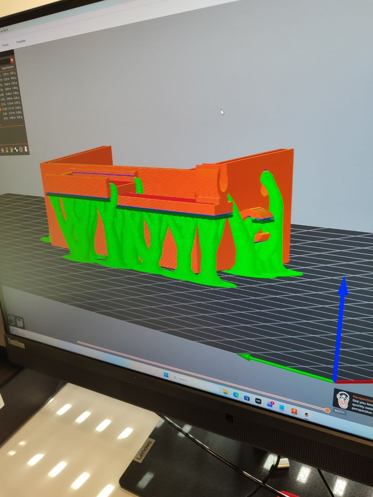

- `camera-mounts/src/xiao-square-mount-v2.f3d`, `camera-mounts/stl/xiao-square-mount-v2.stl`, `camera-mounts/3mf/xiao-square-mount-v2.3mf` (PrusaSliceri projekt: CORE One HF0.4, 0.20mm SPEED, Prusament PLA, orgaanilised toed alusplaadilt, tagurpidi; 49 min, 16,2 g) - **kasutusel olev kinnitus.** Võrreldes v1-ga: (1) eemaldatud sillaga kaabliklamber USB-C pesa juures — USB-C pistik ei mahtunud silla alla; tõmbetõkkeks jääb teine klamber +Y seinal; (2) lisatud kaamerapesa objektiivi jaoks: seinad hoiavad kaameramoodulit, objektiivi aken Ø6,5 mm, kaamera lukustab 1,75 mm PLA-filamendist tihvt (ava Ø1,85). Prinditud, paigaldatud robotile ja töötab.

  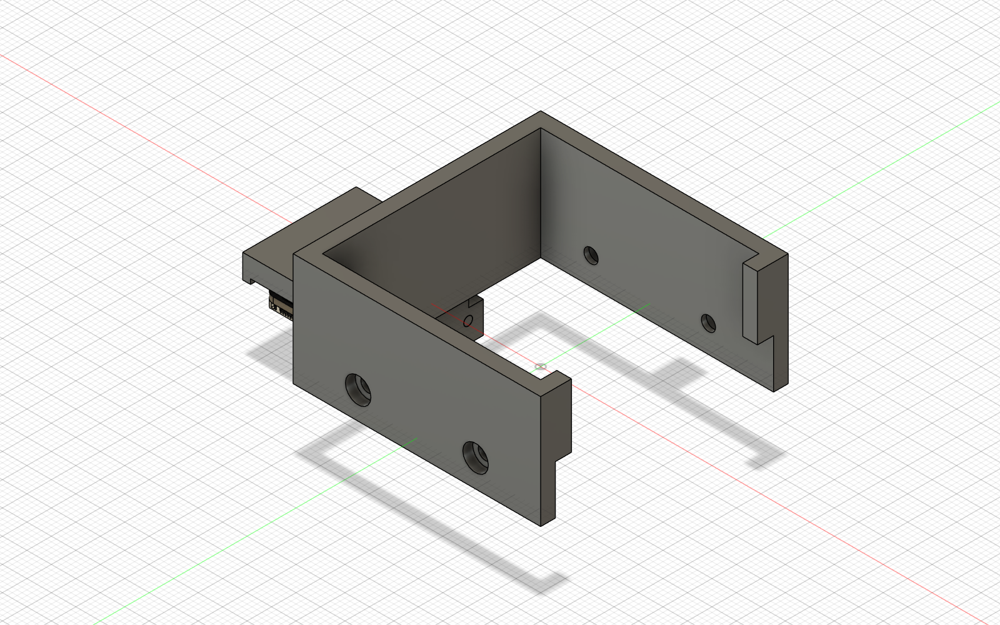

  

- `gridfinity-calibration/src/gridfinity-calibration.f3d`, `gridfinity-calibration/stl/gridfinity-calibration.stl`, `gridfinity-calibration/3mf/gridfinity-calibration.3mf` - 1 × 1 kalibreerimiskast: välismõõt 41,5 × 41,5 mm, kõrgus 21 mm, **standardne Gridfinity jalg** (generaatori `BASE_PROFILE`, `gf_fit_adjust = 0`), sisetasku 37 × 37 mm nelja sisenurga meetodiks, põhjas keskrist 1 × 35 mm, 0,6 mm sügav. Print: Prusa CORE One HF0.4, `0.20mm SPEED`, Prusament PLA, ilma tugedeta, 21 min, 11,2 g. Prinditud ja kontrollitud: istub ruudustikus, kasutusel roboti kalibreerimisel (ruut C−2).

  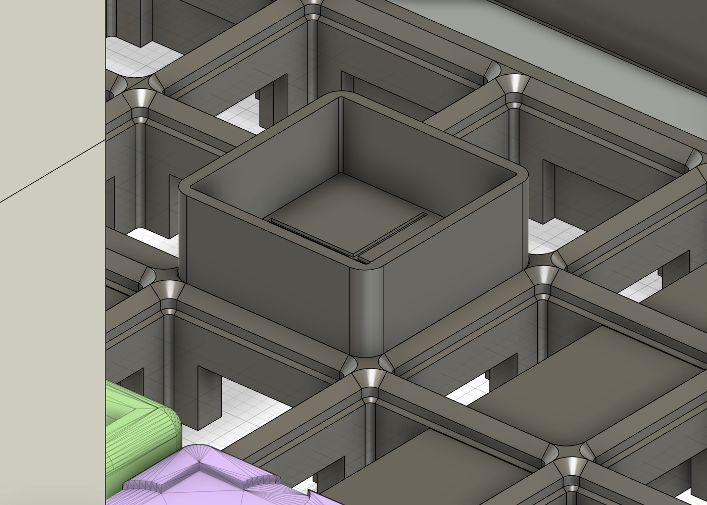

  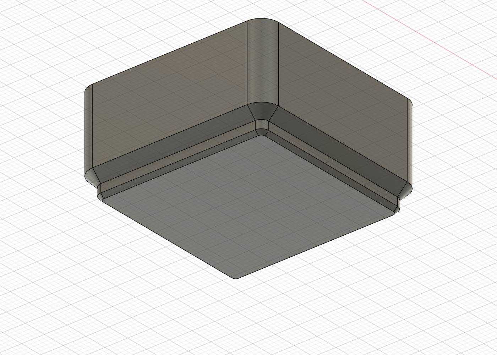
- `atoms3-input-holder/src/atoms3-input-holder-v1.f3d`, `atoms3-input-holder/stl/atoms3-input-holder-v1.stl`, `atoms3-input-holder/3mf/atoms3-input-holder-v1.3mf` - AtomS3 sisendhoidiku Fusioni fail ja ekspordid; mõõtude ning füüsilise sobivuse kinnitus: `TODO — waiting for physical test`.
- `ready-parts-input-holder/src/ready-parts-input-holder-v1.f3d`, `ready-parts-input-holder/stl/ready-parts-input-holder-v1.stl`, `ready-parts-input-holder/3mf/ready-parts-input-holder-v1.3mf` - ReadyParts sisendhoidiku Fusioni fail ja ekspordid; mõõtude ning füüsilise sobivuse kinnitus: `TODO — waiting for physical test`.
- `atoms3-input-holder/src|stl|3mf/atoms3-input-holder-v2.*` - AtomS3 sisendhoidik v2: standardne Gridfinity jalg (nagu klaasi hoidikul), välismõõt 83,5 mm, sõrmepilud; PrusaSlicer 53 min. Printimata. Kaksik kasutab seda.
- `ready-parts-input-holder/src|stl|3mf/ready-parts-input-holder-v2.*` - oranž töökoha hoidik v2: standardne Gridfinity jalg, 83,5 mm, sõrmepilud; PrusaSlicer 1 h 33 min. Prindib. Kaksik kasutab seda; pesa põhi on 3,06 mm madalam kui v1-l → töökoha Z tuleb pärast vahetust uuesti õpetada (kaksik: place −120,9 vs v1 õpetus −119,0).
- `glass-input-holder/src/glass-input-holder.f3d`, `glass-input-holder/stl/glass-input-holder.stl`, `glass-input-holder/3mf/glass-input-holder.3mf` - klaasi sisendhoidik 2 × 2: neli pesa 30,6 × 30,6 mm (30 mm klaas + 0,3 mm külje kohta), sügavus 1,5 mm, keskmed ±21 mm; välismõõt 83,5 × 83,5 mm (`42 × 2 − 0,5`); **standardne Gridfinity jalg** nagu kalibreerimiskastil (generaatori `BASE_PROFILE`, 4,75 mm). Kõrgus jalaga 10,25 mm. Print: Prusa CORE One HF0.4, `0.20mm SPEED`, Prusament PLA, jalad all, ilma tugedeta, 42 min, 28,2 g. Prinditud ja kontrollitud 25.10.26: istub ruudustikus täpselt.
- `valjundhoidik`: jalg 35,78 mm (R 1,5 mm, 0,5 mm faas all), v1 failid üle kirjutatud, printimata.

Need lähtefailid ei ole veel füüsiliselt sobivaks kinnitatud. Iga print vajab PrusaSlicerist eksporditud STL-i ja 3MF-i, uue versiooninime ning mõõtmistulemuste dokumenteerimist.

24.10.26 täpsustus eelnevale üldistusele: kasutaja kinnitas kolme sisendhoidikutüübi detailide käsitsi sobivuse; see ei kinnita kõiki lähtefailiversioone, pesade arvulisi mõõte ega Gridfinity jalgu. Vt [`mõõteregistri 24.10 täiendus`](docs/measurements.md).

Versioonis v2 on standardne nominaalgeomeetria ja printeri sobitusparandus eraldi: `fit_adjustment = 0 mm` tähendab muutmata nominaalprofiili; positiivne väärtus vähendab jala mõõtu selle võrra mõlemalt küljelt. See on esialgne katseparameeter, mitte mõõdetud lõtk. Enne jala korduskasutust teistes hoidikutes tuleb v2 päris laual printida ning mõõta täielikku istumist, loksu ja eemaldamisjõudu. OpenSCADi edukas kompileerimine ei tõesta füüsilist sobivust.

V2 nominaalprofiili allikas on [kennetek/gridfinity-rebuilt-openscad `src/core/standard.scad`](https://github.com/kennetek/gridfinity-rebuilt-openscad/blob/main/src/core/standard.scad) (MIT-litsents); sama profiil on kirjas ametlikus lauakirjelduses.

### Arenduspäevik

**KAARDISTA ISE — päevik.** Üks sissekanne iga töösessiooni kohta, kirjutatud
iseendale, nii et inimene, kes seal ei olnud, saab aru. Sissekandeid lisatakse,
mitte ei muudeta.

**PP.KK.AA — kes olid kohal**
* Tegime:
* Juhtus (numbrid):
* Otsustasime, ja miks:
* Lahti järgmiseks korraks:
* Failid: (valikuline lisainfo)

**04.10.26 — r4imps (Raimo) koos Claude'iga (Fusion MCP kaudu)**
- Tegime: vaatasime üle haaratsi `MG_400_gripper_attachment` ja muutsime seda kaalu ning kruvide järgi. Fusionis on iga samm eraldi versioonina (v1 = algne, v5 = tänane lõpp).
  - Plaat `8 → 5 mm` (`d1`); iminapa posti ülaosa lühendatud koos plaadiga.
  - Iminapa silindriline post (`Extrude3`) eemaldatud; napp kinnitub otse plaadi alla (`z 0`), mitte enam `z −20`.
  - Mõlemad kinnitused (keskmine flantsi boss ja iminapa koht) sama kruviga: **M3 × 6 sisekuuskantpeaga (DIN 912)**, ava `Ø3,4`, peapesa `Ø6,5`, pea all `2 mm` materjali → keermesse jääb ~`4 mm`.
  - Keskmise bossi kruvid käivad altpoolt: peapesa `Ø6,5` ulatub `z −6 → 12`, kahvli katuse nurkadesse tekkisid väikesed sisselõiked. Kontrollitud: kõigi nelja kruvi tee altpoolt on vaba. Vajalik ≥ 50 mm varrega 2,5 mm kuuskantkruvikeeraja.
  - Iminapa kruvipead ülalt, pesa `Ø6,5 × 3 mm` (pea on plaadiga tasa).
  - Materjal Fusionis Steel → PET (PLA-d Fusioni teegis pole); kaalu arvutame PLA tihedusega.
- Mõõtmised ja tulemused koos ühikutega: CAD-ist, mitte nihikuga. Maht `93,9 → 70,2 cm³`; täistäidisega PLA (1,24 g/cm³) ~`116 → 87 g`. Kahvli sõrmed `2,4 mm`, sisemine vahe `24,4 mm`, huulte vahe `21,2 mm`, sisekõrgus huultest katuseni `27,5 mm`. Kahvli otsad `z −36`, iminapa ots ~`z −63` (napp `63 mm`).
- Otsused ja põhjendused: M3, mitte M4 — Lab 1 kirjeldus ütleb `4 × M3 kruvi flantsi külge` ja M4 ei esine dokumentides kordagi. Sisekuuskant, sest kuuskantpea mutrivõti ei mahu kahvli tõttu ligi. Kahvlit ei muudetud (sõrmede paksus määrab klõpsu jõu).
- Mõte tulevikuks (Raimo): kui AtomS3R tulevikus kokku panna (aku, moodul ise ja lõpuks klaas peale liimida UV-valgusega), saab protsessi lahendada kahe tööriistaga ja seda haaratsit pole vaja, kui komplekt ehitada ülevalt alla, mitte alt üles (st alustada pealmisest kihist ehk klaasist, siis moodul, siis aku).
- Nõuded (Raimo sõnul, mõõtmata): napp `63 mm` kõrge; kahvel tõstab akumooduli ja seejärel AtomS3R-i `8 mm` sügavusest süvendist ja vajutab `28 mm` süvendisse, et pinnid kohale suruda.
- Failid ja versioonid: `gripper-attachment/src/mg400-gripper-attachment-v1.f3d`, `gripper-attachment/stl/mg400-gripper-attachment-v1.stl` (Fusioni v5). 3MF tegemata.
- Järgmiseks:
  - Otsustada, kas iminapa kruvid on nagu praegu (pea prindis, keere napa kinnituses) või paneme M3 kuumsisestused (koht = MG400 flantsi koopia, napa komplekti oma kruvid altpoolt).
  - Sügavuskonflikt: napp ulatub ~`27 mm` allapoole kui kahvli otsad — kahvliga töötades võib napp lauda/hoidikut puudutada. Kontrollida hoidikute mõõtudega või lühendada napi kinnitust.
  - Süstla klamber: Raimo vaatab hiljem üle.
  - Nihikuga üle mõõta: MG400 flantsi keere ja augu samm (`17 × 17 mm`?), napa kinnituse keere, AtomS3R-i ja aku mõõdud.

> Märkus: selles ajaloolises kirjes nimetatud AI oli kasutatud tööriist, mitte füüsiliselt kohal olnud meeskonnaliige. Algset päevikukirjet ei muudeta tagantjärele.

**04.10.26 — Dennel04 (Denys) koos Claude'iga (Fusion MCP kaudu)**
- Tegime: XIAO ESP32S3 Sense tööriistakaamera kinnitus MG400 J4 mootori nelikandile (robot Fusionis XREF-ina): U-klamber ümber nelikandi kaane, kaane M2,5 kruvide avad süvistustega, plaadi rennid ja otsapiire, kaabliklamber pistiku taga ja teine +Y seinal; kaabel läheb mööda seina roboti poole.
- Mõõtmised ja tulemused koos ühikutega: nihikuga mõõdetud ainult kaane kruvi: kogupikkus `6,3 mm`, pea `Ø4,62 mm`. Kõik muud mõõdud on CAD-ist (MG400 mudel: nelikant `44 × 44 mm`, kruvide samm `24 mm`) ja XIAO STEP-ist; neil on Fusionis parameetrid. Lõtk nelikandil `0,3 mm` külje kohta (Lab 1 vahemikust `0,2–0,4 mm`, kinnitamata). Interference robotiga ja XIAO-ga `0`. Print: Prusa CORE One HF0.4, `0.20mm SPEED`, Prusament PLA, orgaanilised toed ainult alusplaadilt, tagurpidi (klambri serv alusel); `45 min`, `15,6 g`. Füüsiline sobivus: `TODO — waiting for physical test`.
- Otsused ja põhjendused: õppejõud lubas suuliselt kõigile kaamera kinnitada ükskõik kuhu, mitte ainult iminapa tööriistahoidikule (04.10.26). Valisime J4 nelikandi: see ei pöörle J4-ga, nii et kaabel ei keerdu, ja olemasolev tööriistahoidik jääb muutmata. Teine klamber, mitte tõmbepael: kulumaterjali pole vaja ja kaabli saab ilma lõikamata välja.
- Failid ja versioonid: `camera-mounts/src/xiao-square-mount-v1.f3d`, `camera-mounts/stl/xiao-square-mount-v1.stl`, `camera-mounts/3mf/xiao-square-mount-v1.3mf` (PrusaSlicer projekt).
- Järgmiseks:
  - Prindil kontrollida: sobivus nelikandil, kas originaalkruvi ulatub läbi süvistuse põhja (`1 mm`) keermesse, plaat rennides, kaabel mõlemas klambris. Kruviavadesse kasvanud toed puhastada.
  - Kaameramoodul ripub oma lindikaablil ega ole fikseeritud. Kaamerapesa tuleb järgmisesse versiooni.
  - Mõõta iminapa otsa kõrgus nelikandi suhtes (kinnitus ei tohi ulatuda napa otsast allapoole) ja valida kaamera toide.

> Märkus: selles ajaloolises kirjes nimetatud AI oli kasutatud tööriist, mitte füüsiliselt kohal olnud meeskonnaliige. Algset päevikukirjet ei muudeta tagantjärele.

**23.10.26 — r4imps (Raimo)**
* Tegime: otsustasime haaratsi `MG_400_gripper_attachment` arenduse peatada.
* Juhtus (numbrid): uusi mõõtmisi ega printe ei tehtud. Haarats jääb Fusioni versiooni 5 seisu (`mg400-gripper-attachment-v1`), printimata, 3MF puudub.
* Otsustasime, ja miks: Lab 2-s pole süstalt ega UV-lampi vaja, seega kasutame olemasolevat iminappa ja haaratsit praegu edasi ei arenda. Jätkame haaratsi arendusega, kui selleks vajadus tekib (nt Lab 3 tööriist: napp, süstal, UV-lamp). 04.10.26 lahtised küsimused (kruvid vs kuumsisestused, napa ja kahvli sügavuskonflikt, süstla klamber, flantsi mõõtmine) jäävad seniks lahti.
* Lahti järgmiseks korraks: Lab 2 hoidikud ja töökoht kavandada olemasoleva iminapa järgi; iminapa tööriistahoidiku mõõdud failis `docs/measurements.md`.
* Failid: `README.md`, `docs/bom.md` (M3 × 6 kruvide rida ootel).

**23.10.26 — Dennel04 (Denys) koos Claude'iga**
* Tegime: XIAO ESP32S3 Sense pandi prinditud kinnitusse roboti küljes. Tehasepüsivara (Seeed demo, ootas WiFi-t, kaamerat ei kasutanud) asendati omaga: `tool-camera/firmware/` saadab käsu `c` peale ühe JPEG-kaadri USB kaudu, `tool-camera/capture.py` salvestab selle.
* Juhtus (numbrid): kaamera vastab `INFO camera=ok pid=0x3660 psram=8386199`; kaader 1600 × 1200, ~80–88 kB. Esimene kaader liikumise ajal oli udune, paigal olles terav.
* Otsustasime, ja miks: pilt USB kaudu, mitte WiFi kaudu, sest labori arvutil on ainult Ethernet. USB roboti küljes andis ainult toidet, pilti arvuti ei näe — seepärast kaabel arvutisse.
* Lahti järgmiseks korraks: kaader töökohast koos klaasi ja Atomiga; napa laskumine hoidikusse kinnitusega; kaabli marsruut ja J4 pööre; tööriista kaal; lõplik toite valik `docs/measurements.md` tabelisse.
* Failid: `tool-camera/firmware/`, `tool-camera/capture.py`, `docs/photos/tool-camera-first-frame.jpg`, `README.md`.

**23.10.26 õhtu — Dennel04 (Denys) koos Claude'iga — kalibreerimine**
* Tegime: alustasime nelja sisenurga kalibreerimist musta 1 × 1 kastiga. Robotit juhiti `mg400-base` serveri kaudu (2 % kiirus, 0,5 mm sammud, abiskript `calibration/jog.py`) ja osaliselt DobotStudio Pro-st.
* Juhtus (numbrid): B-2-s jõuab käsi ainult Z ≈ −98-ni (J3 105° piir), seega G-1. Kinnitatud nurgad: Xmax+Ymin 404,47 / 18,80, Xmax+Ymax 403,98 / 34,34, Xmin+Ymax 389,47 / 33,80 (Z −150,85). Xmin+Ymin 389,50 / 18,77 kinnitamata. Napi efektiivne läbimõõt ≈ 22 mm. Eeldatav keskpunkt ≈ 396,85 / 26,43, nihe mudelist ≈ +5,3 / +5,4 mm.
* Probleemid: DobotStudio Pro JOG-režiim võtab roboti üle ja sulgeb serveri TCP ühenduse (vaja lülitada TCP/IP režiimi). Pehme napp kaldub seina vastu — puudutust hinnatakse silmaga, kalle = liiga kaugel.
* Lahti järgmiseks korraks: kinnitada Xmin+Ymin nurk; korrata Xmin+Ymax Z −155,84 peal; arvutada keskpunkt ja pööre; kontrollruut lähemal (nt C+2); kast välja/tagasi ja kordus (kordustäpsus).
* Failid: `docs/calibration_g-1_corners.csv`, `docs/measurements.md`, `calibration/jog.py`.

**23.10.2026 — dokumentatsiooni ülekanne; mõõteallikas Maksim Naprejev**
* Osalejad: kasutaja edastas Maksimi Exceli ja meeskonna kinnituse; dokumentatsiooni töötles Codex. Füüsiliselt kohal olnud inimeste nimekiri ja mõõtmise kuupäev pole teada.
* Tegime: lugesime `Measurements.xlsx` lehe `Measurements`, eristasime `measured`, `nominal`, `confirmed`, `planned` ja TODO ning lisasime lahtriviited. Kontrollisime `main` viimaseid meeskonnakommite (lähtepunkt `acd3d5c`, sh `9e68690`, `175b000`, `95610fc`) ja Lab 2 STL-geomeetriat.
* Probleem ja parandus: klaasi varasem 24 × 24 × 2 mm on meie detaili kohta vale; õige on 30 × 30 × 2 mm (`confirmed`). Vanad kirjed ja ametlik ülesanne säilivad. AtomS3 24 × 24 × 12,9 mm on `nominal`; aku 24,04 × 24,01 × 21,97 mm ja XIAO põhiplaat 17,74 × 21,33 × 1,21 mm on `measured`; Atom USB-C keskjoon 11,4 mm valitud servast on `measured`, lähteserv tuvastamata.
* Parameetrid ja oodatav tulemus: klaasipesa sirgseinte vahe STL-is 30,6 mm annab 30 mm klaasile arvutuslikult 0,3 mm külgvaru. Väljundi sirgseinte vahe 78,2 mm lubab kavandada neli 30 mm klaasi 2 × 2, kuid vajab määratud sihtpunkte, pöörde ja ümardatud nurkade kontrolli. Üksikasjad `docs/cad-measurement-review.md`.
* Tegelik tulemus: dokumentatsioon täiendatud; uusi füüsilisi mõõtmisi, printe ega robotikatseid selles sessioonis ei tehtud. Sobivus, vaakumhaare ja trajektoor: TODO — waiting for physical test.
* Otsused ja põhjused: geomeetriat automaatselt ei muudetud, sest olemasolevad klaasipesad ei ole STL-i järgi 24 mm pesad. Exceli originaali ei avaldatud sisemist võrguteed sisaldavate metaandmete tõttu; kohalik originaal jäi muutmata ja SHA-256 on mõõteregistris.
* Failid: `README.md`, `docs/measurements.md`, `docs/layout.md`, `docs/cad-measurement-review.md`, `docs/test-procedure.md`.
* Järgmiseks: tuvastada USB-C lähteserv, mõõta klaaside hajuvus ning prinditud pesad, kontrollida Fusionis sobivust ja kõiki nelja võtu/asetuse punkti. Lõpetada G-1 kalibreerimine ja kontrollruut enne uue trajektoori kasutamist; säilitada iga füüsilise iteratsiooni eraldi CAD/STL/3MF.

**23.10.2026 — kaamerate ja Smart Solutionsi dokumentatsiooni sünkroonimine**
* Osalejad: kasutaja kinnitas arhitektuuri; dokumentatsiooni töötles Codex. Füüsilist sessiooni ei toimunud ja meeskonnaliikmete kohalolekut ei kinnitata.
* Tegime: kontrollisime ajakohast ametlikku ülesannet ja `main` seisu `a47896d`; parandasime esimese kaitsmise kuupäeva 29.10.2026 ning ülesandekoopia suhtelised lingid. Täpsustasime tegelikke Lab 2 kaustu, kaamerate ühendusi ja komponentide olemasolu.
* Probleem ja lahendus: kohalikus ülesandes oli 27.10.26; README nimetas koopiat muutmata originaaliks. Nüüd on tehnilised parandused ja allikas selgelt kirjas. USB-kaamera tõend eristatakse Wi-Fi HTTP lõppvariandi valikust.
* Parameetrid ja tõend: varasema USB-katse COM5, OV3660 ja 1600 × 1200 px JPEG ning olemasolev foto jäid alles. Uusi mõõtmisi, massi, kaablikoguseid, tellimusi ega katsetulemusi ei lisatud.
* Otsused ja oodatav tulemus: XIAO lõppvariant kasutab Smart Solutionsi eraldi Wi-Fi HTTP püsivara; USB lähtekood jääb diagnostikaks. Verbatim AWC-03 ühendub USB kaudu station PC-ga, MG400 käsud liiguvad Ethernetis, Atom kasutab USB Serialit ja Wi-Fi-t.
* Tegelik tulemus: ainult dokumentatsioon uuendatud; Wi-Fi, toite, kaablite, MG400 täieliku liikumisvahemiku ja töökoha kaadri füüsiline kontroll: TODO — waiting for physical test.
* Failid: `../../AGENTS.md`, `assignment-EST.md`, `README.md`, `docs/test-procedure.md`, `docs/bom.md`.
* Järgmiseks: kontrollida valitud Wi-Fi püsivara tegelikul seadmel ja station PC võrgus, seejärel toide, kaablimarsruut, liikumisvahemik ja kogu 30 × 30 mm klaasi nähtavus. Ohutusreeglid ja ajaloolised päevikukirjed säilivad.

**24.10.2026 — roboti kalibreerimine ruudustiku järgi (G-1 + E+3)**
* Osalejad: kasutaja (Denys) robotiga laboris; Claude MG400 serveri (`mg400-base`) ja arvutuste kaudu.
* Tegime: alguses andis robot vea `Joint4 exceeds positive limit` — J4 loendur oli 814,9° (kaabel keerdus ei olnud). J4 keerati DobotStudio Pro Jog-režiimis tagasi 26,4°-ni. Seejärel võeti G-1 ja E+3 kummaski kaks vastasnurka (diagonaal) ja arvutati keskpunktid.
* Probleem ja lahendus: ainult nihkega (G-1 järgi) läks E+3 mööda +4,0 / −2,7 mm. Põhjus: ruudustik on roboti telgede suhtes pööratud **+1,82°**. Kahe ruudu järgi arvutati nihe + pööre; telgede suund (mudel pööratud 180° ümber Z) ja 42 mm samm kinnitusid (G-1 → E+3 151,54 mm, mudelis 151,43 mm).
* Parameetrid ja tõend: G-1 keskpunkt 420,50 / 27,55; E+3 340,50 / −101,15; R ≈ 33 (napp ei ole J4 teljel, X/Y sõltub R-ist). Kontroll Z −53: E+2 339,19 / −59,12 ja E+4 341,86 / −143,08 — kasutaja hinnangul keskel. Toorandmed `docs/calibration_g-1_corners.csv`, arvutus `docs/measurements.md`.
* Tööriistakaamera kaadrid (USB, COM5): [`tool-camera-2026-10-24.jpg`](docs/photos/tool-camera-2026-10-24.jpg) ja G-1 kohal Z −80 [`tool-camera-2026-10-24-g1.jpg`](docs/photos/tool-camera-2026-10-24-g1.jpg). Töökoha kaader Atomi ja klaasiga: TODO — waiting for physical test.
* Järgmiseks: Z puudutus ruudustiku pinnal; kasti välja/tagasi kordustäpsus; iga pesa Z = ruudustiku Z + pesa põhja kõrgus CAD-ist + detaili paksus (kontroll üks puudutus hoidikutüübi kohta); `layout.md` ruudud ja sihtpunktid kujul ruut + nihe.

**24.10.2026 — XIAO kaamerakinnitus v2**
* Osalejad: Denys vaatas mudeli Fusionis üle, muudatused tegi Claude Fusioni API kaudu, prindi tegi Nikita.
* Muudatused v1-ga võrreldes: eemaldatud sillaga kaabliklamber (USB-C pistik ei mahtunud silla alla); lisatud kaamerapesa objektiivi aknaga ja 1,75 mm filamenditihvt, mis hoiab kaamera paigal. Kontroll Fusionis: interferents XIAO-ga 0, plaat libiseb rennis vabalt.
* Tulemus: prinditud, paigaldatud robotile, kaamera annab pilti; kasutusel.
* Failid: `camera-mounts/src|stl|3mf/xiao-square-mount-v2.*`, `docs/photos/xiao-square-mount-v2-fusion.png`, `docs/photos/xiao-square-mount-v2-slicer.png`.

**24.10.2026 — töökoha digitaalne kaksik (`3d-print/sim/`, ühine kõigile laboritele)**
* Osalejad: Denys soovis realistlikku simulatsiooni, et päris robotiga vigu mitte teha; ehitas Claude. Füüsilist katset ei tehtud.
* Tegime: Dobot ametlik MG400 URDF (MIT) + meie `mg400-base` sobitatud liigesemudel ja piirid + rakis, hoidikud `layout.json` järgi, veebikaamera post, XIAO kinnitus, iminapp; täpsed kokkupõrked `python-fcl`-iga. Kaksik kasutab sama `cycle.py` ja `cells.py` mis robot.
* Kontroll päris andmetega: G-1 liigesepiir −135,8 vs päris −138; B-2 J3 piir −99 vs −98; lahtrikeskmed vs `cells.py` ≤ 0,06 mm; napa pikkus 66,2 mm D-2 puudutusest, 23.10 G-1 nurgad sobivad. Kontrollijat testiti teadlikult vigaste tsüklitega (8 juhtumit, kõik leitud).
* Tulemused: B-2 ei sobi kalibreerimiseks (napp ei mahu kalibreerimiskasti) → C-2; klaasitsükkel kokkupõrgeteta; väljund talub ainult 3 mm kalibreerimisviga. Üksikasjad ja piirid: [`../sim/README.md`](../sim/README.md). Kaksik viidi samal päeval labori kaustast välja `3d-print/sim/`-i (Denys: see on kõigi laborite jaoks); Lab 2 tulemused jäävad `docs/`-i.
* TODO — waiting for physical test: napa läbimõõt, nihe J4 teljest ja pikkus nihikuga; kalibreerimine C-2-s.

**24.10.2026 õhtu — kalibreerimiskast päris robotiga, ruut C-2**
* Osalejad: Denys laboris (paigaldas kasti, hindas puudutusi), Claude juhtis robotit (2 %, 0,5 mm sammud).
* Kalibreerimiskast (rist põhjas, standardne jalg) istub ruudustikus hästi. Z puudutus põhjal −155,0 (kaksik −154,8). Neli sisenurka → keskpunkt 253,81 / 68,46, `cells.py` viga +0,12 / +2,00 mm; mõõdetud keskpunktis on napp risti kohal. Napa efektiivne läbimõõt ≈ 23 mm. Andmed: [`docs/calibration_c-2.csv`](docs/calibration_c-2.csv), [`docs/measurements.md`](docs/measurements.md).
* Kaksiku `dry_run.py` kontrollib nüüd `layout.json`-i nii, nagu robot seda praegu käivitaks (ülekandetest), ja `--full` planeeritud täistsüklit; kokkupõrkeid pole kummaski.
* Lahtine: kas `cells.py` sobitada uuesti C-2-ga (Y +2 mm kordub ka D-4 õpetuses); kasti välja/tagasi kordustäpsus jäi mõõtmata.

**24.10.2026 hilisõhtu — paigutus (layout.md) ja slot pickeri täiendused**
* Osalejad: Denys laboris (valis variandi, seadis C−2, D−4, D−5 keskpunktid, tegi klaasi ülekande), Claude (kaksik, slot picker, dokumendid). Raimo slot pickerit muutis Claude Denysi palvel (Raimot veel ei teavitatud).
* Paigutus: kaksikus võrreldi variante; valiti B — töökoht oranžis C±1 (214–256 mm J1-st), praak B±1, klaas D/E −4/−5 (paigas), AtomS3 E/F −1/−2, väljund D/E +4/+5, kalibreerimiskast F+2. Täistsükkel 4 klaasiga 0 kokkupõrget, ükski tee ei lähe üle kolmanda hoidiku. Väljundi kalibreerimisvea varu ainult 2–5 mm → ettepanek väljundi kohad kasti keskele lähemale (Raimoga kokku leppida).
* Slot picker: kiiruse valik lehel; liikumiskõrgus −90, hover kuni −110; käeulatuse ja tee kontroll enne liikumist; Test → **Move one glass** (From/To lahter, pick Z, place Z). Klaasi ülekanne õnnestus pick Z −152-ga (Denys).
* Kalibreerimine: C−2 kalibreerimiskast (Denys keskele 253,94 / 68,30) lisatud `cells.py` sobitusse; klaasi sisendi nihe D−4/D−5 keskpunktidest (dx −2,00, dy +2,50).
* Järgmiseks: hoidikud uutesse ruutudesse, töökoha ja väljundi punktide õpetamine, 5 ringi × 4 klaasi → `docs/refit_test.csv`.

**24.10.2026 — eraldi iminapa nihikumõõdud ja sisendhoidikute käsitsi sobivuskontroll**
* Osalejad ja allikas: kasutaja mõõtis ja kontrollis füüsilisi detaile ning edastas tulemused; teisi kohalolijaid ei täpsustatud. Dokumentatsiooni täiendas Codex, uusi füüsilisi katseid ise tegemata.
* Tegime: lisasime eraldi kummist iminapa D41 välisläbimõõdu ja H1 kõrguse, tööriista esialgse massihinnangu ning aku-, AtomS3- ja klaasisisendi sobivuskontrolli. Enne muudatusi sünkroonisime puhta töökoopia `pull --ff-only` abil seisule `36d6bc5` ja lugesime meeskonna uusi kalibreerimis- ning katsekirjeid; neid ei muudetud.
* Mõõtmised ja parameetrid: D41 **22,25 mm**, H1 **13,80 mm**, mõlemad `measured`, nihik, 24.10.2026. Mõõdeti eraldi kummist iminappa; samasus robotil paigaldatud eksemplariga pole dokumentaalselt kinnitatud. H1 on lisamõõt, mitte Lab 2 eraldi nõue ega kogu tööriista kõrgus. Komponentide senised mõõdud ja olekud säilivad mõõteregistris.
* Probleem ja piirang: laboris pole kaalu. Enne kaamerat pakutud **umbes 80 g (?)**, orientiir **60–110 g**, on `estimated, not measured`: visuaalne insenerihinnang eeldusel, et korpus on valdavalt alumiiniumist. See pole kaalumine ega teise DOBOT haaratsi mass ning ei sulge massikontrolli.
* Tegelik tulemus: kasutaja kinnitas `ready-parts-input-holder`, `atoms3-input-holder` ja `glass-input-holder` puhul, et detailid sisenevad, jõuavad põhjani, liiguvad lõtku piires vabalt, tulevad sõrmedega välja ega kiilunud. Prinditud pesade täpseid nihikumõõte, kõigi 12 pesa eraldi mõõtmist ega klaasihoidiku prindiversiooni ei kinnitatud. Olemasolevaid STL-e analüüsiti digitaalselt; F3D puhul kontrolliti arhiivikirjeid, Fusioni parameetreid ei kinnitatud. CAD-arvud ei ole füüsilised pesamõõdud.
* Otsus ja oodatav tulemus: säilitame mõõtmiste, hinnangu ja kvalitatiivse sobivuse eristuse, et olemasolev tulemus oleks kasutatav ilma ülejäänud laborit lõpetatuks märkimata. CAD-i, STL-i, 3MF-i, programme, kalibreerimist ega fotosid ei muudetud.
* Järgmiseks: enne kaitsmist 29.10.2026 tegelik kaalumine enne/pärast kaamerat; puuduvad prinditud pesade mõõdud ja arvuline lõtk (mm); hoidikute välja/tagasi kordustäpsus ning viis ringi nelja klaasiga koos tulemustabeliga. Kaamerate, toite ja kogu liikumisvahemiku veel kinnitamata katsed jäävad avatuks. Nende füüsiliste tulemuste olek: TODO — waiting for physical test. Varasem C−2 kontroll ja ühe klaasi õnnestunud ülekanne säilivad oma piiratud katseulatuses.
* Failid: `README.md`, `docs/measurements.md`, `docs/cad-measurement-review.md`.

**24.10.2026 ~19:00–19:16 — töökoht ja väljund õpetatud, esimene täistsükkel**
* Osalejad: Denys laboris (tõstis hoidikud paigutuse B järgi, seadis puudutused), Claude (robot 5 %, kaamera, slot picker).
* Õpetatud: töökoht C+1 (aku + AtomS3 + klaas) nihe 0 / 0, Z −119,0; väljund D+4 nihe 0 / 0, Z −153,0; klaasi sisend `pick_z` −152 (Denys). Kõik kolm on kaksikust 1,5–4,9 mm madalamal (kaksiku parandus TODO).
* Esimene katse 19:09: Denys vajutas avariinuppu, sest ootas klaasi võtmist D+4-st, robot läks sisendisse D−4 (tsükli suund polnud talle enne starti selgelt öeldud). Kahju pole.
* 19:15 täistsükkel 10 %: D−4 → C+1 Atomi peale → D+4, 59 s, vigadeta; Denys kinnitas silmaga. `docs/refit_test.csv` ring 1, klaas 1 = 4 × yes. Väljundi kaader [`photos/cycle-r1-g1-output-2026-10-24.jpg`](docs/photos/cycle-r1-g1-output-2026-10-24.jpg); töökoha kaader kadus (COM5 short read).
* Järgmiseks: klaasid 2–4 (D−5, E−4, E−5 → D+5, E+4, E+5), siis hoidikud välja/tagasi ja ringid 2–5.

**24.10.2026 ~19:20 — ring 1 lõpetatud: 4 / 4**
* Klaasid 2–4 ühe käivitusega (217 s, 10 %): D−5 → D+5, E−4 → E+4, E−5 → E+5, igaüks läbi töökoha C+1 (AtomS3 aku peal). Vigu ega peatusi polnud; Denys: kõik klaasid jõudsid kohale (sinised klaasid, et pildil näha).
* `docs/refit_test.csv` ring 1: 4 × 4 yes. Töökoha ja väljundi kaadrid igast klaasist: [`docs/photos/cycle-r1-*.jpg`](docs/photos/).
* Samad õpetatud punktid töötasid ka pesades, mida eraldi ei õpetatud (D−5 ja E-rida sisendis, D+5 ja E-rida väljundis).
* Järgmiseks: kõik hoidikud ruudustikust välja ja tagasi, ringid 2–5 (`refit_test.csv`), 42 mm teise ruudu küsimus; kaksiku kõrguste parandus; COM5 short read (tööriistakaamera kaader kaob mõnikord).

**24.10.2026 — füüsilise laboritöö fotode lisamine**
* Osalejad ja allikas: kasutaja edastas 24.10.2026 laboritöö fotod; fotograafi ja teiste kohalolijate nimesid ei täpsustatud. Codex kontrollis faile ja täiendas dokumentatsiooni.
* Tegime: avasime kaheksa JPEG-fotot ning kopeerisime need kasutaja lahtipakitud kaustast repo `docs/photos/` kausta. README-sse lisasime eestikeelsed pildiallkirjad, põhiliseks üldfotoks `gridfinity-workspace-overview-ruler-2026-10-24.jpg` ja tööriista lähivaateks `mg400-tool-mount-side-2026-10-24.jpg`.
* Tegelik tulemus: dokumenteeritud on reaalselt prinditud hoidikud, AtomS3 valges ja oranžis hoidikus koos joonlauaga, Gridfinity üldvaade, tegelikult paigaldatud oranž XIAO kinnitus, MG400 vaakumtööriist, kaabel ja voolik ning iminapa paiknemine oranži konteineri ja läbipaistva plaadi kohal. Fotod on asendi ja olemasolu tõendid; edukat automaatset klaasi ülekannet neist ei järeldata.
* Piirangud ja parameetrid: uusi mõõtmisi ega robotikatseid ei tehtud; fotodel olevast joonlauast pesamõõte ei arvutatud. `measured`, `estimated`, `CAD dimensions` ja `physical fit confirmed` jäävad eraldi; tööriista umbes 80 g (?) hinnang ei muutunud kaalumistulemuseks. Fotode paigutust ei nimetata lõplikuks kinnitatud konfiguratsiooniks.
* Otsus ja oodatav tulemus: seostame fotod nähtavate Lab 2 osadega, et füüsilised prindid ja tööriista paigaldus oleksid kontrollitavad. Varasemaid fotosid ei kirjutatud üle ega päevikukirjeid muudetud. Meeskonna uus ringi 1 tulemus (`c72bfb1`, 4 / 4) säilitati eraldi katsetõendina.
* Failid: `README.md`; `docs/photos/mg400-tool-mount-front-2026-10-24.jpg`, `mg400-tool-mount-side-2026-10-24.jpg`, `atoms3-white-holder-fit-2026-10-24.jpg`, `atoms3-orange-holder-fit-2026-10-24.jpg`, `white-holders-gridfinity-ruler-2026-10-24.jpg`, `orange-single-bin-gridfinity-ruler-2026-10-24.jpg`, `gridfinity-workspace-overview-ruler-2026-10-24.jpg`, `output-holder-suction-cup-ruler-2026-10-24.jpg` (kõik `docs/photos/` kaustas).
* Järgmiseks: puuduvad pesade arvulised mõõdud, tööriista tegelik kaalumine enne/pärast kaamerat, kaamerate ja kaablite täielikud katsed, hoidikute välja/tagasi kordustäpsus ning ringid 2–5; tulemused on TODO — waiting for physical test. Käesolevas sessioonis CAD-i, programme ega roboti konfiguratsiooni ei muudetud ja MG400 ei käivitatud.

**25.10.2026 — Dennel04 (Denys) koos Claude'iga: klaasi sisendhoidik standardse Gridfinity jalaga**
* Tegime: klaasi sisendhoidik `glass-input-holder` (2 × 2, neli pesa 30,6 × 30,6 mm) standardse Gridfinity jalaga samast skriptist mis kalibreerimiskastil (`fusion-tutor/shared/tools/fusion-geometry/gf_std_foot.py`), välismõõt 83,5 × 83,5 mm; prinditud (42 min, 28,2 g, ilma tugedeta).
* Tulemus: hoidik istub ruudustikus täpselt (Denys, 25.10).
* Failid: `glass-input-holder/src|stl|3mf/glass-input-holder.*`.
* Järgmiseks: kontrollida klaasi sisendi õpetatud punkti (pick −152) ruutudes D/E −4/−5.

**25.10.2026 — veebikaamera post: üks versioon, nurk prinditud**
* Denys printis nurga (`veebikaamera-post-v1-nurk`), istub rakise torul hästi. Varasemad Gridfinity-jalaga posti kavandid eemaldati laborist; alles jääb ainult toruotsa lahendus (nurk + ülemine), mida kasutame. Post ei võta enam ruudustikus ruute (F/G −4 … −5 vabad).
* Järgmiseks: ülemine osa printida, toru 458 mm, kaamera kõrgus ja kaader kogu laua ning robotiga.

**25.10.2026 — Dennel04 (Denys) koos Claude'iga: veebikaamera postil, pilt hubis**
* Denys printis ülemise osa, lõikas toru, pani kaamera postile ja ühendas arvutiga. Kaader (3840×2160) näitab ülevalt kogu ruudustikku, hoidikuid ja robotit: `docs/photos/veebikaamera-kaader-2026-10-25.jpg`.
* MG400 Station Hubi 3D-ala kõrval on vaade **Webcam**: veebikaamera pilt otse brauseris, **Save frame** salvestab täisresolutsiooniga kaadri kausta `lab2/webcam-frames/` (gitis ei ole; dokumentatsiooni jaoks kopeerida `docs/photos/`).
* Lahtine: pildi värin roboti täiskiirusel, kaamera maha-tagasi sama kaader, käe suurim kõrgus kaamera all, kaabel mööda toru.

**25.10.2026 — Dennel04 (Denys) koos Claude'iga: kaksikus päris komponendimudelid**
* Tegime: kaksikus (`3d-print/sim`) on töökoha aku ja AtomS3 kastide asemel M5Stacki mudelid (`3d-print/models/`) ning XIAO kinnituses Seeedi XIAO ESP32S3 Sense mudel samas kohas kui `xiao-square-mount-v2.f3d`-s. Kaamera osaleb kokkupõrkekontrollis ja 3D-vaates.
* Tulemus: CAD-virn (aku 18,0 + Atom 12,9 mm) on 3,97 mm madalam kui mõõdetud aku 21,97 mm-ga. Nüüd on kõik kolm õpetatud punkti kaksiku esimesest puudutusest sama palju madalamal: sisend 1,2, töökoht 1,2, väljund 0,7 mm (enne töökoht 5,1). Kokkupõrkeid pole (`docs/sim_dry_run*.txt`).
* Lahtine: aku kõrgus nihikuga ilma Atomita (21,97 vs mudel 18,0); kaksikus jääb klaas töökohal oranži hoidiku servale, mitte Atomi ekraanile (oli ka enne, päris robotil töötab) — oranži hoidiku pesa kontroll.

**25.10.2026 — kaksikus uued hoidikud**
* Kaksik (`3d-print/sim`) kasutab nüüd AtomS3 hoidikut v2 ja töökoha hoidikut v2 (standardne jalg); klaasi hoidik oli juba uus. Kõik kolm istuvad ruudustikul samal kõrgusel (põhi z 2,53). Kokkupõrkeid pole; klaas jääb töökohal nüüd Atomi ekraanile (v1-ga jäi hoidiku servale).
* Pärast v2 töökoha paigaldamist: õpetada töökoha Z uuesti (kaksiku järgi ~3 mm madalam kui praegune −119,0).

**25.10.2026 — kaksikus laud ja ruudustiku asukoht nagu päris rakisel**
* Laud Treston 700 mm (CAD-i laud): algab roboti taga tagumiste L-ide all, torud ulatuvad ette ~50 mm üle esiserva, veebikaamera post toru otsas.
* Robot istub kaksikus nüüd oma pesa keskel, napp flantsi keskel. Kalibreerimise 31 mm nihe on ruudustiku asukoht torudel: ruudustik on CAD-ist 31,2 mm robotist eemal → pesa ja ruudustiku vahel ~30 mm paljast toru, nagu Denys laual näeb. Varem joonistati see nihe napa nihkeks ja robot oli pesas paigast ära. Kaksiku lahtrid = `cells.py`, kokkupõrkeid pole, kõrgused muutumata.

### Väljundid ja tulemused

**Väljundid**
* Gridfinity hoidikute kandidaadid ja töölaua paigutusdokumendid; lõplikud
  hoidikud ning ruudukohad on TODO — real measurement and physical fit test
  required.
* XIAO tööriistakaamera kinnituse CAD-kandidaat on olemas; selle füüsiline
  sobivus ja USB üldvaatekaamera lõplik kinnitus on TODO — waiting for physical
  test.
* Hoidikute eemaldamise/tagasipaneku sobivus ja kordustäpsus: TODO — real
  measurement required.
* Smart Solutions Lab 2/3 saab siit pärast füüsilisi katseid kontrollitud
  hoidikukohad, roboti sihtpunktid ja kaamerate kinnitusgeomeetria: TODO — real
  measurement required.

**KAARDISTA ISE, lõpus.**
* Git repo ja tag: TODO — lisada alles esitamisel.
* Numbrid, mille see labor andis, ühikutega: TODO — real measurement required;
  CAD-i nominaale ei esitata füüsilise kordustäpsuse tulemusena.
* Mida me teeksime teisiti: TODO — complete after physical fit and refit tests.
* Mida järgmine labor peaks enne alustamist teadma: TODO — complete after the
  holders, camera mounts and robot target points are physically verified.
