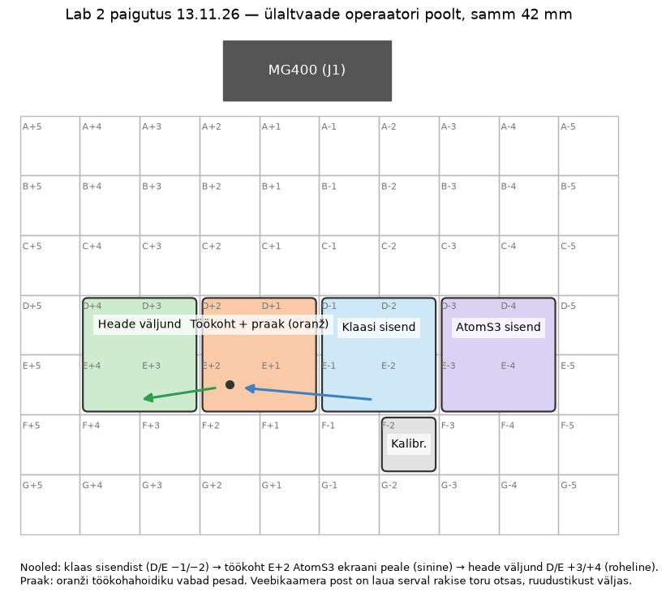

# Töövoog ja paigutus

Paigutus 13.11.2026: ruudustik on lükatud roboti platvormi (pesa) vastu, kalibreerimine F-2 + C+4 ([`measurements.md`](measurements.md)). Masinloetav sama paigutus: [`../slot-picker/layout.json`](../slot-picker/layout.json).

Ülaltvaade operaatori poolt (robot üleval, rida A roboti juures):

| | +5 | +4 | +3 | +2 | +1 | −1 | −2 | −3 | −4 | −5 |
|---|---|---|---|---|---|---|---|---|---|---|
| **A** | | | | | | | | | | |
| **B** | | | | | | | | | | |
| **C** | | | | | | | | | | |
| **D** | | väljund | väljund | oranž | oranž | klaas | klaas | Atom | Atom | |
| **E** | | väljund | väljund | töökoht | oranž | klaas | klaas | Atom | Atom | |
| **F** | | | | | | | kalibr. | | | |
| **G** | | | | | | | | | | |

## Protsess (sildi kokkupanek)

1. Inimene laeb akumooduli oranži hoidiku töökohapessa (E+2), AtomS3-d AtomS3 sisendisse ja klaasid klaasi sisendisse (igas sisendis 4 tk).
2. Robot: AtomS3 sisendist → akumooduli peale töökohas. Akumooduli pesas on tihvtid, mis lähevad AtomS3 aku pistikusse, seega saab AtomS3 seal olla ainult ühte moodi.
3. Robot: klaas klaasi sisendist → AtomS3 ekraani peale (klaasil eraldi pesa ei ole).
4. Robot: valmis detail → heade väljund; ebaõnnestunud → praak (oranži hoidiku vabad pesad).

Selle labori test teeb ainult klaasi tee: sisend → töökoht E+2 (päris AtomS3 aku peal) → heade väljund. Tulemus: [`refit_test.csv`](refit_test.csv).

- **Töökohti üks:** kõik sammud toimuvad samas kohas virna peal (ülesanne lubab sammul kohta eelmisega jagada).
- **Väljundeid kaks:** heade väljund ja praak.
- Liikumine käib ühes suunas: sisendid numbritel −1 … −4, töökoht ja väljund + poolel. Ükski tee ei lähe üle kolmanda hoidiku.

## Hoidikud

| Hoidik | Fail | Suurus | Ruudud | Roll |
|---|---|---|---|---|
| Klaasi sisend | `glass-input-holder` | 2 × 2 | D−1, D−2, E−1, E−2 | 4 klaasi |
| AtomS3 sisend | `atoms3-input-holder` | 2 × 2 | D−3, D−4, E−3, E−4 | 4 AtomS3-t, ekraan üles |
| Töökoht + praak (oranž) | `ready-parts-input-holder` | 2 × 2 | D+1, D+2, E+1, E+2 | E+2 aku + AtomS3 + klaas; vabad pesad = praak |
| Heade väljund | `valjundhoidik` | 2 × 2 | D+3, D+4, E+3, E+4 | 4 valmis detaili |
| Kalibreerimishoidik | `gridfinity-calibration` | 1 × 1 | F−2 | roboti kalibreerimine |
| Veebikaamera post | `veebikaamera-post` | — | ruudustikust väljas | laua serval rakise toru otsas |

## Roboti sihtpunktid (ruut + nihe, R 33)

Ruudu keskpunkt robotis = [`../calibration/cells.py`](../calibration/cells.py). Nihe = hoidiku `teach` slot pickeris (`layout.json`); kõrgused roboti Z-is, mm.

| Koht | Ruudud | Nihe X / Y (mm) | Z | Allikas |
|---|---|---|---|---|
| Klaas, võtmine sisendist | D−1, D−2, E−1, E−2 | +1,0 / +0,5 | −152 | Denys seadis napa klaasi keskele 13.11.26 |
| Klaas, panek töökohas AtomS3 peale | E+2 | 0 / 0 | −119 | puudutus 24.10.26 |
| Klaas, võtmine töökohast | E+2 | 0 / 0 | −121 | 13.11.26: −119 juures napp ei haaranud |
| Klaas, panek väljundisse | D+3, D+4, E+3, E+4 | 0 / 0 | −153 | puudutus 24.10.26 |
| Kalibreerimiskasti põhi | F−2 | 0 / 0 | −155,0 | 13.11.26 |

## Detailide mõõdud

Allikas [`measurements.md`](measurements.md).

| Detail | X × Y × Z (mm) | Olek |
|---|---|---|
| Polükarbonaatklaas | 30 × 30 × 1,2 | nihikuga 13.11.26 (paksus 1,0–1,2), 4 tk |
| AtomS3 | 24 × 24 × 12,9 | nihikuga 13.11.26, sama mis M5Stacki mudel |
| Akumoodul | 24,04 × 24,01 × 21,97 | mõõdetud |
