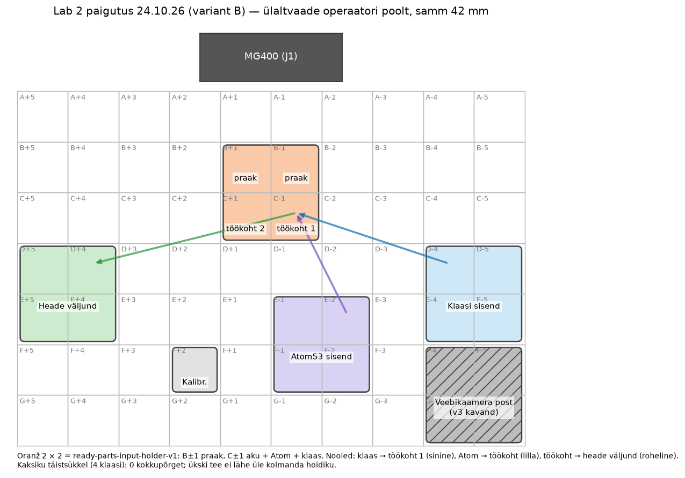

# Töövoog ja paigutus

Täida pärast päris laua, roboti ja detailide ülevaatust, enne hoidikute lõplikku modelleerimist. Ära märgi ruutu ega nihkeid eelduste põhjal.

## 24.10.26 otsus: paigutus (variant B)

Valis Denys 24.10.26 kahe kaksikus kontrollitud variandi vahelt (A = varasem `layout.json` ettepanek). Hoidikute rollid on meeskonna 23.10.26 otsused (README). Masinloetav sama paigutus: [`../slot-picker/layout.json`](../slot-picker/layout.json). Füüsiliselt on paigas ainult klaasi sisend; ülejäänud hoidikud tuleb laual ümber tõsta — TODO.

Ülaltvaade operaatori poolt (robot üleval, rida A roboti juures):

| | +5 | +4 | +3 | +2 | +1 | −1 | −2 | −3 | −4 | −5 |
|---|---|---|---|---|---|---|---|---|---|---|
| **A** | | | | | | | | | | |
| **B** | | | | | praak | praak | | | | |
| **C** | | | | | töökoht 2 | töökoht 1 | | | | |
| **D** | väljund | väljund | | | | | | | klaas | klaas |
| **E** | väljund | väljund | | | | Atom | Atom | | klaas | klaas |
| **F** | | | | kalibr. | | Atom | Atom | | | |
| **G** | | | | | | | | | | |

### Protsessi sammud (sildi kokkupanek)

1. Inimene laeb akumoodulid oranži hoidiku töökohapesadesse (C−1, C+1), AtomS3-d AtomS3 sisendisse ja klaasid klaasi sisendisse (igas sisendis 4 tk).
2. Robot: AtomS3 sisendist → akumooduli peale töökohas (ekraan üles).
3. Robot: klaas klaasi sisendist → Atomi peale töökohas.
4. Robot: valmis detail → heade väljund; ebaõnnestunud → praak (B−1 / B+1).

Selle labori test (ülesanne osa 3) teeb ainult klaasi teed: sisend → töökoht 1 (päris AtomS3 aku peal) → heade väljund.

### Töökohad ja väljundid

- **Töökohti: üks samm-tüüp** (detailide virnastamine aku peale), sest kõik kolm robotisammu toimuvad samas kohas virna peal; ülesanne lubab sammul kohta eelmisega jagada (meeskonna otsus 23.10.26). Pesasid on kaks: **C−1 = töökoht 1** (tsükli vaikimisi koht, `cycle.workstation_cell`), **C+1 = töökoht 2** (Denys 24.10.26).
- Töökoht on ruutudes, kus robot on kõige täpsem: kaugus J1 teljest **214–256 mm** (ülesanne: kuni 300 mm, read A–C, numbrid −3 … +3).
- **Väljundeid kaks:** heade väljund (`valjundhoidik-v1`, 2 × 2 lahtine kast) ja praak (oranži hoidiku robotipoolsed pesad B−1, B+1; Denys 24.10.26).
- Liikumine käib ühes suunas: sisendid numbritel −1 … −5, töökoht keskel, väljund +4 … +5.

### Hoidikud

| Hoidik | Fail (prinditud) | Suurus | Ruudud | Roll |
|---|---|---|---|---|
| Klaasi sisend | `glass-input-holder` | 2 × 2 | D−4, D−5, E−4, E−5 | 4 klaasi; **paigas**, õpetatud (vt allpool) |
| AtomS3 sisend | `atoms3-input-holder-v1` | 2 × 2 | E−1, E−2, F−1, F−2 | 4 AtomS3-t, ekraan üles |
| Oranž | `ready-parts-input-holder-v1` | 2 × 2 | B−1, B+1, C−1, C+1 | C±1 aku sisend + töökoht, B±1 praak |
| Heade väljund | `valjundhoidik-v1` | 2 × 2 | D+4, D+5, E+4, E+5 | valmis detailid |
| Kalibreerimishoidik | `gridfinity-calibration` | 1 × 1 | F+2 | roboti kalibreerimine (24.10.26 mõõdeti C−2-s) |
| Veebikaamera post | `veebikaamera-post-v1` | — | ruudustikust väljas | laua serval rakise toru otsas; ruute ei võta |

Kasutatud ruute 17 / 70. Järgmiste laborite moodulitele jäävad vabaks näiteks B ja C ±2 … ±5, D −3 … +3, E −3 ja E +1 … +3, F+1, F±3, F/G −4 … −5 (rida A on aluse lähedal ulatusega piiratud).

### Detailide mõõdud

Allikas [`measurements.md`](measurements.md) (Maksimi `Measurements.xlsx`, 23.10.26). Mõõtevahend tabelis märkimata, seega nihikuga kinnitamine: TODO.

| Detail | X × Y × Z (mm) | Olek |
|---|---|---|
| Polükarbonaatklaas | 30 × 30 × 2 | confirmed (meeskond), 4 tk |
| AtomS3 | 24 × 24 × 12,9 | nominal — nihikumõõt TODO |
| Akumoodul | 24,04 × 24,01 × 21,97 | measured |

### Roboti sihtpunktid (ruut + nihe, R 33)

Ruudu keskpunkt robotis = [`../calibration/cells.py`](../calibration/cells.py) (24.10.26 sobitus, sh C−2 kalibreerimiskastiga). Nihe = hoidiku `teach` slot pickeris.

| Koht | Ruut | Nihe X / Y (mm) | Z (robot) | Allikas |
|---|---|---|---|---|
| Klaas, võtmine | D−4 … E−5 | −2,00 / +2,50 | −150,5 (`pick_z`); 24.10.26 õhtul ülekanne õnnestus Z −152-ga | D−4 ja D−5 pesa keskpunkt, Denys 24.10.26 |
| Töökoht 2, klaasi asetamine / võtmine (tsükli töökoht) | C+1 | 0 / 0 | −119,0 / −119,0 (klaasi puudutus; kaksik −114,1) | Denys 24.10.26 õhtu, [`measurements.md`](measurements.md) |
| Töökoht 1 | C−1 | 0 / 0 (sama hoidik) | sama | eraldi kontrollimata |
| Heade väljund, asetamine | D+4 … E+5 | 0 / 0 | −153,0 (klaasi puudutus põhjal; kaksik −151,3) | Denys 24.10.26 õhtu, [`measurements.md`](measurements.md) |
| AtomS3 võtmine / asetamine akule | E−1 … F−2 / C−1 | TODO | TODO | testis ei kasutata |

### Kontroll digitaalses kaksikus ([`../../sim/`](../../sim/README.md), 24.10.26)

- Täistsükkel 4 klaasiga (`dry_run.py --full`): **0 kokkupõrget**, väikseim vahe 5,4 mm (kantav klaas ↔ ruudustik väljundis); klaas jääb väljundi põhjale. Tulemus: [`sim_dry_run_full.txt`](sim_dry_run_full.txt).
- Ükski tee (klaas → töökoht, Atom → töökoht, töökoht → väljund) ei lähe üle kolmanda hoidiku. Variant A-s läks klaas üle AtomS3 sisendi ja töökoht oli 297–339 mm kaugusel.
- Ruudud, kuhu napp jõuab klaasi võtmiseks (min Z): [`sim_reach.csv`](sim_reach.csv), [`photos/sim-reach-map.png`](photos/sim-reach-map.png). AtomS3 sisendit ei pandud ritta G: seal ei jõua napp alla −130.
- Kalibreerimisvea taluvus ([`sim_tolerance.txt`](sim_tolerance.txt)): võtmine 5 mm, **väljund ainult 2–5 mm** (suunast sõltuvalt; 45°, 90°, 135° juures 2 mm) — klaas pannakse lahtri keskele ja tema serv jääb 3 mm kasti seinast. Ettepanek: väljundi kohad kasti keskpunktile lähemale (nt ±16 mm); vajab `cycle.py` muudatust — TODO, kokku leppida Raimoga.

### Lahtised

- Hoidikud füüsiliselt uutesse ruutudesse; seejärel töökoha ja väljundi punktide õpetamine.
- AtomS3 mõõdud nihikuga; nelja klaasi hajuvus.

### 25.10.26 täpsustus

- Ülal „Füüsiliselt on paigas ainult klaasi sisend“ ja lahtine punkt „hoidikud uutesse ruutudesse … õpetamine“ on 24.10.26 õhtu seis enne õpetamist. Samal õhtul tõsteti hoidikud paigutuse B järgi, töökoht C+1 ja väljund D+4 õpetati ning ring 1 tehti 4 / 4 (README arenduspäevik 24.10.2026 ~19:00 ja ~19:20, [`refit_test.csv`](refit_test.csv)). AtomS3 sisendi ja kalibreerimiskasti paigaldus pole eraldi kirjas.
- „Töökohad ja väljundid“ ütleb, et tsükli vaikimisi koht (`cycle.workstation_cell`) on C−1. Tegelikult on [`../slot-picker/layout.json`](../slot-picker/layout.json) väärtus `"workstation_cell": "C+1"` ja ring 1 kasutas C+1-te; sihtpunktide tabel ütleb sama („tsükli töökoht“ C+1).
- Veebikaamera posti koht on otsustatud: laua serval rakise toru otsas, ruudustikust väljas (README 25.10.2026).

## Esialgne mall (23.10.26, ajalugu)

## Koordinaadid ja töövoog

- Ruudustik: 7 x 10 ruutu, samm 42 mm.
- Täht näitab kaugust robotist; number näitab külge keskjoonest. Kontrolli füüsilisel laual tähtede kasvusuund, numbrite järjestus ja roboti keskjoon.
- Roboti kalibreerimise lähtepunkt ja koordinaatide suund:
- Gridfinity kalibreerimishoidiku ruut:
- Iga hoidiku lähtekoha nihe ruudu keskpunktist, X/Y/Z (mm):

Töövoog:

1. AtomS3, klaas ja akumoodul sisendhoidikutest.
2. Robot paigaldab ainult klaasi Atomi mannekeenile töökoha hoidikus.
   - 23.10.26: mannekeeni asemel on töökohal päris AtomS3.
3. Valmis detail liigub heade väljundisse; ebaõnnestunud detail liigub praagi väljundisse.

Töökoha sammude arv ja roboti täpsusala tuleb kinnitada tegeliku protsessi põhjal:

| Samm | Tegevus | Hoidiku ruut | Pesa / sihtpunkt | Nihe ruudu keskpunktist X/Y/Z (mm) |
|---|---|---|---|---|
| Sisend 1 | AtomS3, vähemalt 4 tk | | | |
| Sisend 2 | Polükarbonaatklaas, vähemalt 4 tk | | | |
| Sisend 3 | Akumoodul, vähemalt 4 tk | | | |
| Töökoht | Klaasi tõstmine Atomi mannekeenile | | | |
| Väljund | Valmis detail (`valjundhoidik-v1`, 2 × 2 lahtine kast) | | | |
| Väljund | Praak (oranž `ready-parts-input-holder-v1`) | | | |

## Ruudustiku plaan

Skeem on tühi plaan. Kirjuta igasse lahtrisse hoidiku ruut (nt `B-2`) pärast füüsilise koordinaadistiku kinnitamist. Tähista ka robot ja keskjoon.

| Robotist kauguse rida / külg keskjoonest | 1 | 2 | 3 | 4 | 5 | 6 | 7 | 8 | 9 | 10 |
|---|---|---|---|---|---|---|---|---|---|---|
| A | | | | | | | | | | |
| B | | | | | | | | | | |
| C | | | | | | | | | | |
| D | | | | | | | | | | |
| E | | | | | | | | | | |
| F | | | | | | | | | | |
| G | | | | | | | | | | |

## Mõõtmised

Lisa detaili mõõtmed nihikuga, pesa mõõtmed, kasutatud lõtk ja iga roboti sihtpunkt. Kui mõõtmist parandatakse, lisa uus kuupäevaga tulemus vana alla.

| Detail / pesa | Detaili mõõt X/Y/Z (mm) | Pesa X/Y/Z (mm) | Kasutatud lõtk ja allikas (mm) | Ruudu tähis | Nihe X/Y/Z (mm) |
|---|---|---|---|---|---|
| AtomS3 | | | | | |
| Klaas | | | | | |
| Akumoodul | | | | | |
| Töökoha mannekeen | | | | | |
| Heade väljund | | | | | |
| Praagi väljund | | | | | |

## Kaamerad

- XIAO ESP32S3 Sense töökoha vaade, kinnitus ja korduspaigalduse kontroll:
- Kaamera toiteallikas, pinge/vool ja katse tulemus:
- Tööriista mass enne/pärast kaamera lisamist (g):
- USB UHD veebikaamera kõrgus ja asukoht:
- Kogu ruudustik ja robot kaadris:
- Pildi liikumine roboti liikumise ajal (px või mõõdetud mm):

## 23.10.2026 — Maksimi mõõteandmete täiendus ja klaasi parandus

Allikas: Maksimi `Measurements.xlsx`, leht `Measurements`; täielik lahtrite ja olekute register: [`measurements.md`](measurements.md). Varasemad tühjad väljad säilivad algse plaani ajaloo jaoks. Allolevad mõõdud ei määra veel ruute ega roboti sihtpunkte.

| Detail | Lähteväärtus X/Y/Z | Olek | Orientatsioon ja mõju paigutusele |
|---|---|---|---|
| Klaas | 30 × 30 × 2 mm | confirmed; D8:E19 ja meeskond | Varasem 24 × 24 × 2 mm ei kirjelda meie klaasi. Määrata haaramispind ja keskme referents; 30 mm klaasi serv ulatub sama keskme korral 3 mm kaugemale kui varasema vale 24 mm lähteväärtuse puhul. |
| AtomS3 | 24 × 24 × 12,9 mm | nominal; D2:E4 | Ekraan üles (`planned`, D7:E7); USB-C keskjoon 11,4 mm valitud servast (`measured`, D5:E5). Lähteserv ja mõõtesuund vajavad skeemi. |
| Akumoodul | 24,04 × 24,01 × 21,97 mm | measured; D21:E23 | Kontaktid üles (`planned`, D25:E25); sisend ja töökoht vastavalt varasemale otsusele `ready-parts-input-holder`. Pistiku asukoht jäeti Excelis vahele, seda ei loeta nulliks. |
| XIAO põhiplaat | 17,74 × 21,33 × 1,21 mm | measured; D26:E28 | Ei hõlma kaameralaienduse ega kogu koostu gabariite. Kontrollida renne, antenniala ja USB-C ligipääsu. |

- Klaasi sisendi, töökoha, väljundi ja praagi ruudud, pesade mõõdetud lõtk ning keskme X/Y/Z nihked: `TODO — waiting for physical test`.
- Kesksele 24 mm Atomile asetatud 30 mm klaasi üleulatus on arvutuslikult 3 mm külje kohta. Kontrollida naaberpesasid, seinu ning iminapa ja kaamera laskumisteed; robotiga transpordil arvestada ka klaasi pööratud ümbrist.
- `valjundhoidik` on üks lahtine kast, mitte neli fikseerivat pesa. Kavandada neli 30 mm klaasi 2 × 2 paigutuses, määrata sihtpunktid ja vahed; mahtumine ja kordustäpsus: `TODO — waiting for physical test`.
- Tööriistakaamera ligikaudne orientatsioon Excelis on 90° alla (`planned`, D47:E47). Mõõta kõrgus klaasi kohal ja kaugus töökohast (mm); kontrollida, et kogu 30 × 30 mm klaas ja Atom on kaadris. Kaamera USB-C ligipääs on konstruktsiooninõue (`planned`, D52:E52), mitte katsetulemus.
- Olemasolev USB-kaadri tõend on README 23.10.26 sessioonis. Kaabli pikkus, kinnituspunktid, liikumistee ja J4 kontroll, kaamera mass ning kogu tööriista mass enne/pärast (g) jäävad: `TODO — waiting for physical test`.
- Konkreetne mudelite ja trajektoori kontrollnimekiri: [`cad-measurement-review.md`](cad-measurement-review.md). Geomeetriat ega õpetatud robotipunkte selles sessioonis ei muudetud.
