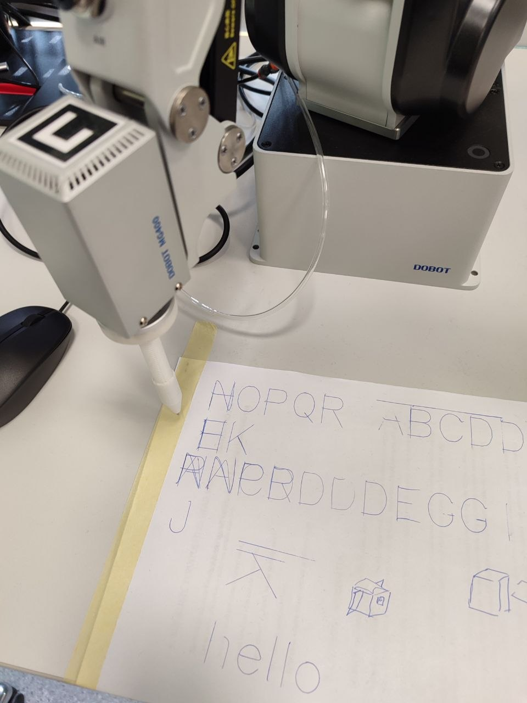
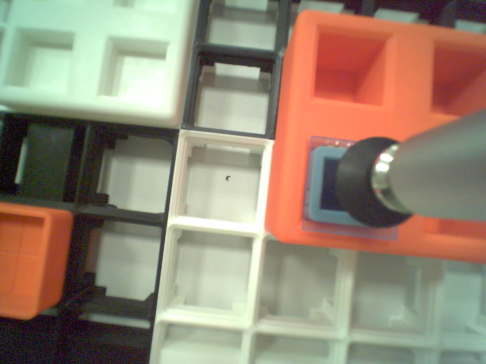

# 3D printimine ja CAD

Ülikooli kursusel „3D printimine ja CAD“ (SVNC.00.322) projekteerime ja prindime Dobot MG400 robotkäele tööriistu ning selle töölauale detailihoidikuid. Alustasime pastakahoidikust, millega robot joonistab AtomS3R-il valitud tähe. Kursuse lõpueesmärk on paigaldada AtomS3 ekraanile polükarbonaatklaas ja liim kõvendada.

**English summary.** This course repository documents 3D-printed tooling for a Dobot MG400 robot. Lab 1 demonstrated letter drawing, Lab 2 recorded one physical glass-transfer round, and Lab 3 prepares a tool for dispensing and UV curing. The simulation quickstart uses a browser replay and requires no robot.

## Mis juba töötab

| Labor 1 · tähe joonistamine | Labor 2 · klaasi paigutamine |
| --- | --- |
|  |  |
| 03.10.2026 joonistas MG400 paberile AtomS3R-il valitud tähe. [Vaata katsevideot (MP4)](3d-print/lab1/docs/videos/atom-letter-robot-draws.mp4). | 24.10.2026 viis MG400 ühes füüsilises katseringis kõik neli klaasi sisendist AtomS3 peale ja sealt väljundisse. [Väljundi foto](3d-print/lab2/docs/photos/cycle-r1-g4-output-20261024-192256.jpg) · [Katsetabel (CSV)](3d-print/lab2/docs/refit_test.csv). |

## Laborid 1–3

| Labor | Eesmärk | Kinnitatud tulemus | Lahtine töö |
| --- | --- | --- | --- |
| [1 · Lõtk, painduvus ja pastakahoidik](3d-print/lab1/README.md) | Õppida prinditud detailide sobivust katsetama ja teha robotile vedruga pastakahoidik. | Lõtkukatses liikus silinder 0,4 mm juures vabalt ja kiilus 0,2 mm juures. Meeskond katsetas kolme PLA-katsekeha paksust ning demonstreeris tähe joonistamist. Esitamise tähis on `3d-print-lab1`. | Paindekatsekeha Fusioni lähtefail puudub. 0,3 mm lõtku meeskond ei katsetanud. |
| [2 · Sisend, töökoht ja väljund](3d-print/lab2/README.md) | Paigutada hoidikud Gridfinity ruudustikule ning liigutada klaas iminapaga sisendist töökoha kaudu väljundisse. | Üks füüsiline ring, 4/4 klaasi. XIAO tööriistakaamera andis USB kaudu pildi ning üldvaatekaameraga salvestati töölaud. | Ringid 2–5 pärast hoidikute korduspaigaldust, 42 mm ümberpaigutuskatse, lõplik kalibreerimine ja Wi-Fi kaamerakatse. |
| [3 · Iminapp, süstal ja UV-lamp](3d-print/lab3/README.md) | Kavandada MG400-le tööriist klaasi tõstmiseks, liimi doseerimiseks ja kõvendamiseks. | Meeskond dokumenteeris tööjärjekorra, katseplaani ja UV-komponentide valiku. | Uue tööriista füüsiline sobivus, mass ja nihked ning rõhu-, lekke-, UV- ja tsüklikatsed vajavad kinnitamist. |

Ülesanded, mõõtmised ja **Arenduspäevik** on iga labori README-s. Lab 2 ja 3 kaustades on ka eraldi ülesandekoopiad ja katsefailid.

## Süsteemi arhitektuur

```text
Lab 1  AtomS3R → USB → jaamaarvuti → MG400 + pastakahoidik → täht paberil
Lab 2  Sisendhoidik → MG400 + iminapp → AtomS3 töökohal → väljundhoidik
Mudel  Lab 2 paigutus + CAD + liigesemudel → digitaalne kaksik → 3D-taasesitus
```

Jaamaarvutis ühendab **MG400 Station Hub** roboti juhtimise, ruudustiku lahtrite valiku, kaameravaated ja kaksiku kontrollid. Algaja saab digitaalset kaksikut eraldi brauseris vaadata. Lab 3 plaan lisab tööriistale süstla ja UV-lambi.

## Kaustad

| Asukoht | Sisu |
| --- | --- |
| [`3d-print/`](3d-print/) | Laborite esitlusfailid. Detailikaustades on CAD-lähtefailid (`src`), prinditavad mudelid (`stl`) ja viilutusprojektid (`3mf`), kui need on olemas. |
| [`3d-print/hub/`](3d-print/hub/README.md) | MG400 Station Hub ja selle kasutusjuhend. |
| [`3d-print/sim/`](3d-print/sim/README.md) | Digitaalne kaksik, ulatuse ja kokkupõrgete kontrollid ning 3D-vaatur. |
| [`3d-print/models/`](3d-print/models/README.md) | Ühised ostukomponentide CAD-mudelid. |
| [`fusion-tutor/`](fusion-tutor/README.md) · [`study-ru/`](study-ru/README.md) | Fusioni õppematerjal ja ülesannete mitteametlikud venekeelsed tõlked. |

## Kiirstart algajale · ainult simulatsioon

Vaja läheb Python 3.11, brauserit ja internetiühendust sõltuvuste ning vaaturi 3D-teegi laadimiseks. Ava terminal klooni juurkaustas. Vaikimisi kasutab eksport Lab 2 paigutust. Valik `--full` näitab kavandatud täistsüklit.

```powershell
# Windows PowerShell
cd 3d-print/sim
py -3.11 -m venv .venv
.\.venv\Scripts\python.exe -m pip install -r requirements.txt
.\.venv\Scripts\python.exe export_viewer.py --full
.\.venv\Scripts\python.exe -m http.server --bind 127.0.0.1 --directory viewer 8020
```

```sh
# macOS / Linux
cd 3d-print/sim
python3.11 -m venv .venv
./.venv/bin/python -m pip install -r requirements.txt
./.venv/bin/python export_viewer.py --full
./.venv/bin/python -m http.server --bind 127.0.0.1 --directory viewer 8020
```

Ava brauseris `http://127.0.0.1:8020` ja jälgi ajajoonel klaasi teekonda. Tühik peatab või jätkab taasesitust. Serveri sulgemiseks vajuta terminalis `Ctrl+C`. Kui vaade ei avane, kontrolli, kas eksport lõi `viewer/data/` alla 3D-stseeni ja animatsiooni. [Vaaturi juhend](3d-print/sim/viewer/README.md).

Kui soovid simulatsiooni tulemust vaadata midagi paigaldamata, ava [salvestatud Lab 2 simulatsiooniaruanne](3d-print/lab2/docs/sim_dry_run_full.txt).

## Kaitsmisel

1. Näita Lab 1 videost, kuidas AtomS3R-il valitud täht jõuab paberile. Ava labori README ja selgita üht lõtku- või keermemuudatust.
2. Näita Lab 2 töökoha ja väljundi fotosid koos katsetabeliga. Too välja, et tulemus **4/4** pärineb ühest füüsilisest ringist. Seejärel näita brauseris kavandatud tsüklit ja nimeta lahtised korduskatsed.
3. Ava Lab 3 tööplaan. Selgita tööjärjekorda **doseerimine → klaasi tõstmine → kõvendamine → väljund** ning näita, millised mõõtmised ja katsed veel kinnitust vajavad.

## Seotud kursuseprojektid

- Rõhuanduri mõõtmised ja andmetöötlus. [Andmehõive (Data Acquisition)](https://github.com/Dennel04/data-acquisition-course).
- AtomS3R-i kasutajaliides, joonistusjaam ja tööriistakaamera Wi-Fi püsivara. [Nutilahendused (Smart Solutions)](https://github.com/Dennel04/smart-solutions-course).

## Ohutus ja piirangud

- Esmatutvuseks kasuta brauseri taasesitust. Station Hub võib taaskäivitamisel taastada viimati valitud robotirežiimi. Päris MG400-ga tööta laboris juhendaja juuresolekul. Hoia tööala vaba, tee esimene käik aeglaselt ja hoia hädastopp käeulatuses.
- Eemalda prinditud detail jahtunud aluselt. Suruõhu ja UV-lambi katsetel järgi labori katsejuhendit. [Lab 3 ohutusjuhised](3d-print/lab3/README.md#ohutus).
- Kaksik kontrollib mudeli järgi ulatust ja kokkupõrkeid. Detailide istuvus, iminapa pidamine, klaasi libisemine ning Lab 3 rõhk ja UV-kaitse vajavad füüsilist kontrolli.
