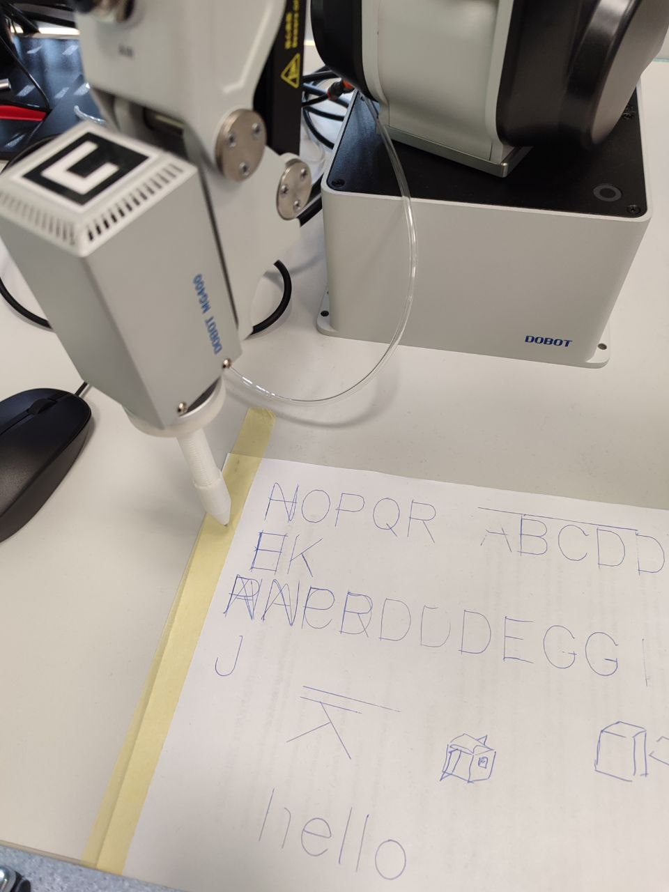
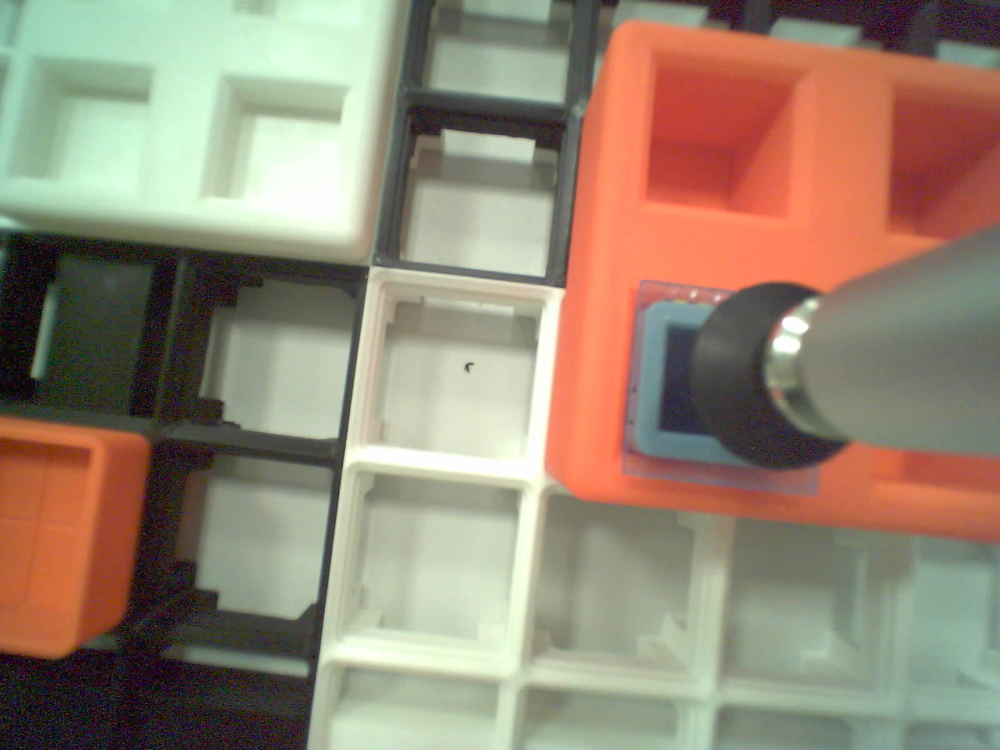

# 3D printimine ja CAD

Ülikooli kursusel „3D printimine ja CAD“ (SVNC.00.322) projekteerime ja prindime Dobot MG400 robotkäele tööriistu ning selle töölauale detailihoidikuid. Alustasime pastakahoidikust, millega robot joonistab AtomS3R-il valitud tähe. Kursuse lõpueesmärk on paigaldada AtomS3 ekraanile polükarbonaatklaas ja liim kõvendada.

**English summary.** This course repository documents 3D-printed tooling for a Dobot MG400 robot. Lab 1 demonstrated letter drawing. Lab 2 recorded 12 successful glass transfers over three physical rounds, including a holder refit on 13 November. Rounds 4–5 and the 42 mm relocation remain untested. Lab 3 measured components and dry-fitted prototypes for a dispensing and UV-curing tool. Lab 4 contains the plan for comparing an original, manually redesigned and generatively designed part. The browser replay requires no robot connection.

## Mis juba töötab

| Labor 1 · tähe joonistamine | Labor 2 · klaasi paigutamine |
| --- | --- |
|  |  |
| 03.10.2026 joonistas MG400 paberile AtomS3R-il valitud tähe. [Vaata katsevideot (MP4)](3d-print/lab1/docs/videos/atom-letter-robot-draws.mp4). | MG400 viis klaasi sisendist AtomS3 peale ja sealt väljundisse kolmes füüsilises ringis (12/12). Ring 1 toimus 24.10, ringid 2–3 lõpppaigutuses 13.11. Ring 3 järgnes kolme hoidiku tagasipanekule samadesse ruutudesse, punkte ümber õpetamata. [Väljundi foto](3d-print/lab2/docs/photos/cycle-r3-g4-output-20261113-165026.jpg) · [Katsetabel (CSV)](3d-print/lab2/docs/refit_test.csv). |

## Laborid 1–4 · seis 15.11.2026

| Labor | Eesmärk | Kinnitatud tulemus | Lahtine töö |
| --- | --- | --- | --- |
| [1 · Lõtk, painduvus ja pastakahoidik](3d-print/lab1/README.md) | Õppida prinditud detailide sobivust katsetama ja teha robotile vedruga pastakahoidik. | Lõtkukatses liikus silinder 0,4 mm juures vabalt ja kiilus 0,2 mm juures. Meeskond katsetas kolme PLA-katsekeha paksust ning demonstreeris tähe joonistamist. Esitamise tähis on `3d-print-lab1`. | Paindekatsekeha Fusioni lähtefail puudub. 0,3 mm lõtku meeskond ei katsetanud. |
| [2 · Sisend, töökoht ja väljund](3d-print/lab2/README.md) | Paigutada hoidikud Gridfinity ruudustikule ning liigutada klaas iminapaga sisendist töökoha kaudu väljundisse. | Kolm füüsilist ringi (12/12), neist 8/8 lõpppaigutuses ja 4/4 pärast tagasipanekut. 13.11 kalibreeriti ruudustik ruutude F−2 ja C+4 järgi. XIAO andis USB kaudu pildi ning üldvaatekaameraga salvestati töölaud. | Ringid 4–5 ja 42 mm füüsiline ümberpaigutus jäid tegemata. Tagasipaneku viga millimeetrites ja Wi-Fi kaamerakatse on lahtised. |
| [3 · Iminapp, süstal ja UV-lamp](3d-print/lab3/README.md) | Kavandada MG400-le tööriist klaasi tõstmiseks, liimi doseerimiseks ja kõvendamiseks. | 15.11 mõõdeti süstalt ja kaaluti muu hulgas klapikoost (68,84 g) ning napakoost (42,03 g). Prinditi viis prooviosa. Kordusproovis istus süstal sügavamal C-klambris tihedalt ning leitud 24,05 g päis sobis kuivalt CAD-võrdluseks. [Mõõtmised](3d-print/lab3/docs/measurements.md#mõõtmised-15112026) · [Kuivsobitus](3d-print/lab3/docs/test-procedure.md#kordusproov-ja-leitud-süstlapäis-15112026) | Lõppkoostu sobivus, suurima koormaga mass ja neli tööriistanihet. Süstlavahetuse korduvus ning rõhu-, lekke-, UV- ja robotitsüklite katsed. |
| [4 · Üks detail paremaks, kolmel moel](3d-print/lab4/README.md) | Võrrelda ühe detaili originaali, käsitsi tehtud ja Fusionis generatiivset varianti. | Koostatud on tööplaan, kandidaatide võrdlus ja katseprotokoll. V3 klaasi sisendhoidik on esialgne soovitus. | Mõõdetud koormus, originaali piloot ja Fusioni ligipääs, seejärel disainid, simulatsioon, printimine ja katsed. |

Iga labori README koondab ülesande, mõõtmised ja **Arenduspäeviku**. Lab 2–4 kaustades on ka eraldi ülesandekoopiad ja katsefailid.

## Süsteemi arhitektuur

```text
Lab 1  AtomS3R → USB → jaamaarvuti → MG400 + pastakahoidik → täht paberil
Lab 2  Sisendhoidik → MG400 + iminapp → AtomS3 töökohal → väljundhoidik
Lab 3  Tööriista plaan: doseerimine → klaasi tõstmine → UV-kõvendamine → väljund
Lab 4  Detaili parendus: originaal / käsitsi / generatiivne → simulatsioon → võrreldav katse
Mudel  Lab 2 paigutus + CAD + liigesemudel → digitaalne kaksik → 3D-taasesitus
```

Jaamaarvutis ühendab **MG400 Station Hub** roboti juhtimise, ruudustiku lahtrite valiku, kaameravaated ja kaksiku kontrollid. Algaja saab digitaalset kaksikut eraldi brauseris vaadata. Lab 3 plaan lisab tööriistale süstla ja UV-lambi.

## Kaustad

| Asukoht | Sisu |
| --- | --- |
| [`3d-print/`](3d-print/) | Laborite esitlusfailid. Detailikaustades on CAD-lähtefailid (`src`), prinditavad mudelid (`stl`) ja viilutusprojektid (`3mf`), kui need on olemas. |
| [`3d-print/lab4/`](3d-print/lab4/README.md) | [Originaali analüüs](3d-print/lab4/docs/analysis_original.md), [katseplaan](3d-print/lab4/docs/test-procedure.md), [integratsioon](3d-print/lab4/docs/integration.md) ja [katsetabeli mall](3d-print/lab4/data/test.csv). |
| [`3d-print/hub/`](3d-print/hub/README.md) | MG400 Station Hub ja selle kasutusjuhend. |
| [`3d-print/sim/`](3d-print/sim/README.md) | Digitaalne kaksik, ulatuse ja kokkupõrgete kontrollid ning 3D-vaatur. |
| [`3d-print/models/`](3d-print/models/README.md) | Ühised ostukomponentide CAD-mudelid. |
| [`fusion-tutor/`](fusion-tutor/README.md) · [`study-ru/`](study-ru/README.md) | Fusioni õppematerjal ja ülesannete mitteametlikud venekeelsed tõlked. |

## Kiirstart algajale · ainult simulatsioon

Vaja läheb Python 3.11, brauserit ja internetiühendust sõltuvuste ning vaaturi 3D-teegi laadimiseks. Ava terminal klooni juurkaustas. Allolev eksport kasutab Lab 2 paigutust ja õpetatud punkte. [Kaksiku juhend](3d-print/sim/README.md#mida-dry_run-kontrollib) kirjeldab eraldi valikut `--full`, mis tuletab kõrgused mudelist.

```powershell
# Windows PowerShell
cd 3d-print/sim
py -3.11 -m venv .venv
.\.venv\Scripts\python.exe -m pip install -r requirements.txt
.\.venv\Scripts\python.exe export_viewer.py
.\.venv\Scripts\python.exe -m http.server --bind 127.0.0.1 --directory viewer 8020
```

```sh
# macOS / Linux
cd 3d-print/sim
python3.11 -m venv .venv
./.venv/bin/python -m pip install -r requirements.txt
./.venv/bin/python export_viewer.py
./.venv/bin/python -m http.server --bind 127.0.0.1 --directory viewer 8020
```

Ava brauseris `http://127.0.0.1:8020` ja jälgi ajajoonel klaasi teekonda. Tühik peatab või jätkab taasesitust. Serveri sulgemiseks vajuta terminalis `Ctrl+C`. Kui vaade ei avane, kontrolli, kas eksport lõi `viewer/data/` alla 3D-stseeni ja animatsiooni. [Vaaturi juhend](3d-print/sim/viewer/README.md).

Kui soovid simulatsiooni tulemust vaadata midagi paigaldamata, ava [salvestatud Lab 2 simulatsiooniaruanne](3d-print/lab2/docs/sim_dry_run.txt).

## Kaitsmisel

1. Näita Lab 1 videost, kuidas AtomS3R-il valitud täht jõuab paberile. Ava labori README ja selgita üht lõtku- või keermemuudatust.
2. Näita Lab 2 töökoha ja väljundi fotosid koos katsetabeliga. Too välja **12/12** füüsilist ülekannet, neist **4/4** pärast tagasipanekut. Nimeta tegemata ringid 4–5 ja 42 mm ümberpaigutus ning näita seejärel brauseris simulatsiooni.
3. Ava Lab 3 tööplaan. Selgita tööjärjekorda **doseerimine → klaasi tõstmine → kõvendamine → väljund** ning näita 15.11 mõõtmisi ja kuivsobituse tulemusi koos lahtiste katsetega.
4. Lab 4 kaitsmiseks täida katsete järel ennustuse ja mõõtmiste võrdlus ning kinnita paigaldatud detaili sobivus. [Lab 4 kontrollnimekiri](3d-print/lab4/README.md#kontrollnimekiri)

## Seotud kursuseprojektid

- Rõhuanduri mõõtmised ja andmetöötlus. [Andmehõive (Data Acquisition)](https://github.com/Dennel04/data-acquisition-course).
- AtomS3R-i kasutajaliides, joonistusjaam ja tööriistakaamera Wi-Fi püsivara. [Nutilahendused (Smart Solutions)](https://github.com/Dennel04/smart-solutions-course).

## Ohutus ja piirangud

- Esmatutvuseks kasuta brauseri taasesitust. Kui Station Hub taastab salvestatud Real-režiimi, proovib ta käivitumisel robotiga ühenduda. Päris MG400-ga tööta laboris juhendaja juuresolekul. Hoia tööala vaba, tee esimene käik aeglaselt ja hoia hädastopp käeulatuses. [Hubi käivitamine ja olekud](3d-print/hub/README.md)
- Eemalda prinditud detail jahtunud aluselt. Suruõhu ja UV-lambi katsetel järgi labori katsejuhendit. [Lab 3 ohutusjuhised](3d-print/lab3/README.md#ohutus).
- Kaksik kontrollib mudeli järgi ulatust ja kokkupõrkeid. Detailide istuvus, iminapa pidamine, klaasi libisemine ning Lab 3 rõhk ja UV-kaitse vajavad füüsilist kontrolli.
